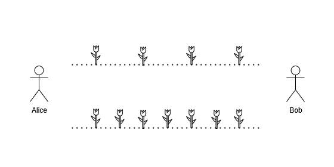

# 3021. Alice 和 Bob 玩鲜花游戏

Medium · [力扣原题](https://leetcode.cn/problems/alice-and-bob-playing-flower-game/)

| 作者 | 题解 | 动画讲解 |
|---|---|---|
| 灵茶山艾府 | [📄 题解](灵茶山艾府.md) | [▶︎ 动画（GIF）](3021%20Alice%20和%20Bob%20玩鲜花游戏%20·%20灵茶山艾府.gif) · [mp4 文件](3021%20Alice%20和%20Bob%20玩鲜花游戏%20·%20灵茶山艾府.mp4) |
| yiduobo | [📄 题解](yiduobo.md) | [▶︎ 动画（GIF）](3021%20Alice%20和%20Bob%20玩鲜花游戏%20·%20yiduobo.gif) · [mp4 文件](3021%20Alice%20和%20Bob%20玩鲜花游戏%20·%20yiduobo.mp4) |

## 动画讲解

> 动图会循环播放；想暂停、拖进度条请下载上面表格里的 mp4 文件。

### 灵茶山艾府


### yiduobo


## 题目描述

Alice 和 Bob 在一片田野上玩一个回合制游戏，他们之间有两排花。Alice 和 Bob 之间第一排有 `x` 朵花，第二排有 `y` 朵花。



游戏过程如下：

1. Alice 先行动。

2. 每一次行动中，当前玩家必须选择其中一排，然后在这边摘一朵鲜花。

3. 一次行动结束后，如果两排上都没有剩下鲜花，那么 **当前** 玩家抓住对手并赢得游戏的胜利。

给你两个整数 `n` 和 `m` ，你的任务是求出满足以下条件的所有 `(x, y)` 对：

- 按照上述规则，Alice 必须赢得游戏。

- 第一排的鲜花数目 `x` 必须在区间 `[1,n]` 之间。

- 第二排的鲜花数目 `y` 必须在区间 `[1,m]` 之间。

请你返回满足题目描述的数对 `(x, y)` 的数目。

**示例 1：**

```

输入：n = 3, m = 2
输出：3
解释：以下数对满足题目要求：(1,2) ，(3,2) ，(2,1) 。
```

**示例 2：**

```

输入：n = 1, m = 1
输出：0
解释：没有数对满足题目要求。
```

**提示：**

- `1 <= n, m <= 10⁵`

---
[↑ 返回 3000-3099](../README.md) · [总索引](../../../索引.md) · [仓库首页](../../../README.md)
