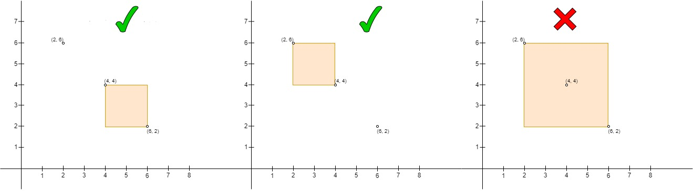
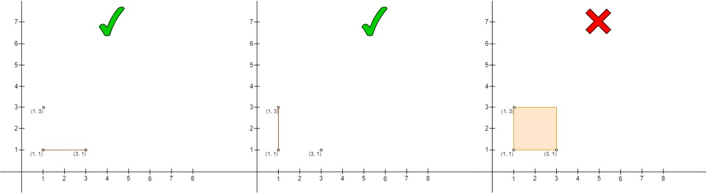

# 3025. 人员站位的方案数 I

Medium · [力扣原题](https://leetcode.cn/problems/find-the-number-of-ways-to-place-people-i/)

| 作者 | 题解 | 动画讲解 |
|---|---|---|
| 灵茶山艾府 | [📄 题解](灵茶山艾府.md) | 灵神这篇题解指向 3027 题的题解，请看那道题的视频：[▶︎ 3027 人员站位的方案数 II · 灵茶山艾府](../3027%20人员站位的方案数%20II/3027%20人员站位的方案数%20II%20·%20灵茶山艾府.gif) |
| yiduobo | [📄 题解](yiduobo.md) | [▶︎ 动画（GIF）](3025%20人员站位的方案数%20I%20·%20yiduobo.gif) · [mp4 文件](3025%20人员站位的方案数%20I%20·%20yiduobo.mp4) |

## 动画讲解

> 动图会循环播放；想暂停、拖进度条请下载上面表格里的 mp4 文件。

### yiduobo

## 题目描述

给你一个  `n x 2` 的二维数组 `points` ，它表示二维平面上的一些点坐标，其中 `points[i] = [x_i, y_i]` 。

计算点对 `(A, B)` 的数量，其中

- `A` 在 `B` 的左上角，并且

- 它们形成的长方形中（或直线上）没有其它点（**包括边界**），除了点 `A` 和点 `B`。

返回数量。

**示例 1：**

**输入：**`points = [[1,1],[2,2],[3,3]]`

**输出：**`0`

**解释：**

没有办法选择 `A` 和 `B`，使得 `A` 在 `B` 的左上角。

**示例 2：**

**输入：**`points = [[6,2],[4,4],[2,6]]`

**输出：**`2`

**解释：**

- 左边的是点对 `(points[1], points[0])`，其中 `points[1]` 在 `points[0]` 的左上角，并且形成的长方形内部是空的。

- 中间的是点对 `(points[2], points[1])`，和左边的一样是合法的点对。

- 右边的是点对 `(points[2], points[0])`，其中 `points[2]` 在 `points[0]` 的左上角，但 `points[1]` 在长方形内部，所以不是一个合法的点对。

**示例 3：**

**输入：**`points = [[3,1],[1,3],[1,1]]`

**输出：**`2`

**解释：**

- 左边的是点对 `(points[2], points[0])`，其中 `points[2]` 在 `points[0]` 的左上角并且在它们形成的直线上没有其它点。注意两个点形成一条线的情况是合法的。

- 中间的是点对 `(points[1], points[2])`，和左边一样也是合法的点对。

- 右边的是点对 `(points[1], points[0])`，它不是合法的点对，因为 `points[2]` 在长方形的边上。

**提示：**

- `2 <= n <= 50`

- `points[i].length == 2`

- `0 <= points[i][0], points[i][1] <= 50`

- `points[i]` 点对两两不同。

---
[↑ 返回 3000-3099](../README.md) · [总索引](../../../索引.md) · [仓库首页](../../../README.md)
