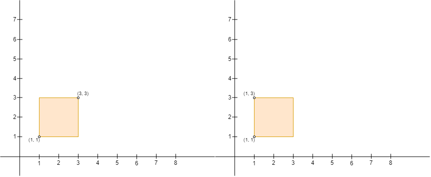
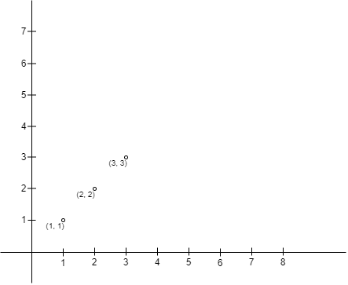
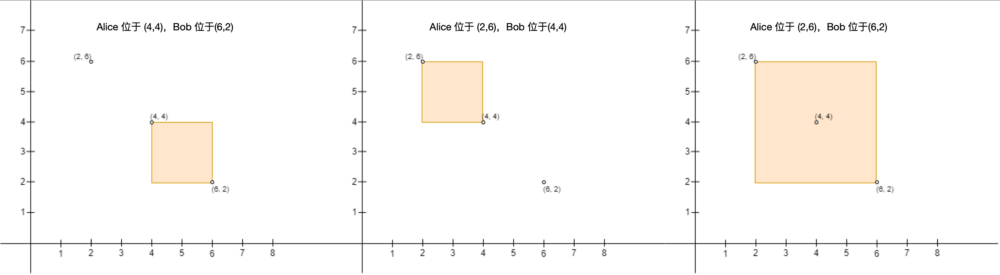
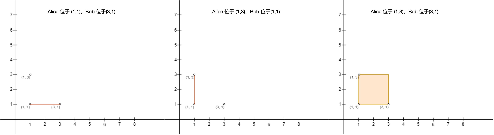

# 利用排序简化问题（Python/Java/C++/C/Go/JS/Rust）

> **[3027. 人员站位的方案数 II](https://leetcode.cn/problems/find-the-number-of-ways-to-place-people-ii/solutions/2630655/on2-you-ya-mei-ju-by-endlesscheng-z86d/) · Hard · 难度分 2020**

> **所属题单**
> - [常用数据结构 · 零、常用枚举技巧](../../../刷题路径/灵神原版题单/常用数据结构/零、常用枚举技巧.md) · §0.1 枚举右，维护左 · §0.1.2 进阶
> - [常用数据结构 · 十、CDQ 分治 / 值域分治](../../../刷题路径/灵神原版题单/常用数据结构/十、CDQ%20分治%20-%20值域分治.md)

> **题目描述**
> 给你一个  `n x 2` 的二维数组 `points` ，它表示二维平面上的一些点坐标，其中 `points[i] = [x_i, y_i]` 。
>
> 我们定义 x 轴的正方向为 **右** （**x 轴递增的方向**），x 轴的负方向为 **左** （**x 轴递减的方向**）。类似的，我们定义 y 轴的正方向为 **上** （**y 轴递增的方向**），y 轴的负方向为 **下** （**y 轴递减的方向**）。
>
> 你需要安排这 `n` 个人的站位，这 `n` 个人中包括 Alice 和 Bob 。你需要确保每个点处 **恰好** 有 **一个** 人。同时，Alice 想跟 Bob 单独玩耍，所以 Alice 会以 Alice 的坐标为 **左上角** ，Bob 的坐标为 **右下角** 建立一个矩形的围栏（**注意**，围栏可能 **不** 包含任何区域，也就是说围栏可能是一条线段）。如果围栏的 **内部** 或者 **边缘** 上有任何其他人，Alice 都会难过。
>
> 请你在确保 Alice **不会** 难过的前提下，返回 Alice 和 Bob 可以选择的 **点对** 数目。
>
> **注意**，Alice 建立的围栏必须确保 Alice 的位置是矩形的左上角，Bob 的位置是矩形的右下角。比方说，以 `(1, 1)` ，`(1, 3)` ，`(3, 1)` 和 `(3, 3)` 为矩形的四个角，给定下图的两个输入，Alice 都不能建立围栏，原因如下：
>
> - 图一中，Alice 在 `(3, 3)` 且 Bob 在 `(1, 1)` ，Alice 的位置不是左上角且 Bob 的位置不是右下角。
>
> - 图二中，Alice 在 `(1, 3)` 且 Bob 在 `(1, 1)`（如图所示，用矩形代替线条），Bob 的位置不是在围栏的右下角。
>
> 
>
> **示例 1：**
>
> 
>
> ```
>
> 输入：points = [[1,1],[2,2],[3,3]]
> 输出：0
> 解释：没有办法可以让 Alice 的围栏以 Alice 的位置为左上角且 Bob 的位置为右下角。所以我们返回 0 。
> ```
>
> **示例 2：**
>
> 
>
> ```
>
> 输入：points = [[6,2],[4,4],[2,6]]
> 输出：2
> 解释：总共有 2 种方案安排 Alice 和 Bob 的位置，使得 Alice 不会难过：
> - Alice 站在 (4, 4) ，Bob 站在 (6, 2) 。
> - Alice 站在 (2, 6) ，Bob 站在 (4, 4) 。
> 不能安排 Alice 站在 (2, 6) 且 Bob 站在 (6, 2) ，因为站在 (4, 4) 的人处于围栏内。
> ```
>
> **示例 3：**
>
> 
>
> ```
>
> 输入：points = [[3,1],[1,3],[1,1]]
> 输出：2
> 解释：总共有 2 种方案安排 Alice 和 Bob 的位置，使得 Alice 不会难过：
> - Alice 站在 (1, 1) ，Bob 站在 (3, 1) 。
> - Alice 站在 (1, 3) ，Bob 站在 (1, 1) 。
> 不能安排 Alice 站在 (1, 3) 且 Bob 站在 (3, 1) ，因为站在 (1, 1) 的人处于围栏内。
> 注意围栏是可以不包含任何面积的，上图中第一和第二个围栏都是合法的。
> ```
>
> **提示：**
>
> - `2 <= n <= 1000`
>
> - `points[i].length == 2`
>
> - `-10⁹ <= points[i][0], points[i][1] <= 10⁹`
>
> - `points[i]` 点对两两不同。

> **题解**
> 设矩形的左上角为 $(x_1,y_1)$，右下角为 $(x_2,y_2)$。
>
> 根据题意，合法矩形需要满足如下三个要求：
>
> 1. $x_1\le x_2$。
> 2. $y_1\ge y_2$。
> 3. 矩形内部或边界上没有其他点。
>
> 为方便计算，先把 $\textit{points}$ 按照横坐标**从小到大**排序（横坐标相同呢？后面会说明）。排序后，第一个要求在枚举时自动成立。
>
> 然后外层循环枚举 $\textit{points}[i] = (x_1,y_1)$；内层循环从 $i+1$ 开始，枚举 $\textit{points}[j] = (x_2,y_2)$，跳过 $y_2 > y_1$ 的点。这样就满足了第二个要求。
>
> 最后来处理第三个要求，其等价于：
>
> - 对于下标在闭区间 $[i+1,j-1]$ 中的每个点，纵坐标要么大于 $y_1$，要么小于 $y_2$。如果不满足，那么这个点就在矩形内部或边界上了。
>
> 纵坐标大于 $y_1$ 的点，我们已经跳过了，所以只需满足纵坐标小于 $y_2$。
>
> 枚举到 $\textit{points}[j] = (x_2,y_2)$ 时，之前遍历过的点，纵坐标都必须小于 $y_2$。难道要再遍历一遍 $[i+1,j-1]$？不需要，只要这些点的纵坐标的**最大值**小于 $y_2$，那么这些点的纵坐标就都小于 $y_2$（$\mathcal{O}(1)$ 时间获取 $\mathcal{O}(n)$ 信息）。所以只需维护遍历过的点的纵坐标的最大值 $\textit{maxY}$。如果发现 $y_2> \textit{maxY}$，就找到了一个合法矩形，把答案加一。
>
> 最后来说，对于横坐标相同的点，要怎么处理。
>
> 比如 $\textit{points} = [(1,3),(1,2),(1,1)]$，其中有两个满足要求的矩形：$(1,3)$ 为左上角，$(1,2)$ 为右下角的矩形；$(1,2)$ 为左上角，$(1,1)$ 为右下角的矩形。注意 $(1,3)$ 为左上角，$(1,1)$ 为右下角的矩形包含 $(1,2)$，不满足要求。
>
> 由于内层循环中的 $j$ 是从 $i+1$ 开始枚举的，所以在横坐标相同时，要按照纵坐标**从大到小**排序。这也保证了横坐标相同时，我们总是会先遍历到纵坐标更大的点。在上面的例子中，遍历到 $(1,1)$ 之前，一定会先遍历到 $(1,2)$。这样对于 $(1,3)$ 为左上角，$(1,1)$ 为右下角的矩形，我们就能正确地判断出这个矩形是不合法的。
>
> **优化**：如果在循环中发现 $\textit{maxY} = y_1$，那么不存在满足要求的 $y_2$，此时可以退出循环。
>
> [视频讲解](https://www.bilibili.com/video/BV14C411r7nN/) 第四题。
>
> ```python
> class Solution:
>     def numberOfPairs(self, points: List[List[int]]) -> int:
>         points.sort(key=lambda p: (p[0], -p[1]))  # x 升序，y 降序
>         ans = 0
>         for i, (_, y1) in enumerate(points):
>             max_y = -inf
>             for (_, y2) in points[i + 1:]:
>                 if y1 >= y2 > max_y:
>                     max_y = y2
>                     ans += 1
>                 if max_y == y1:  # 优化
>                     break
>         return ans
> ```
>
>
> #### 复杂度分析
>
> - 时间复杂度：$\mathcal{O}(n^2)$，其中 $n$ 为 $\textit{points}$ 的长度。
> - 空间复杂度：$\mathcal{O}(1)$。忽略排序的栈开销。Python 可以用循环代替切片。
>
> ## 分类题单
>
> [如何科学刷题？](https://leetcode.cn/circle/discuss/RvFUtj/)
>
> 1. [滑动窗口与双指针（定长/不定长/单序列/双序列/三指针/分组循环）](https://leetcode.cn/circle/discuss/0viNMK/)
> 2. [二分算法（二分答案/最小化最大值/最大化最小值/第K小）](https://leetcode.cn/circle/discuss/SqopEo/)
> 3. [单调栈（基础/矩形面积/贡献法/最小字典序）](https://leetcode.cn/circle/discuss/9oZFK9/)
> 4. [网格图（DFS/BFS/综合应用）](https://leetcode.cn/circle/discuss/YiXPXW/)
> 5. [位运算（基础/性质/拆位/试填/恒等式/思维）](https://leetcode.cn/circle/discuss/dHn9Vk/)
> 6. [图论算法（DFS/BFS/拓扑排序/基环树/最短路/最小生成树/网络流）](https://leetcode.cn/circle/discuss/01LUak/)
> 7. [动态规划（入门/背包/划分/状态机/区间/状压/数位/数据结构优化/树形/博弈/概率期望）](https://leetcode.cn/circle/discuss/tXLS3i/)
> 8. [常用数据结构（前缀和/差分/栈/队列/堆/字典树/并查集/树状数组/线段树）](https://leetcode.cn/circle/discuss/mOr1u6/)
> 9. [数学算法（数论/组合/概率期望/博弈/计算几何/随机算法）](https://leetcode.cn/circle/discuss/IYT3ss/)
> 10. [贪心与思维（基本贪心策略/反悔/区间/字典序/数学/思维/脑筋急转弯/构造）](https://leetcode.cn/circle/discuss/g6KTKL/)
> 11. [链表、二叉树与回溯（前后指针/快慢指针/DFS/BFS/直径/LCA/一般树）](https://leetcode.cn/circle/discuss/K0n2gO/)
> 12. [字符串（KMP/Z函数/Manacher/字符串哈希/AC自动机/后缀数组/子序列自动机）](https://leetcode.cn/circle/discuss/SJFwQI/)
>
> [我的题解精选（已分类）](https://github.com/EndlessCheng/codeforces-go/blob/master/leetcode/SOLUTIONS.md)
>
> 欢迎关注 [B站@灵茶山艾府](https://space.bilibili.com/206214)
