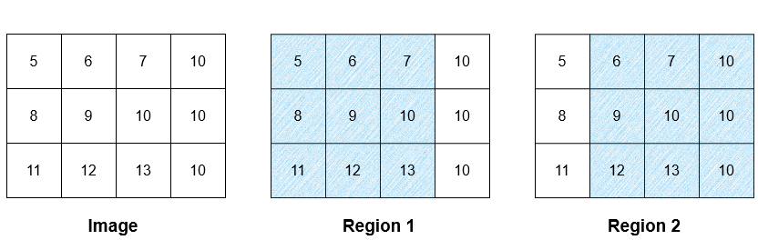
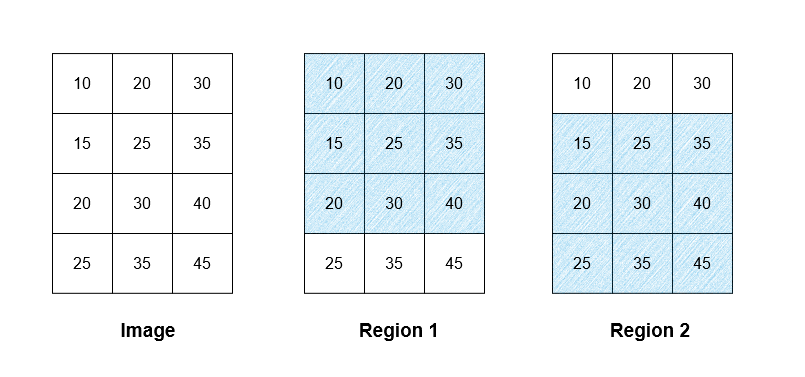

# 阅读理解（Python/Java/C++/Go）

> **[3030. 找出网格的区域平均强度](https://leetcode.cn/problems/find-the-grid-of-region-average/solutions/2630945/yue-du-li-jie-pythonjavacgo-by-endlessch-pcnd/) · Medium**

> **题目描述**
> 给你一个下标从 **0** 开始、大小为 `m x n` 的网格 `image` ，表示一个灰度图像，其中 `image[i][j]` 表示在范围 `[0..255]` 内的某个像素强度。另给你一个 **非负** 整数 `threshold` 。
>
> 如果 `image[a][b]` 和 `image[c][d]` 满足 `|a - c| + |b - d| == 1` ，则称这两个像素是 **相邻像素** 。
>
> **区域** 是一个 `3 x 3` 的子网格，且满足区域中任意两个 **相邻** 像素之间，像素强度的 **绝对差**  **小于或等于** `threshold` 。
>
> **区域** 内的所有像素都认为属于该区域，而一个像素 **可以** 属于 **多个** 区域。
>
> 你需要计算一个下标从 **0** 开始、大小为 `m x n` 的网格 `result` ，其中 `result[i][j]` 是 `image[i][j]` 所属区域的 **平均** 强度，**向下取整** 到最接近的整数。如果 `image[i][j]` 属于多个区域，`result[i][j]` 是这些区域的 **“取整后的平均强度”** 的 **平均值**，也 **向下取整** 到最接近的整数。如果 `image[i][j]` 不属于任何区域，则 `result[i][j]` **等于** `image[i][j]` 。
>
> 返回网格 `result` 。
>
> **示例 1：**
>
> 
>
> ```
>
> 输入：image = [[5,6,7,10],[8,9,10,10],[11,12,13,10]], threshold = 3
> 输出：[[9,9,9,9],[9,9,9,9],[9,9,9,9]]
> 解释：图像中存在两个区域，如图片中的阴影区域所示。第一个区域的平均强度为 9 ，而第二个区域的平均强度为 9.67 ，向下取整为 9 。两个区域的平均强度为 (9 + 9) / 2 = 9 。由于所有像素都属于区域 1 、区域 2 或两者，因此 result 中每个像素的强度都为 9 。
> 注意，在计算多个区域的平均值时使用了向下取整的值，因此使用区域 2 的平均强度 9 来进行计算，而不是 9.67 。
> ```
>
> **示例 2：**
>
> 
>
> ```
>
> 输入：image = [[10,20,30],[15,25,35],[20,30,40],[25,35,45]], threshold = 12
> 输出：[[25,25,25],[27,27,27],[27,27,27],[30,30,30]]
> 解释：图像中存在两个区域，如图片中的阴影区域所示。第一个区域的平均强度为 25 ，而第二个区域的平均强度为 30 。两个区域的平均强度为 (25 + 30) / 2 = 27.5 ，向下取整为 27 。图像中第 0 行的所有像素属于区域 1 ，因此 result 中第 0 行的所有像素为 25 。同理，result 中第 3 行的所有像素为 30 。图像中第 1 行和第 2 行的像素属于区域 1 和区域 2 ，因此它们在 result 中的值为 27 。
> ```
>
> **示例 3：**
>
> ```
>
> 输入：image = [[5,6,7],[8,9,10],[11,12,13]], threshold = 1
> 输出：[[5,6,7],[8,9,10],[11,12,13]]
> 解释：图像中不存在任何区域，因此对于所有像素，result[i][j] == image[i][j] 。
> ```
>
> **提示：**
>
> - `3 <= n, m <= 500`
>
> - `0 <= image[i][j] <= 255`
>
> - `0 <= threshold <= 255`

> **题解**
> 1. 遍历所有 $3 \times 3$ 的子网格。
> 2. 遍历网格内的所有左右相邻格子和上下相邻格子，如果存在差值超过 $\textit{threshold}$ 的情况，则枚举下一个子网格。
> 3. 如果合法，计算子网格的平均值 $\textit{avg}$，等于子网格的元素和除以 $9$ 下取整。
> 4. 更新子网格内的 $\textit{result}[i][j]$，由于需要计算平均值，我们先把 $\textit{avg}$ 加到 $\textit{result}[i][j]$ 中，同时用一个 $\textit{cnt}$ 矩阵统计 $(i,j)$ 在多少个合法子网格内。
> 5. 最后返回答案。如果 $\textit{cnt}[i][j]=0$ 则 $\textit{result}[i][j] = \textit{image}[i][j]$，否则 $\textit{result}[i][j] = \left\lfloor\dfrac{\textit{result}[i][j]}{\textit{cnt}[i][j]}\right\rfloor$。
>
> ```python
> class Solution:
>     def resultGrid(self, a: List[List[int]], threshold: int) -> List[List[int]]:
>         m, n = len(a), len(a[0])
>         result = [[0] * n for _ in range(m)]
>         cnt = [[0] * n for _ in range(m)]
>         for i in range(2, m):
>             for j in range(2, n):
>                 # 检查左右相邻格子
>                 ok = True
>                 for row in a[i - 2: i + 1]:
>                     if abs(row[j - 2] - row[j - 1]) > threshold or abs(row[j - 1] - row[j]) > threshold:
>                         ok = False
>                         break  # 不合法，下一个
>                 if not ok: continue
>
>                 # 检查上下相邻格子
>                 for y in range(j - 2, j + 1):
>                     if abs(a[i - 2][y] - a[i - 1][y]) > threshold or abs(a[i - 1][y] - a[i][y]) > threshold:
>                         ok = False
>                         break  # 不合法，下一个
>                 if not ok: continue
>
>                 # 合法，计算 3x3 子网格的平均值
>                 avg = sum(a[x][y] for x in range(i - 2, i + 1) for y in range(j - 2, j + 1)) // 9
>
>                 # 更新 3x3 子网格内的 result
>                 for x in range(i - 2, i + 1):
>                     for y in range(j - 2, j + 1):
>                         result[x][y] += avg  # 先累加，最后再求平均值
>                         cnt[x][y] += 1
>
>         for i, row in enumerate(cnt):
>             for j, c in enumerate(row):
>                 if c == 0:  # (i,j) 不属于任何子网格
>                     result[i][j] = a[i][j]
>                 else:
>                     result[i][j] //= c  # 求平均值
>         return result
> ```
>
>
> #### 复杂度分析
>
> - 时间复杂度：$\mathcal{O}(Amn)$，其中 $m$ 和 $n$ 分别为 $\textit{a}$ 的行数和列数，$A=9$ 表示子网格大小。
> - 空间复杂度：$\mathcal{O}(mn)$。
>
> ## 思考题
>
> 如果额外输入两个数 $w$ 和 $h$，把题目中 $3\times 3$ 改成 $w\times h$，要怎么做？你能做到 $\mathcal{O}(mn)$ 的时间复杂度吗？
>
> 欢迎在评论区分享你的思路/代码。
>
> 相关题目：[2132. 用邮票贴满网格图](https://leetcode.cn/problems/stamping-the-grid/)，[我的题解](../../2100-2199/2132%20用邮票贴满网格图/灵茶山艾府.md)，包含了解决思考题需要掌握的算法。
>
> ## 分类题单
>
> [如何科学刷题？](https://leetcode.cn/circle/discuss/RvFUtj/)
>
> 1. [滑动窗口（定长/不定长/多指针）](https://leetcode.cn/circle/discuss/0viNMK/)
> 2. [二分算法（二分答案/最小化最大值/最大化最小值/第K小）](https://leetcode.cn/circle/discuss/SqopEo/)
> 3. [单调栈（基础/矩形面积/贡献法/最小字典序）](https://leetcode.cn/circle/discuss/9oZFK9/)
> 4. [网格图（DFS/BFS/综合应用）](https://leetcode.cn/circle/discuss/YiXPXW/)
> 5. [位运算（基础/性质/拆位/试填/恒等式/思维）](https://leetcode.cn/circle/discuss/dHn9Vk/)
> 6. [图论算法（DFS/BFS/拓扑排序/最短路/最小生成树/二分图/基环树/欧拉路径）](https://leetcode.cn/circle/discuss/01LUak/)
> 7. [动态规划（入门/背包/状态机/划分/区间/状压/数位/数据结构优化/树形/博弈/概率期望）](https://leetcode.cn/circle/discuss/tXLS3i/)
> 8. [常用数据结构（前缀和/差分/栈/队列/堆/字典树/并查集/树状数组/线段树）](https://leetcode.cn/circle/discuss/mOr1u6/)
> 9. [数学算法（数论/组合/概率期望/博弈/计算几何/随机算法）](https://leetcode.cn/circle/discuss/IYT3ss/)
> 10. [贪心算法（基本贪心策略/反悔/区间/字典序/数学/思维/脑筋急转弯/构造）](https://leetcode.cn/circle/discuss/g6KTKL/)
> 11. [链表、二叉树与一般树（前后指针/快慢指针/DFS/BFS/直径/LCA）](https://leetcode.cn/circle/discuss/K0n2gO/)
>
> [我的题解精选（已分类）](https://github.com/EndlessCheng/codeforces-go/blob/master/leetcode/SOLUTIONS.md)
>
> 欢迎关注 [B站@灵茶山艾府](https://space.bilibili.com/206214)
