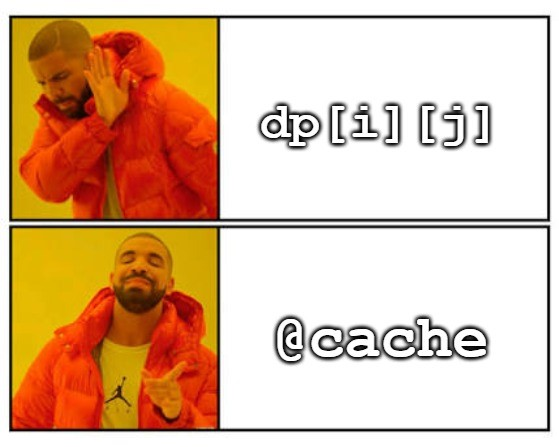

# 两种方法：记忆化搜索/递推（Python/Java/C++/Go）

> **[3040. 相同分数的最大操作数目 II](https://leetcode.cn/problems/maximum-number-of-operations-with-the-same-score-ii/solutions/2643756/qu-jian-dp-de-tao-lu-pythonjavacgo-by-en-nynz/) · Medium · 难度分 1709**

> **所属题单**
> - [动态规划 · 八、区间 DP](../../../刷题路径/灵神原版题单/动态规划/八、区间%20DP.md) · §8.2 区间 DP

> **题目描述**
> 给你一个整数数组 `nums` ，如果 `nums` **至少** 包含 `2` 个元素，你可以执行以下操作中的 **任意** 一个：
>
> - 选择 `nums` 中最前面两个元素并且删除它们。
>
> - 选择 `nums` 中最后两个元素并且删除它们。
>
> - 选择 `nums` 中第一个和最后一个元素并且删除它们。
>
> 一次操作的 **分数** 是被删除元素的和。
>
> 在确保 **所有操作分数相同** 的前提下，请你求出 **最多** 能进行多少次操作。
>
> 请你返回按照上述要求 **最多** 可以进行的操作次数。
>
> **示例 1：**
>
> ```
>
> 输入：nums = [3,2,1,2,3,4]
> 输出：3
> 解释：我们执行以下操作：
> - 删除前两个元素，分数为 3 + 2 = 5 ，nums = [1,2,3,4] 。
> - 删除第一个元素和最后一个元素，分数为 1 + 4 = 5 ，nums = [2,3] 。
> - 删除第一个元素和最后一个元素，分数为 2 + 3 = 5 ，nums = [] 。
> 由于 nums 为空，我们无法继续进行任何操作。
> ```
>
> **示例 2：**
>
> ```
>
> 输入：nums = [3,2,6,1,4]
> 输出：2
> 解释：我们执行以下操作：
> - 删除前两个元素，分数为 3 + 2 = 5 ，nums = [6,1,4] 。
> - 删除最后两个元素，分数为 1 + 4 = 5 ，nums = [6] 。
> 至多进行 2 次操作。
> ```
>
> **提示：**
>
> - `2 <= nums.length <= 2000`
>
> - `1 <= nums[i] <= 1000`

> **题解**
> ## 寻找子问题
>
> 第一步可以做什么？做完后，剩下要解决的问题是什么？
>
> - 删除前两个数，剩下 $\textit{nums}[2]$ 到 $\textit{nums}[n-1]$，这是一个连续的子数组。
> - 删除后两个数，剩下 $\textit{nums}[0]$ 到 $\textit{nums}[n-3]$，这也是一个连续的子数组。
> - 删除第一个和最后一个数，剩下 $\textit{nums}[1]$ 到 $\textit{nums}[n-2]$，这还是一个连续的子数组。
> - 无论怎么删除，剩下的都是连续子数组，都是和原问题相似的，规模更小的子问题。我们可以用子数组的左右端点下标表示状态，状态的值就是这个子数组的操作次数。
>
> 当你发现子问题是**从两侧向内缩小的**，就可以往**区间 DP** 上想了。这个套路我在 [区间 DP【基础算法精讲 22】](https://www.bilibili.com/video/BV1Gs4y1E7EU/)中讲过，欢迎收看。
>
> 如果确定了第一次删除的元素和，那么后续删除的元素和也就确定了（因为每次操作的元素和必须相等）。三种操作，对应着至多三种不同的元素和，分别用三次区间 DP 解决。
>
> ## 方法一：记忆化搜索
>
> 定义 $\textit{dfs}(i,j)$ 表示下标在闭区间 $[i,j]$ 内的连续子数组，最多可以执行多少次操作。
>
> 枚举三种操作方式，分别从 $\textit{dfs}(i+2,j)+1, \textit{dfs}(i,j-2)+1, \textit{dfs}(i+1,j-1)+1$ 转移过来（如果能操作），取最大值，即为 $\textit{dfs}(i,j)$。如果三种操作方式都不行，那么 $\textit{dfs}(i,j)=0$。
>
> 递归终点：如果 $i\ge j$，此时至多剩下一个数，无法操作，返回 $0$。
>
> 递归入口：根据三种初始操作，分别为 $\textit{dfs}(2,n-1), \textit{dfs}(0,n-3), \textit{dfs}(1,n-2)$。三者取最大值再加一（加上第一次操作），即为答案。
>
> 代码实现时，在计算第二次区间 DP 和第三次区间 DP 时，无需重置 $\textit{memo}$ 数组，这是因为不同的 $\textit{target}$ 不会递归到同一对 $(i,j)$ 上。这可以用反证法证明：假如不同的 $\textit{target}$ 递归到同一对 $(i,j)$ 上，这说明之前的操作次数相同，且删除的元素和相同，所以两次区间 DP 对应的得分是相同的，矛盾。
>
> ### 优化前
>
> ```python
> class Solution:
>     def maxOperations(self, nums: List[int]) -> int:
>         @cache  # 缓存装饰器，避免重复计算 dfs 的结果（记忆化）
>         def dfs(i: int, j: int, target: int) -> int:
>             if i >= j:
>                 return 0
>             res = 0
>             if nums[i] + nums[i + 1] == target:  # 删除前两个数
>                 res = max(res, dfs(i + 2, j, target) + 1)
>             if nums[j - 1] + nums[j] == target:  # 删除后两个数
>                 res = max(res, dfs(i, j - 2, target) + 1)
>             if nums[i] + nums[j] == target:  # 删除第一个和最后一个数
>                 res = max(res, dfs(i + 1, j - 1, target) + 1)
>             return res
>
>         n = len(nums)
>         res1 = dfs(2, n - 1, nums[0] + nums[1])  # 删除前两个数
>         res2 = dfs(0, n - 3, nums[-2] + nums[-1])  # 删除后两个数
>         res3 = dfs(1, n - 2, nums[0] + nums[-1])  # 删除第一个和最后一个数
>         return max(res1, res2, res3) + 1  # 加上第一次操作
> ```
>
>
> ### 优化
>
> 答案最大是 $\left\lfloor\dfrac{n}{2}\right\rfloor$。如果可以递归到 $i\ge j$ 的状态，说明可以执行 $\left\lfloor\dfrac{n}{2}\right\rfloor$ 次操作，不需要再计算了，直接返回 $\left\lfloor\dfrac{n}{2}\right\rfloor$。
>
> 比如下面代码中，如果发现 `res1` 已经算出了最多的操作次数，那么后面计算 `res2` 和 `res3` 的两个递归就不用执行了，毕竟算出来的值不可能比 `res1` 还要大。
>
> ```python
> class Solution:
>     def maxOperations(self, nums: List[int]) -> int:
>         @cache  # 缓存装饰器，避免重复计算 dfs 的结果（记忆化）
>         def dfs(i: int, j: int, target: int) -> int:
>             nonlocal done
>             if done:
>                 return 0
>             if i >= j:
>                 done = True
>                 return 0
>             res = 0
>             if nums[i] + nums[i + 1] == target:  # 删除前两个数
>                 res = max(res, dfs(i + 2, j, target) + 1)
>             if nums[j - 1] + nums[j] == target:  # 删除后两个数
>                 res = max(res, dfs(i, j - 2, target) + 1)
>             if nums[i] + nums[j] == target:  # 删除第一个和最后一个数
>                 res = max(res, dfs(i + 1, j - 1, target) + 1)
>             return res
>
>         done = False
>         n = len(nums)
>         res1 = dfs(2, n - 1, nums[0] + nums[1])  # 删除前两个数
>         res2 = dfs(0, n - 3, nums[-2] + nums[-1])  # 删除后两个数
>         res3 = dfs(1, n - 2, nums[0] + nums[-1])  # 删除第一个和最后一个数
>         return max(res1, res2, res3) + 1  # 加上第一次操作
> ```
>
>
> #### 复杂度分析
>
> - 时间复杂度：$\mathcal{O}(n^2)$，其中 $n$ 为 $\textit{nums}$ 的长度。由于每个状态只会计算一次，动态规划的时间复杂度 $=$ 状态个数 $\times$ 单个状态的计算时间。本题状态个数等于 $\mathcal{O}(n^2)$，单个状态的计算时间为 $\mathcal{O}(1)$，所以动态规划的时间复杂度为 $\mathcal{O}(n^2)$。
> - 空间复杂度：$\mathcal{O}(n^2)$。保存多少状态，就需要多少空间。
>
> ## 方法二：1:1 翻译成递推
>
> 和 $\textit{dfs}(i,j)$ 一样，定义 $f[i][j]$ 表示当前剩余元素从 $\textit{nums}[i]$ 到 $\textit{nums}[j]$，此时最多可以执行的操作次数。转移来源同方法一。
>
> 为避免出现 $j=-1$ 的状态，需要把 $f[i][j]$ 中的 $j$ 加一（相当于在最左边插入一列），即 $f[i][j+1]$ 表示当前剩余元素从 $\textit{nums}[i]$ 到 $\textit{nums}[j]$，此时最多可以执行的操作次数。
>
> 注：如果记忆化搜索中的三个 `if` 都不成立，就不会继续递归，但递推需要计算所有状态。在随机数据下，**本题递推效率不如记忆化搜索**。
>
> #### 答疑
>
> **问**：如何思考循环顺序？什么时候要正序枚举，什么时候要倒序枚举？
>
> **答**：这里有一个通用的做法：盯着状态转移方程，想一想，要计算 $f[i][\cdot]$，必须先把 $f[i+1][\cdot]$ 和 $f[i+2][\cdot]$ 算出来，那么只有 $i$ **从大到小**枚举才能做到。
>
> 对于 $j$ 来说，要计算 $f[i][j+1]$，必须先把 $f[i][j-1]$ 算出来，那么只有 $j$ **从小到大**枚举才能做到。
>
> ```python
> class Solution:
>     def maxOperations(self, nums: List[int]) -> int:
>         def helper(start: int, end: int, target: int) -> int:
>             max = lambda a, b: b if b > a else a  # 手写 max
>             f = [[0] * (n + 1) for _ in range(n + 1)]
>             for i in range(end - 1, start - 1, -1):
>                 for j in range(i + 1, end + 1):
>                     res = 0
>                     if nums[i] + nums[i + 1] == target:  # 删除前两个数
>                         res = max(res, f[i + 2][j + 1] + 1)
>                     if nums[j - 1] + nums[j] == target:  # 删除后两个数
>                         res = max(res, f[i][j - 1] + 1)
>                     if nums[i] + nums[j] == target:  # 删除第一个和最后一个数
>                         res = max(res, f[i + 1][j] + 1)
>                     f[i][j + 1] = res
>             return f[start][end + 1]
>
>         n = len(nums)
>         res1 = helper(2, n - 1, nums[0] + nums[1])  # 删除前两个数
>         res2 = helper(0, n - 3, nums[-2] + nums[-1])  # 删除后两个数
>         res3 = helper(1, n - 2, nums[0] + nums[-1])  # 删除第一个和最后一个数
>         return max(res1, res2, res3) + 1  # 加上第一次操作
> ```
>
>
> #### 复杂度分析
>
> - 时间复杂度：$\mathcal{O}(n^2)$，其中 $n$ 为 $\textit{nums}$ 的长度。
> - 空间复杂度：$\mathcal{O}(n^2)$。
>
> ## 总结（对于本题来说）
>
> 
>
> ## 分类题单
>
> [如何科学刷题？](https://leetcode.cn/circle/discuss/RvFUtj/)
>
> 1. [滑动窗口与双指针（定长/不定长/单序列/双序列/三指针/分组循环）](https://leetcode.cn/circle/discuss/0viNMK/)
> 2. [二分算法（二分答案/最小化最大值/最大化最小值/第K小）](https://leetcode.cn/circle/discuss/SqopEo/)
> 3. [单调栈（基础/矩形面积/贡献法/最小字典序）](https://leetcode.cn/circle/discuss/9oZFK9/)
> 4. [网格图（DFS/BFS/综合应用）](https://leetcode.cn/circle/discuss/YiXPXW/)
> 5. [位运算（基础/性质/拆位/试填/恒等式/思维）](https://leetcode.cn/circle/discuss/dHn9Vk/)
> 6. [图论算法（DFS/BFS/拓扑排序/最短路/最小生成树/二分图/基环树/欧拉路径）](https://leetcode.cn/circle/discuss/01LUak/)
> 7. [动态规划（入门/背包/状态机/划分/区间/状压/数位/数据结构优化/树形/博弈/概率期望）](https://leetcode.cn/circle/discuss/tXLS3i/)
> 8. [常用数据结构（前缀和/差分/栈/队列/堆/字典树/并查集/树状数组/线段树）](https://leetcode.cn/circle/discuss/mOr1u6/)
> 9. [数学算法（数论/组合/概率期望/博弈/计算几何/随机算法）](https://leetcode.cn/circle/discuss/IYT3ss/)
> 10. [贪心与思维（基本贪心策略/反悔/区间/字典序/数学/思维/脑筋急转弯/构造）](https://leetcode.cn/circle/discuss/g6KTKL/)
> 11. [链表、二叉树与回溯（前后指针/快慢指针/DFS/BFS/直径/LCA/一般树）](https://leetcode.cn/circle/discuss/K0n2gO/)
> 12. [字符串（KMP/Z函数/Manacher/字符串哈希/AC自动机/后缀数组/子序列自动机）](https://leetcode.cn/circle/discuss/SJFwQI/)
>
> [我的题解精选（已分类）](https://github.com/EndlessCheng/codeforces-go/blob/master/leetcode/SOLUTIONS.md)
>
> 欢迎关注 [B站@灵茶山艾府](https://space.bilibili.com/206214)
