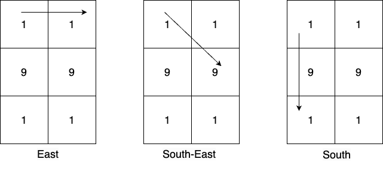

# 3044. 出现频率最高的质数

Medium · 难度分 1737 · [力扣原题](https://leetcode.cn/problems/most-frequent-prime/)

所在刷题路径：灵神题单·数学算法

| 作者 | 题解 | 动画讲解 |
|---|---|---|
| 灵茶山艾府 | [📄 题解](灵茶山艾府.md) | [▶︎ 动画（GIF）](3044%20出现频率最高的质数%20·%20灵茶山艾府.gif) · [mp4 文件](3044%20出现频率最高的质数%20·%20灵茶山艾府.mp4) |
| yiduobo | [📄 题解](yiduobo.md) | [▶︎ 动画（GIF）](3044%20出现频率最高的质数%20·%20yiduobo.gif) · [mp4 文件](3044%20出现频率最高的质数%20·%20yiduobo.mp4) |

## 动画讲解

> 动图会循环播放；想暂停、拖进度条请下载上面表格里的 mp4 文件。

### 灵茶山艾府


### yiduobo


## 题目描述

给你一个大小为 `m x n` 、下标从 **0** 开始的二维矩阵 `mat` 。在每个单元格，你可以按以下方式生成数字：

- 最多有 `8` 条路径可以选择：东，东南，南，西南，西，西北，北，东北。

- 选择其中一条路径，沿着这个方向移动，并且将路径上的数字添加到正在形成的数字后面。

- 注意，每一步都会生成数字，例如，如果路径上的数字是 `1, 9, 1`，那么在这个方向上会生成三个数字：`1, 19, 191` 。

返回在遍历矩阵所创建的所有数字中，出现频率最高的、**大于** `10`的质数；如果不存在这样的质数，则返回 `-1` 。如果存在多个出现频率最高的质数，那么返回其中最大的那个。

**注意：**移动过程中不允许改变方向。

**示例 1：**



```

输入：mat = [[1,1],[9,9],[1,1]]
输出：19
解释：
从单元格 (0,0) 出发，有 3 个可能的方向，这些方向上可以生成的大于 10 的数字有：
东方向: [11], 东南方向: [19], 南方向: [19,191] 。
从单元格 (0,1) 出发，所有可能方向上生成的大于 10 的数字有：[19,191,19,11] 。
从单元格 (1,0) 出发，所有可能方向上生成的大于 10 的数字有：[99,91,91,91,91] 。
从单元格 (1,1) 出发，所有可能方向上生成的大于 10 的数字有：[91,91,99,91,91] 。
从单元格 (2,0) 出发，所有可能方向上生成的大于 10 的数字有：[11,19,191,19] 。
从单元格 (2,1) 出发，所有可能方向上生成的大于 10 的数字有：[11,19,19,191] 。
在所有生成的数字中，出现频率最高的质数是 19 。
```

**示例 2：**

```

输入：mat = [[7]]
输出：-1
解释：唯一可以生成的数字是 7 。它是一个质数，但不大于 10 ，所以返回 -1 。
```

**示例 3：**

```

输入：mat = [[9,7,8],[4,6,5],[2,8,6]]
输出：97
解释：
从单元格 (0,0) 出发，所有可能方向上生成的大于 10 的数字有: [97,978,96,966,94,942] 。
从单元格 (0,1) 出发，所有可能方向上生成的大于 10 的数字有: [78,75,76,768,74,79] 。
从单元格 (0,2) 出发，所有可能方向上生成的大于 10 的数字有: [85,856,86,862,87,879] 。
从单元格 (1,0) 出发，所有可能方向上生成的大于 10 的数字有: [46,465,48,42,49,47] 。
从单元格 (1,1) 出发，所有可能方向上生成的大于 10 的数字有: [65,66,68,62,64,69,67,68] 。
从单元格 (1,2) 出发，所有可能方向上生成的大于 10 的数字有: [56,58,56,564,57,58] 。
从单元格 (2,0) 出发，所有可能方向上生成的大于 10 的数字有: [28,286,24,249,26,268] 。
从单元格 (2,1) 出发，所有可能方向上生成的大于 10 的数字有: [86,82,84,86,867,85] 。
从单元格 (2,2) 出发，所有可能方向上生成的大于 10 的数字有: [68,682,66,669,65,658] 。
在所有生成的数字中，出现频率最高的质数是 97 。
```

**提示：**

- `m == mat.length`

- `n == mat[i].length`

- `1 <= m, n <= 6`

- `1 <= mat[i][j] <= 9`

---
[↑ 返回 3000-3099](../README.md) · [总索引](../../../索引.md) · [仓库首页](../../../README.md)
