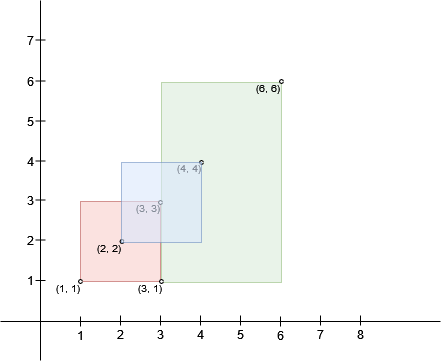
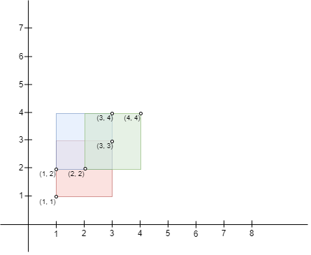
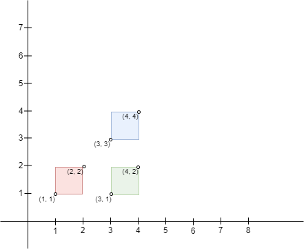

# 枚举 + 最优性剪枝（Python/Java/C++/C/Go/JS/Rust）

> **[3047. 求交集区域内的最大正方形面积](https://leetcode.cn/problems/find-the-largest-area-of-square-inside-two-rectangles/solutions/2653554/jian-ji-xie-fa-wu-xu-fen-lei-tao-lun-pyt-b7yq/) · Medium**

> **题目描述**
> 在二维平面上存在 `n` 个矩形。给你两个下标从 **0** 开始的二维整数数组 `bottomLeft` 和 `topRight`，两个数组的大小都是 `n x 2` ，其中 `bottomLeft[i]` 和 `topRight[i]` 分别代表第 `i` 个矩形的 **左下角** 和 **右上角** 坐标。
>
> 我们定义 **向右** 的方向为 x 轴正半轴（**x 坐标增加**），**向左** 的方向为 x 轴负半轴（**x 坐标减少**）。同样地，定义 **向上** 的方向为 y 轴正半轴（**y 坐标增加**）**，向下** 的方向为 y 轴负半轴（**y 坐标减少**）。
>
> 你可以选择一个区域，该区域由两个矩形的 **交集** 形成。你需要找出能够放入该区域 **内** 的 **最大** 正方形面积，并选择最优解。
>
> 返回能够放入交集区域的正方形的 **最大** 可能面积，如果矩形之间不存在任何交集区域，则返回 `0`。
>
> **示例 1：**
>
> 
>
> ```
>
> 输入：bottomLeft = [[1,1],[2,2],[3,1]], topRight = [[3,3],[4,4],[6,6]]
> 输出：1
> 解释：边长为 1 的正方形可以放入矩形 0 和矩形 1 的交集区域，或矩形 1 和矩形 2 的交集区域。因此最大面积是边长 * 边长，即 1 * 1 = 1。
> 可以证明，边长更大的正方形无法放入任何交集区域。
> ```
>
> **示例 2：**
>
> 
>
> ```
>
> 输入：bottomLeft = [[1,1],[2,2],[1,2]], topRight = [[3,3],[4,4],[3,4]]
> 输出：1
> 解释：边长为 1 的正方形可以放入矩形 0 和矩形 1，矩形 1 和矩形 2，或所有三个矩形的交集区域。因此最大面积是边长 * 边长，即 1 * 1 = 1。
> 可以证明，边长更大的正方形无法放入任何交集区域。
> 请注意，区域可以由多于两个矩形的交集构成。
> ```
>
> **示例 3：**
>
> 
>
> ```
>
> 输入：bottomLeft = [[1,1],[3,3],[3,1]], topRight = [[2,2],[4,4],[4,2]]
> 输出：0
> 解释：不存在相交的矩形，因此，返回 0 。
> ```
>
> **提示：**
>
> - `n == bottomLeft.length == topRight.length`
>
> - `2 <= n <= 10³`
>
> - `bottomLeft[i].length == topRight[i].length == 2`
>
> - `1 <= bottomLeft[i][0], bottomLeft[i][1] <= 10⁷`
>
> - `1 <= topRight[i][0], topRight[i][1] <= 10⁷`
>
> - `bottomLeft[i][0] < topRight[i][0]`
>
> - `bottomLeft[i][1] < topRight[i][1]`

> **题解**
> 枚举从 $n$ 个矩形中选出两个矩形。
>
> 如果两个矩形有交集，那么交集也是矩形。
>
> 求出这个交集矩形的左下角和右上角，就可以算出交集矩形的长和宽。
>
> - 左下角横坐标：两个矩形左下角横坐标的最大值。
> - 左下角纵坐标：两个矩形左下角纵坐标的最大值。
> - 右上角横坐标：两个矩形右上角横坐标的最小值。
> - 右上角纵坐标：两个矩形右上角纵坐标的最小值。
>
> 长和宽的最小值，就是能放入交集区域的正方形的最大边长 $\textit{side}$。
>
> 最大的 $\textit{side}$ 的平方（正方形面积）即为答案。
>
> ## 优化前
>
> ```python
> class Solution:
>     def largestSquareArea(self, bottomLeft: List[List[int]], topRight: List[List[int]]) -> int:
>         max_side = 0
>         for i, ((bx, by), (tx, ty)) in enumerate(zip(bottomLeft, topRight)):
>             for j in range(i):
>                 bx2, by2 = bottomLeft[j]
>                 tx2, ty2 = topRight[j]
>                 width = min(tx, tx2) - max(bx, bx2)  # 右上横坐标 - 左下横坐标
>                 height = min(ty, ty2) - max(by, by2)  # 右上纵坐标 - 左下纵坐标
>                 side = min(width, height)
>                 max_side = max(max_side, side)
>         return max_side ** 2
> ```
>
>
> ## 优化
>
> 外层循环枚举的矩形，如果其长或宽 $\le \textit{maxSide}$，那么交集矩形的长或宽也 $\le \textit{maxSide}$，所以 $\textit{maxSide}$ 不会变大，无需跑内层循环，直接 `continue`。
>
> ```python
> class Solution:
>     def largestSquareArea(self, bottomLeft: List[List[int]], topRight: List[List[int]]) -> int:
>         max_side = 0
>         for i, ((bx, by), (tx, ty)) in enumerate(zip(bottomLeft, topRight)):
>             if tx - bx <= max_side or ty - by <= max_side:
>                 continue  # 最优性剪枝：max_side 不可能变大
>             for j in range(i):
>                 bx2, by2 = bottomLeft[j]
>                 tx2, ty2 = topRight[j]
>                 width = min(tx, tx2) - max(bx, bx2)  # 右上横坐标 - 左下横坐标
>                 height = min(ty, ty2) - max(by, by2)  # 右上纵坐标 - 左下纵坐标
>                 side = min(width, height)
>                 max_side = max(max_side, side)
>         return max_side ** 2
> ```
>
>
> #### 复杂度分析
>
> - 时间复杂度：$\mathcal{O}(n^2)$，其中 $n$ 是 $\textit{bottomLeft}$ 的长度。
> - 空间复杂度：$\mathcal{O}(1)$。
>
> ## 分类题单
>
> [如何科学刷题？](https://leetcode.cn/circle/discuss/RvFUtj/)
>
> 1. [滑动窗口与双指针（定长/不定长/单序列/双序列/三指针/分组循环）](https://leetcode.cn/circle/discuss/0viNMK/)
> 2. [二分算法（二分答案/最小化最大值/最大化最小值/第K小）](https://leetcode.cn/circle/discuss/SqopEo/)
> 3. [单调栈（基础/矩形面积/贡献法/最小字典序）](https://leetcode.cn/circle/discuss/9oZFK9/)
> 4. [网格图（DFS/BFS/综合应用）](https://leetcode.cn/circle/discuss/YiXPXW/)
> 5. [位运算（基础/性质/拆位/试填/恒等式/思维）](https://leetcode.cn/circle/discuss/dHn9Vk/)
> 6. [图论算法（DFS/BFS/拓扑排序/基环树/最短路/最小生成树/网络流）](https://leetcode.cn/circle/discuss/01LUak/)
> 7. [动态规划（入门/背包/划分/状态机/区间/状压/数位/数据结构优化/树形/博弈/概率期望）](https://leetcode.cn/circle/discuss/tXLS3i/)
> 8. [常用数据结构（前缀和/差分/栈/队列/堆/字典树/并查集/树状数组/线段树）](https://leetcode.cn/circle/discuss/mOr1u6/)
> 9. [数学算法（数论/组合/概率期望/博弈/计算几何/随机算法）](https://leetcode.cn/circle/discuss/IYT3ss/)
> 10. [贪心与思维（基本贪心策略/反悔/区间/字典序/数学/思维/脑筋急转弯/构造）](https://leetcode.cn/circle/discuss/g6KTKL/)
> 11. [链表、树与回溯（前后指针/快慢指针/DFS/BFS/直径/LCA）](https://leetcode.cn/circle/discuss/K0n2gO/)
> 12. [字符串（KMP/Z函数/Manacher/字符串哈希/AC自动机/后缀数组/子序列自动机）](https://leetcode.cn/circle/discuss/SJFwQI/)
>
> [我的题解精选（已分类）](https://github.com/EndlessCheng/codeforces-go/blob/master/leetcode/SOLUTIONS.md)
>
> 欢迎关注 [B站@灵茶山艾府](https://space.bilibili.com/206214)
