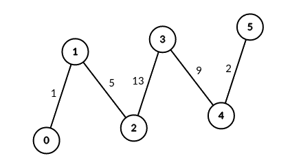
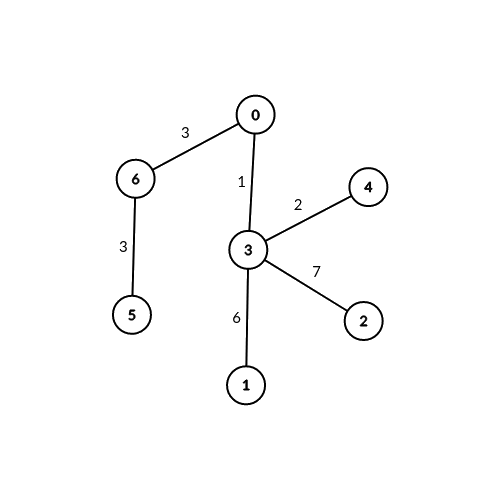

# 3067. 在带权树网络中统计可连接服务器对数目

Medium · 难度分 1909 · [力扣原题](https://leetcode.cn/problems/count-pairs-of-connectable-servers-in-a-weighted-tree-network/)

所在刷题路径：灵神题单·常用数据结构、灵神题单·数学算法、灵神题单·链表树与回溯

| 作者 | 题解 | 动画讲解 |
|---|---|---|
| 灵茶山艾府 | [📄 题解](灵茶山艾府.md) | [▶︎ 动画（GIF）](3067%20在带权树网络中统计可连接服务器对数目%20·%20灵茶山艾府.gif) · [mp4 文件](3067%20在带权树网络中统计可连接服务器对数目%20·%20灵茶山艾府.mp4) |
| yiduobo | [📄 题解](yiduobo.md) | [▶︎ 动画（GIF）](3067%20在带权树网络中统计可连接服务器对数目%20·%20yiduobo.gif) · [mp4 文件](3067%20在带权树网络中统计可连接服务器对数目%20·%20yiduobo.mp4) |

## 动画讲解

> 动图会循环播放；想暂停、拖进度条请下载上面表格里的 mp4 文件。

### 灵茶山艾府


### yiduobo


## 题目描述

给你一棵无根带权树，树中总共有 `n` 个节点，分别表示 `n` 个服务器，服务器从 `0` 到 `n - 1` 编号。同时给你一个数组 `edges` ，其中 `edges[i] = [a_i, b_i, weight_i]` 表示节点 `a_i` 和 `b_i` 之间有一条双向边，边的权值为 `weight_i` 。再给你一个整数 `signalSpeed` 。

如果两台服务器 `a` 和 `b` 是通过服务器 `c` **可连接的**，则：

- `a < b` ，`a != c` 且 `b != c` 。

- 从 `c` 到 `a` 的距离是可以被 `signalSpeed` 整除的。

- 从 `c` 到 `b` 的距离是可以被 `signalSpeed` 整除的。

- 从 `c` 到 `b` 的路径与从 `c` 到 `a` 的路径没有任何公共边。

请你返回一个长度为 `n` 的整数数组 `count` ，其中 `count[i]` 表示通过服务器 `i` **可连接** 的服务器对的 **数目** 。

**示例 1：**



```

输入：edges = [[0,1,1],[1,2,5],[2,3,13],[3,4,9],[4,5,2]], signalSpeed = 1
输出：[0,4,6,6,4,0]
解释：由于 signalSpeed 等于 1 ，count[c] 等于所有从 c 开始且没有公共边的路径对数目。
在输入图中，count[c] 等于服务器 c 左边服务器数目乘以右边服务器数目。
```

**示例 2：**



```

输入：edges = [[0,6,3],[6,5,3],[0,3,1],[3,2,7],[3,1,6],[3,4,2]], signalSpeed = 3
输出：[2,0,0,0,0,0,2]
解释：通过服务器 0 ，有 2 个可连接服务器对(4, 5) 和 (4, 6) 。
通过服务器 6 ，有 2 个可连接服务器对 (4, 5) 和 (0, 5) 。
所有服务器对都必须通过服务器 0 或 6 才可连接，所以其他服务器对应的可连接服务器对数目都为 0 。
```

**提示：**

- `2 <= n <= 1000`

- `edges.length == n - 1`

- `edges[i].length == 3`

- `0 <= a_i, b_i < n`

- `edges[i] = [a_i, b_i, weight_i]`

- `1 <= weight_i <= 10⁶`

- `1 <= signalSpeed <= 10⁶`

- 输入保证 `edges` 构成一棵合法的树。

---
[↑ 返回 3000-3099](../README.md) · [总索引](../../../索引.md) · [仓库首页](../../../README.md)
