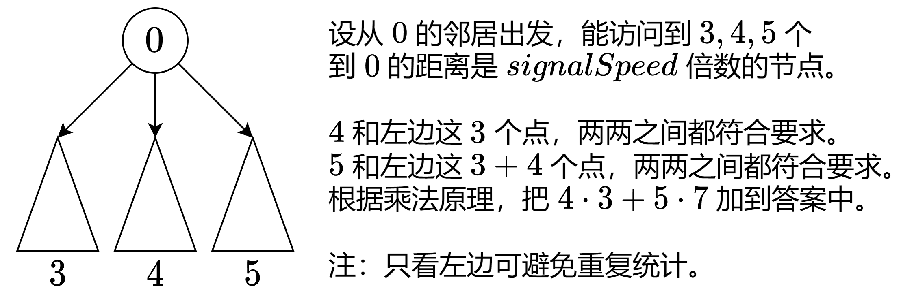

# 枚举根 DFS + 乘法原理（Python/Java/C++/Go）

> **[3067. 在带权树网络中统计可连接服务器对数目](https://leetcode.cn/problems/count-pairs-of-connectable-servers-in-a-weighted-tree-network/solutions/2664330/mei-ju-gen-dfs-cheng-fa-yuan-li-pythonja-ivw5/) · Medium · 难度分 1909**

> **所属题单**
> - [常用数据结构 · 零、常用枚举技巧](../../../刷题路径/灵神原版题单/常用数据结构/零、常用枚举技巧.md) · §0.2 枚举中间 · §0.2.2 进阶
> - [链表、二叉树与回溯 · 三、一般树](../../../刷题路径/灵神原版题单/链表、二叉树与回溯/三、一般树.md) · §3.2 自顶向下 DFS
> - [数学算法 · 二、组合数学](../../../刷题路径/灵神原版题单/数学算法/二、组合数学.md) · §2.1 乘法原理

> **题目描述**
> 给你一棵无根带权树，树中总共有 `n` 个节点，分别表示 `n` 个服务器，服务器从 `0` 到 `n - 1` 编号。同时给你一个数组 `edges` ，其中 `edges[i] = [a_i, b_i, weight_i]` 表示节点 `a_i` 和 `b_i` 之间有一条双向边，边的权值为 `weight_i` 。再给你一个整数 `signalSpeed` 。
>
> 如果两台服务器 `a` 和 `b` 是通过服务器 `c` **可连接的**，则：
>
> - `a < b` ，`a != c` 且 `b != c` 。
>
> - 从 `c` 到 `a` 的距离是可以被 `signalSpeed` 整除的。
>
> - 从 `c` 到 `b` 的距离是可以被 `signalSpeed` 整除的。
>
> - 从 `c` 到 `b` 的路径与从 `c` 到 `a` 的路径没有任何公共边。
>
> 请你返回一个长度为 `n` 的整数数组 `count` ，其中 `count[i]` 表示通过服务器 `i` **可连接** 的服务器对的 **数目** 。
>
> **示例 1：**
>
> 
>
> ```
>
> 输入：edges = [[0,1,1],[1,2,5],[2,3,13],[3,4,9],[4,5,2]], signalSpeed = 1
> 输出：[0,4,6,6,4,0]
> 解释：由于 signalSpeed 等于 1 ，count[c] 等于所有从 c 开始且没有公共边的路径对数目。
> 在输入图中，count[c] 等于服务器 c 左边服务器数目乘以右边服务器数目。
> ```
>
> **示例 2：**
>
> 
>
> ```
>
> 输入：edges = [[0,6,3],[6,5,3],[0,3,1],[3,2,7],[3,1,6],[3,4,2]], signalSpeed = 3
> 输出：[2,0,0,0,0,0,2]
> 解释：通过服务器 0 ，有 2 个可连接服务器对(4, 5) 和 (4, 6) 。
> 通过服务器 6 ，有 2 个可连接服务器对 (4, 5) 和 (0, 5) 。
> 所有服务器对都必须通过服务器 0 或 6 才可连接，所以其他服务器对应的可连接服务器对数目都为 0 。
> ```
>
> **提示：**
>
> - `2 <= n <= 1000`
>
> - `edges.length == n - 1`
>
> - `edges[i].length == 3`
>
> - `0 <= a_i, b_i < n`
>
> - `edges[i] = [a_i, b_i, weight_i]`
>
> - `1 <= weight_i <= 10⁶`
>
> - `1 <= signalSpeed <= 10⁶`
>
> - 输入保证 `edges` 构成一棵合法的树。

> **题解**
> 枚举服务器 $c$，作为树的根，按照下图计算（下图 $c=0$）。
>
> 
>
> **优化**：如果 $c$ 只有一个邻居，则答案为 $0$，不调用 $\text{dfs}$。
>
> 根据论文 [On the number of leaves in a random recursive tree](https://projecteuclid.org/journals/brazilian-journal-of-probability-and-statistics/volume-29/issue-4/On-the-number-of-leaves-in-a-random-recursive-tree/10.1214/14-BJPS252.pdf)，在随机数据下，这可以减少一半的计算量。
>
> [视频讲解](https://www.bilibili.com/video/BV1AU411F7Fp/) 第三题。
>
> ```python
> # 更快的写法见【Python3 写法二】
> class Solution:
>     def countPairsOfConnectableServers(self, edges: List[List[int]], signalSpeed: int) -> List[int]:
>         n = len(edges) + 1
>         g = [[] for _ in range(n)]
>         for x, y, wt in edges:
>             g[x].append((y, wt))
>             g[y].append((x, wt))
>
>         def dfs(x: int, fa: int, s: int) -> int:
>             cnt = 0 if s % signalSpeed else 1
>             for y, wt in g[x]:
>                 if y != fa:
>                     cnt += dfs(y, x, s + wt)
>             return cnt
>
>         ans = [0] * n
>         for i, gi in enumerate(g):
>             if len(gi) == 1:
>                 continue
>             s = 0
>             for y, wt in gi:
>                 cnt = dfs(y, i, wt)
>                 ans[i] += cnt * s
>                 s += cnt
>         return ans
> ```
>
> > [!example]- Python3 写法二
> > ```python
> > class Solution:
> >     def countPairsOfConnectableServers(self, edges: List[List[int]], signalSpeed: int) -> List[int]:
> >         n = len(edges) + 1
> >         g = [[] for _ in range(n)]
> >         for x, y, wt in edges:
> >             g[x].append((y, wt))
> >             g[y].append((x, wt))
> >
> >         @cache
> >         def dfs(x: int, fa: int, s: int) -> int:
> >             cnt = 0 if s else 1
> >             for y, wt in g[x]:
> >                 if y != fa:
> >                     cnt += dfs(y, x, (s + wt) % signalSpeed)
> >             return cnt
> >
> >         ans = [0] * n
> >         for i, gi in enumerate(g):
> >             if len(gi) == 1:
> >                 continue
> >             s = 0
> >             for y, wt in gi:
> >                 cnt = dfs(y, i, wt % signalSpeed)
> >                 ans[i] += cnt * s
> >                 s += cnt
> >         return ans
> > ```
>
>
> #### 复杂度分析
>
> - 时间复杂度：$\mathcal{O}(n^2)$，其中 $n$ 为 $\textit{edges}$ 的长度加一。
> - 空间复杂度：$\mathcal{O}(n)$。
>
> ## 相似题目
>
> - [2867. 统计树中的合法路径数目](https://leetcode.cn/problems/count-valid-paths-in-a-tree/)
>
> ## 思考题
>
> 如果 $n=10^5,\ \textit{signalSpeed}=10$，你能想出一个更快的做法吗？
>
> - 可以参考 [CF791D Bear and Tree Jumps](https://codeforces.com/problemset/problem/791/D)
>
> ## 分类题单
>
> [如何科学刷题？](https://leetcode.cn/circle/discuss/RvFUtj/)
>
> 1. [滑动窗口与双指针（定长/不定长/单序列/双序列/三指针/分组循环）](https://leetcode.cn/circle/discuss/0viNMK/)
> 2. [二分算法（二分答案/最小化最大值/最大化最小值/第K小）](https://leetcode.cn/circle/discuss/SqopEo/)
> 3. [单调栈（基础/矩形面积/贡献法/最小字典序）](https://leetcode.cn/circle/discuss/9oZFK9/)
> 4. [网格图（DFS/BFS/综合应用）](https://leetcode.cn/circle/discuss/YiXPXW/)
> 5. [位运算（基础/性质/拆位/试填/恒等式/思维）](https://leetcode.cn/circle/discuss/dHn9Vk/)
> 6. [图论算法（DFS/BFS/拓扑排序/基环树/最短路/最小生成树/网络流）](https://leetcode.cn/circle/discuss/01LUak/)
> 7. [动态规划（入门/背包/划分/状态机/区间/状压/数位/数据结构优化/树形/博弈/概率期望）](https://leetcode.cn/circle/discuss/tXLS3i/)
> 8. [常用数据结构（前缀和/差分/栈/队列/堆/字典树/并查集/树状数组/线段树）](https://leetcode.cn/circle/discuss/mOr1u6/)
> 9. [数学算法（数论/组合/概率期望/博弈/计算几何/随机算法）](https://leetcode.cn/circle/discuss/IYT3ss/)
> 10. [贪心与思维（基本贪心策略/反悔/区间/字典序/数学/思维/脑筋急转弯/构造）](https://leetcode.cn/circle/discuss/g6KTKL/)
> 11. [链表、树与回溯（前后指针/快慢指针/DFS/BFS/直径/LCA）](https://leetcode.cn/circle/discuss/K0n2gO/)
> 12. [字符串（KMP/Z函数/Manacher/字符串哈希/AC自动机/后缀数组/子序列自动机）](https://leetcode.cn/circle/discuss/SJFwQI/)
>
> [我的题解精选（已分类）](https://github.com/EndlessCheng/codeforces-go/blob/master/leetcode/SOLUTIONS.md)
>
> 欢迎关注 [B站@灵茶山艾府](https://space.bilibili.com/206214)
