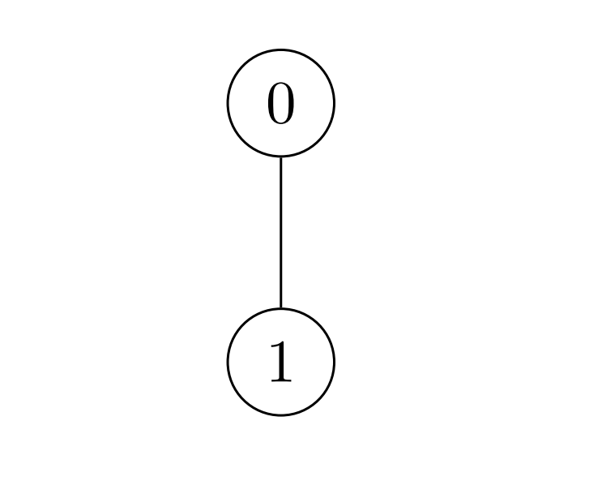

# 脑筋急转弯，状态机 DP（Python/Java/C++/Go）

> **[3068. 最大节点价值之和](https://leetcode.cn/problems/find-the-maximum-sum-of-node-values/solutions/2664309/liang-chong-fang-fa-shu-xing-dp-xian-xin-lh6b/) · Hard · 难度分 2268**

> **所属题单**
> - [动态规划 · 六、状态机 DP](../../../刷题路径/灵神原版题单/动态规划/六、状态机%20DP.md) · §6.3 进阶
> - [动态规划 · 十二、树形 DP](../../../刷题路径/灵神原版题单/动态规划/十二、树形%20DP.md) · §12.5 其他树形 DP

> **题目描述**
> 给你一棵 `n` 个节点的 **无向** 树，节点从 `0` 到 `n - 1` 编号。树以长度为 `n - 1` 下标从 **0** 开始的二维整数数组 `edges` 的形式给你，其中 `edges[i] = [u_i, v_i]` 表示树中节点 `u_i` 和 `v_i` 之间有一条边。同时给你一个 **正** 整数 `k` 和一个长度为 `n` 下标从 **0** 开始的 **非负** 整数数组 `nums` ，其中 `nums[i]` 表示节点 `i` 的 **价值** 。
>
> Alice 想 **最大化** 树中所有节点价值之和。为了实现这一目标，Alice 可以执行以下操作 **任意** 次（**包括** **0 次**）：
>
> - 选择连接节点 `u` 和 `v` 的边 `[u, v]` ，并将它们的值更新为：
>
>     - `nums[u] = nums[u] XOR k`
>
>     - `nums[v] = nums[v] XOR k`
>
> 请你返回 Alice 通过执行以上操作 **任意次** 后，可以得到所有节点 **价值之和** 的 **最大值** 。
>
> **示例 1：**
>
> 
>
> ```
>
> 输入：nums = [1,2,1], k = 3, edges = [[0,1],[0,2]]
> 输出：6
> 解释：Alice 可以通过一次操作得到最大价值和 6 ：
> - 选择边 [0,2] 。nums[0] 和 nums[2] 都变为：1 XOR 3 = 2 ，数组 nums 变为：[1,2,1] -> [2,2,2] 。
> 所有节点价值之和为 2 + 2 + 2 = 6 。
> 6 是可以得到最大的价值之和。
> ```
>
> **示例 2：**
>
> 
>
> ```
>
> 输入：nums = [2,3], k = 7, edges = [[0,1]]
> 输出：9
> 解释：Alice 可以通过一次操作得到最大和 9 ：
> - 选择边 [0,1] 。nums[0] 变为：2 XOR 7 = 5 ，nums[1] 变为：3 XOR 7 = 4 ，数组 nums 变为：[2,3] -> [5,4] 。
> 所有节点价值之和为 5 + 4 = 9 。
> 9 是可以得到最大的价值之和。
> ```
>
> **示例 3：**
>
> 
>
> ```
>
> 输入：nums = [7,7,7,7,7,7], k = 3, edges = [[0,1],[0,2],[0,3],[0,4],[0,5]]
> 输出：42
> 解释：Alice 不需要执行任何操作，就可以得到最大价值之和 42 。
> ```
>
> **提示：**
>
> - `2 <= n == nums.length <= 2 * 10⁴`
>
> - `1 <= k <= 10⁹`
>
> - `0 <= nums[i] <= 10⁹`
>
> - `edges.length == n - 1`
>
> - `edges[i].length == 2`
>
> - `0 <= edges[i][0], edges[i][1] <= n - 1`
>
> - 输入保证 `edges` 构成一棵合法的树。

> **题解**
> ## 性质一
>
> 由于一个数异或两次 $k$ 后保持不变，所以对于一条从 $x$ 到 $y$ 的简单路径，我们把路径上的所有边操作后，路径上除了 $x$ 和 $y$ 的其它节点都恰好操作两次，所以只有 $\textit{nums}[x]$ 和 $\textit{nums}[y]$ 都异或了 $k$，其余元素不变。
>
> 所以题目中的操作可以作用在**任意两个数**上。我们不需要建树，$\textit{edges}$ 是多余的！
>
> ## 性质二
>
> 注意到，无论操作多少次，总是有**偶数个**元素异或了 $k$。理由如下：
>
> - 如果我们操作的两个数之前都没有异或过，那么操作后，异或 $k$ 的元素增加了 $2$。
> - 如果我们操作的两个数之前都异或过，那么操作后，异或 $k$ 的元素减少了 $2$。
> - 如果我们操作的两个数之前一个异或过，另一个没有异或过，那么操作后，异或 $k$ 的元素加一减一，不变。
>
> ## 思路
>
> 结合这两个性质，问题变成：
>
> - 选择 $\textit{nums}$ 中的**偶数**个元素（长为偶数的子序列），把这些数都异或 $k$ 之后，整个 $\textit{nums}$ 的元素和最大是多少？
>
> 这可以用状态机 DP 解决。如果你没有做过状态机 DP 的题目，可以看[【基础算法精讲 21】](https://www.bilibili.com/video/BV1ho4y1W7QK/)。
>
> - 定义 $f[i+1][0]$ 表示选择 $\textit{nums}[0]$ 到 $\textit{nums}[i]$ 中的偶数个元素异或 $k$ 之后，$\textit{nums}[0]$ 到 $\textit{nums}[i]$ 的元素和的最大值。这里写 $i+1$ 是为了用 $f[0]$ 表示初始值。
> - 定义 $f[i+1][1]$ 表示选择 $\textit{nums}[0]$ 到 $\textit{nums}[i]$ 中的奇数个元素异或 $k$，$\textit{nums}[0]$ 到 $\textit{nums}[i]$ 的元素和的最大值。
>
> 设 $x=\textit{nums}[i]$。用**选或不选**思考：
>
> - 不选 $x$ 操作，问题变成选择 $\textit{nums}[0]$ 到 $\textit{nums}[i-1]$ 中的偶数/奇数个元素异或 $k$，得到的最大元素和，即 $f[i][0]$ 和 $f[i][1]$：
>   - $f[i+1][0] = f[i][0] + x$。
>   - $f[i+1][1] = f[i][1] + x$。
> - 选 $x$ 操作，问题变成选择 $\textit{nums}[0]$ 到 $\textit{nums}[i-1]$ 中的奇数/偶数个元素异或 $k$，得到的最大元素和，即 $f[i][1]$ 和 $f[i][0]$：
>   - $f[i+1][0] = f[i][1] + (x\oplus k)$。
>   - $f[i+1][1] = f[i][0] + (x\oplus k)$。
>
> 两种情况取最大值，有
>
> $$
> \begin{aligned}
> f[i+1][0] &= \max(f[i][0] + x, f[i][1] + (x\oplus k))  \\
> f[i+1][1] &= \max(f[i][1] + x, f[i][0] + (x\oplus k))  \\
> \end{aligned}
> $$
>
> 初始值 $f[0][0] = 0,\ f[0][1] = -\infty$。用 $-\infty$ 表示不合法的状态，这样计算 $\max$ 的时候，合法状态一定会大于不合法的状态。$f[0][1] = -\infty$ 是因为没有数字，不可能选奇数个数。
>
> 答案为 $f[n][0]$。
>
> 代码实现时，$f$ 数组的第一个维度可以压缩掉。
>
> [视频讲解](https://www.bilibili.com/video/BV1AU411F7Fp/) 第四题。
>
> ```python
> class Solution:
>     def maximumValueSum(self, nums: List[int], k: int, _: List[List[int]]) -> int:
>         f0, f1 = 0, -inf
>         for x in nums:
>             f0, f1 = max(f0 + x, f1 + (x ^ k)), max(f1 + x, f0 + (x ^ k))
>         return f0
> ```
>
>
> #### 复杂度分析
>
> - 时间复杂度：$\mathcal{O}(n)$，其中 $n$ 为 $\textit{nums}$ 的长度。
> - 空间复杂度：$\mathcal{O}(1)$。
>
> ## 分类题单
>
> [如何科学刷题？](https://leetcode.cn/circle/discuss/RvFUtj/)
>
> 1. [滑动窗口与双指针（定长/不定长/单序列/双序列/三指针/分组循环）](https://leetcode.cn/circle/discuss/0viNMK/)
> 2. [二分算法（二分答案/最小化最大值/最大化最小值/第K小）](https://leetcode.cn/circle/discuss/SqopEo/)
> 3. [单调栈（基础/矩形面积/贡献法/最小字典序）](https://leetcode.cn/circle/discuss/9oZFK9/)
> 4. [网格图（DFS/BFS/综合应用）](https://leetcode.cn/circle/discuss/YiXPXW/)
> 5. [位运算（基础/性质/拆位/试填/恒等式/思维）](https://leetcode.cn/circle/discuss/dHn9Vk/)
> 6. [图论算法（DFS/BFS/拓扑排序/基环树/最短路/最小生成树/网络流）](https://leetcode.cn/circle/discuss/01LUak/)
> 7. [动态规划（入门/背包/划分/状态机/区间/状压/数位/数据结构优化/树形/博弈/概率期望）](https://leetcode.cn/circle/discuss/tXLS3i/)
> 8. [常用数据结构（前缀和/差分/栈/队列/堆/字典树/并查集/树状数组/线段树）](https://leetcode.cn/circle/discuss/mOr1u6/)
> 9. [数学算法（数论/组合/概率期望/博弈/计算几何/随机算法）](https://leetcode.cn/circle/discuss/IYT3ss/)
> 10. [贪心与思维（基本贪心策略/反悔/区间/字典序/数学/思维/脑筋急转弯/构造）](https://leetcode.cn/circle/discuss/g6KTKL/)
> 11. [链表、二叉树与回溯（前后指针/快慢指针/DFS/BFS/直径/LCA/一般树）](https://leetcode.cn/circle/discuss/K0n2gO/)
> 12. [字符串（KMP/Z函数/Manacher/字符串哈希/AC自动机/后缀数组/子序列自动机）](https://leetcode.cn/circle/discuss/SJFwQI/)
>
> [我的题解精选（已分类）](https://github.com/EndlessCheng/codeforces-go/blob/master/leetcode/SOLUTIONS.md)
>
> 欢迎关注 [B站@灵茶山艾府](https://space.bilibili.com/206214)
