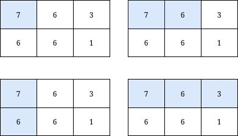
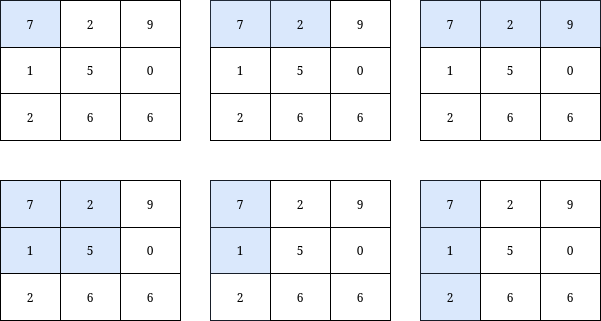

# 3070. 元素和小于等于 k 的子矩阵的数目

Medium · 难度分 1499 · [力扣原题](https://leetcode.cn/problems/count-submatrices-with-top-left-element-and-sum-less-than-k/)

所在刷题路径：灵神核心路线、灵神题单·常用数据结构

| 作者 | 题解 | 动画讲解 |
|---|---|---|
| 灵茶山艾府 | [📄 题解](灵茶山艾府.md) | [▶︎ 动画（GIF）](3070%20元素和小于等于%20k%20的子矩阵的数目%20·%20灵茶山艾府.gif) · [mp4 文件](3070%20元素和小于等于%20k%20的子矩阵的数目%20·%20灵茶山艾府.mp4) |
| yiduobo | [📄 题解](yiduobo.md) | [▶︎ 动画（GIF）](3070%20元素和小于等于%20k%20的子矩阵的数目%20·%20yiduobo.gif) · [mp4 文件](3070%20元素和小于等于%20k%20的子矩阵的数目%20·%20yiduobo.mp4) |

## 动画讲解

> 动图会循环播放；想暂停、拖进度条请下载上面表格里的 mp4 文件。

### 灵茶山艾府


### yiduobo


## 题目描述

给你一个下标从 **0** 开始的整数矩阵 `grid` 和一个整数 `k`。

返回包含 `grid` 左上角元素、元素和小于或等于 `k` 的 **子矩阵**的数目。

**示例 1：**



```

输入：grid = [[7,6,3],[6,6,1]], k = 18
输出：4
解释：如上图所示，只有 4 个子矩阵满足：包含 grid 的左上角元素，并且元素和小于或等于 18 。
```

**示例 2：**



```

输入：grid = [[7,2,9],[1,5,0],[2,6,6]], k = 20
输出：6
解释：如上图所示，只有 6 个子矩阵满足：包含 grid 的左上角元素，并且元素和小于或等于 20 。
```

**提示：**

- `m == grid.length `

- `n == grid[i].length`

- `1 <= n, m <= 1000 `

- `0 <= grid[i][j] <= 1000`

- `1 <= k <= 10⁹`

---
[↑ 返回 3000-3099](../README.md) · [总索引](../../../索引.md) · [仓库首页](../../../README.md)
