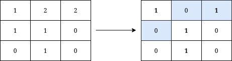
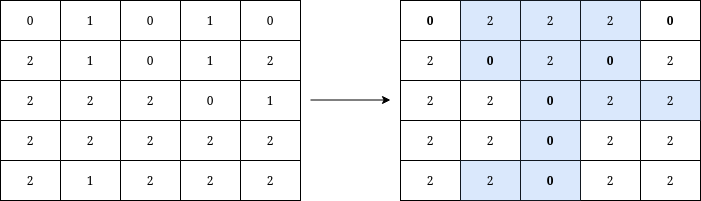

# 一次遍历，以及更大值域怎么做（Python/Java/C++/Go）

> **[3071. 在矩阵上写出字母 Y 所需的最少操作次数](https://leetcode.cn/problems/minimum-operations-to-write-the-letter-y-on-a-grid/solutions/2664650/yi-ci-bian-li-pythonjavacgo-by-endlessch-at9u/) · Medium**

> **题目描述**
> 给你一个下标从 **0** 开始、大小为 `n x n` 的矩阵 `grid` ，其中 `n` 为奇数，且 `grid[r][c]` 的值为 `0` 、`1` 或 `2` 。
>
> 如果一个单元格属于以下三条线中的任一一条，我们就认为它是字母 **Y** 的一部分：
>
> - 从左上角单元格开始到矩阵中心单元格结束的对角线。
>
> - 从右上角单元格开始到矩阵中心单元格结束的对角线。
>
> - 从中心单元格开始到矩阵底部边界结束的垂直线。
>
> 当且仅当满足以下全部条件时，可以判定矩阵上写有字母 **Y** ：
>
> - 属于 Y 的所有单元格的值相等。
>
> - 不属于 Y 的所有单元格的值相等。
>
> - 属于 Y 的单元格的值与不属于Y的单元格的值不同。
>
> 每次操作你可以将任意单元格的值改变为 `0` 、`1` 或 `2` 。返回在矩阵上写出字母 Y 所需的 **最少** 操作次数。
>
> **示例 1：**
>
> 
>
> ```
>
> 输入：grid = [[1,2,2],[1,1,0],[0,1,0]]
> 输出：3
> 解释：将在矩阵上写出字母 Y 需要执行的操作用蓝色高亮显示。操作后，所有属于 Y 的单元格（加粗显示）的值都为 1 ，而不属于 Y 的单元格的值都为 0 。
> 可以证明，写出 Y 至少需要进行 3 次操作。
> ```
>
> **示例 2：**
>
> 
>
> ```
>
> 输入：grid = [[0,1,0,1,0],[2,1,0,1,2],[2,2,2,0,1],[2,2,2,2,2],[2,1,2,2,2]]
> 输出：12
> 解释：将在矩阵上写出字母 Y 需要执行的操作用蓝色高亮显示。操作后，所有属于 Y 的单元格（加粗显示）的值都为 0 ，而不属于 Y 的单元格的值都为 2 。
> 可以证明，写出 Y 至少需要进行 12 次操作。
> ```
>
> **提示：**
>
> - `3 <= n <= 49`
>
> - `n == grid.length == grid[i].length`
>
> - `0 <= grid[i][j] <= 2`
>
> - `n` 为奇数。

> **题解**
> 请看 [视频讲解](https://www.bilibili.com/video/BV14r421W7oR/) 第三题，包含思考题（更大值域）的做法。
>
> 统计 Y 中的元素出现次数，记到一个长为 $3$ 的数组 $\textit{cnt}_1$ 中。统计不在 Y 中的元素出现次数，记到一个长为 $3$ 的数组 $\textit{cnt}_2$ 中。
>
> 计算最多可以保留多少个元素**不变**，设这个值为 $\textit{maxNotChange}$。
>
> 在 $0,1,2$ 中枚举 $i$ 和 $j$，其中 $i\ne j$。让 Y 中的元素都变成 $i$，不在 Y 中的元素都变成 $j$，那么 $\textit{maxNotChange}$ 就是 $\textit{cnt}_1[i]+\textit{cnt}_2[j]$ 的最大值。
>
> 最后返回 $n^2 - \textit{maxNotChange}$，即最少要修改的元素个数。
>
> ```python
> class Solution:
>     def minimumOperationsToWriteY(self, grid: List[List[int]]) -> int:
>         cnt1 = [0] * 3
>         cnt2 = [0] * 3
>         n = len(grid)
>         m = n // 2
>
>         for i, row in enumerate(grid[:m]):
>             cnt1[row[i]] += 1
>             cnt1[row[-1 - i]] += 1
>             for j, x in enumerate(row):
>                 if j != i and j != n - 1 - i:
>                     cnt2[x] += 1
>         for row in grid[m:]:
>             cnt1[row[m]] += 1
>             for j, x in enumerate(row):
>                 if j != m:
>                     cnt2[x] += 1
>
>         max_not_change = 0
>         for i, c1 in enumerate(cnt1):
>             for j, c2 in enumerate(cnt2):
>                 if i != j:
>                     max_not_change = max(max_not_change, c1 + c2)
>         return n * n - max_not_change
> ```
>
>
> #### 复杂度分析
>
> - 时间复杂度：$\mathcal{O}(n^2 + k^2)$，其中 $n$ 为 $\textit{grid}$ 的长度，$k=3$。
> - 空间复杂度：$\mathcal{O}(k)$。Python 忽略切片开销。
>
> ## 思考题（更快的做法）
>
> 如果元素不仅仅是 $0,1,2$ 要怎么做？
>
> **解答**：$\textit{maxNotChange}$ 只有三种情况：
>
> - $\textit{cnt}_1$ 中的最大值加上 $\textit{cnt}_2$ 中的最大值，前提是这两个最大值对应的元素不同。
> - 如果对应的元素相同，我们可以取 $\textit{cnt}_1$ 中的最大值加上 $\textit{cnt}_2$ 中的次大值，或者 $\textit{cnt}_1$ 中的次大值加上 $\textit{cnt}_2$ 中的最大值。
>
> [2023 下半年周赛题目总结](https://leetcode.cn/circle/discuss/lUu0KB/)
