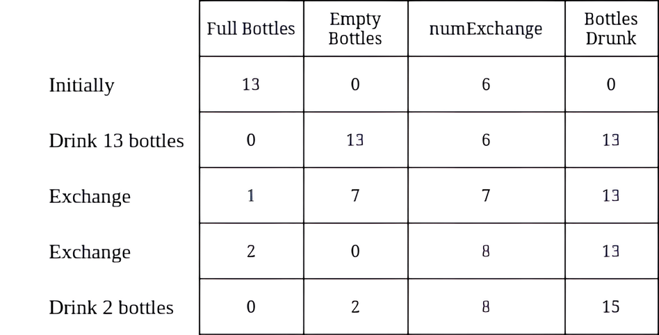
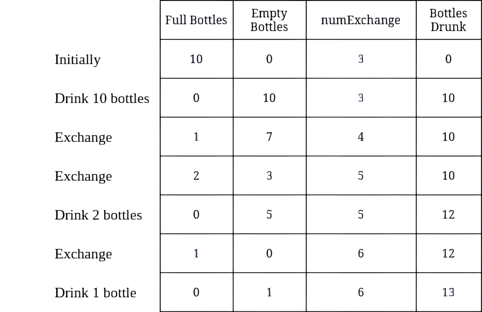

# 3100. 换水问题 II

Medium · [力扣原题](https://leetcode.cn/problems/water-bottles-ii/)

| 作者 | 题解 | 动画讲解 |
|---|---|---|
| 灵茶山艾府 | [📄 题解](灵茶山艾府.md) | [▶︎ 动画（GIF）](3100%20换水问题%20II%20·%20灵茶山艾府.gif) · [mp4 文件](3100%20换水问题%20II%20·%20灵茶山艾府.mp4) |
| yiduobo | [📄 题解](yiduobo.md) | [▶︎ 动画（GIF）](3100%20换水问题%20II%20·%20yiduobo.gif) · [mp4 文件](3100%20换水问题%20II%20·%20yiduobo.mp4) |

## 动画讲解

> 动图会循环播放；想暂停、拖进度条请下载上面表格里的 mp4 文件。

### 灵茶山艾府


### yiduobo


## 题目描述

给你两个整数 `numBottles` 和 `numExchange` 。

`numBottles` 代表你最初拥有的满水瓶数量。在一次操作中，你可以执行以下操作之一：

- 喝掉任意数量的满水瓶，使它们变成空水瓶。

- 用 `numExchange` 个空水瓶交换一个满水瓶。然后，将 `numExchange` 的值增加 1 。

注意，你不能使用相同的 `numExchange` 值交换多批空水瓶。例如，如果 `numBottles == 3` 并且 `numExchange == 1` ，则不能用 `3` 个空水瓶交换成 `3` 个满水瓶。

返回你 **最多** 可以喝到多少瓶水。

**示例 1：**



```

输入：numBottles = 13, numExchange = 6
输出：15
解释：上表显示了满水瓶的数量、空水瓶的数量、numExchange 的值，以及累计喝掉的水瓶数量。
```

**示例 2：**



```

输入：numBottles = 10, numExchange = 3
输出：13
解释：上表显示了满水瓶的数量、空水瓶的数量、numExchange 的值，以及累计喝掉的水瓶数量。
```

**提示：**

- `1 <= numBottles <= 100 `

- `1 <= numExchange <= 100`

---
[↑ 返回 3100-3199](../README.md) · [总索引](../../../索引.md) · [仓库首页](../../../README.md)
