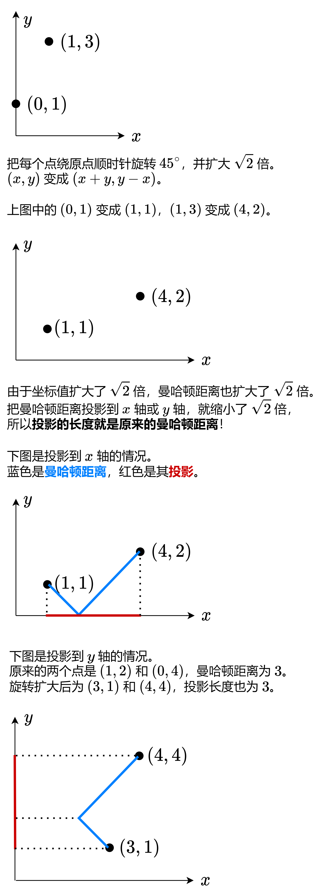

# 【图解】曼哈顿距离转切比雪夫距离（Python/Java/C++/Go）

> **[3102. 最小化曼哈顿距离](https://leetcode.cn/problems/minimize-manhattan-distances/solutions/2716755/tu-jie-man-ha-dun-ju-chi-heng-deng-shi-b-op84/) · Hard · 难度分 2216**

> **所属题单**
> - [数学算法 · 七、杂项](../../../刷题路径/灵神原版题单/数学算法/七、杂项.md) · §7.3 曼哈顿距离与切比雪夫距离

> **题目描述**
> 给你一个下标从 **0** 开始的数组 `points` ，它表示二维平面上一些点的整数坐标，其中 `points[i] = [x_i, y_i]` 。
>
> 两点之间的距离定义为它们的曼哈顿距离。
>
> 请你恰好移除一个点，返回移除后任意两点之间的 **最大** 距离可能的 **最小** 值。
>
> **示例 1：**
>
> ```
>
> 输入：points = [[3,10],[5,15],[10,2],[4,4]]
> 输出：12
> 解释：移除每个点后的最大距离如下所示：
> - 移除第 0 个点后，最大距离在点 (5, 15) 和 (10, 2) 之间，为 |5 - 10| + |15 - 2| = 18 。
> - 移除第 1 个点后，最大距离在点 (3, 10) 和 (10, 2) 之间，为 |3 - 10| + |10 - 2| = 15 。
> - 移除第 2 个点后，最大距离在点 (5, 15) 和 (4, 4) 之间，为 |5 - 4| + |15 - 4| = 12 。
> - 移除第 3 个点后，最大距离在点 (5, 15) 和 (10, 2) 之间的，为 |5 - 10| + |15 - 2| = 18 。
> 在恰好移除一个点后，任意两点之间的最大距离可能的最小值是 12 。
> ```
>
> **示例 2：**
>
> ```
>
> 输入：points = [[1,1],[1,1],[1,1]]
> 输出：0
> 解释：移除任一点后，任意两点之间的最大距离都是 0 。
> ```
>
> **提示：**
>
> - `3 <= points.length <= 10⁵`
>
> - `points[i].length == 2`
>
> - `1 <= points[i][0], points[i][1] <= 10⁸`

> **题解**
> 
>
> 这两种投影长度，其中较大者为曼哈顿距离（较小者是两段折线的投影长度**之差**，不合法），即如下恒等式
>
> $$
> |x_1 - x_2| + |y_1 - y_2| = \max(|x_1'-x_2'|,|y_1'-y_2'|)
> $$
>
> 其中等式左侧为 $(x_1,y_1)$ 和 $(x_2,y_2)$ 的**曼哈顿距离**，等式右侧 $(x',y') = (x+y,y-x)$，计算的是 $(x_1',y_1')$ 和 $(x_2',y_2')$ 两点的曼哈顿距离投影到 $x$ 轴和 $y$ 轴的线段长度的最大值，即**切比雪夫距离**。
>
> 所以要求任意两点曼哈顿距离的最大值，根据上面的恒等式，我们只需要计算任意两个 $(x',y')$ 切比雪夫距离的最大值，即横纵坐标差的最大值
>
> $$
> \max\{\max(x') - \min(x'), \max(y') - \min(y')\}
> $$
>
> 请看 [视频讲解](https://www.bilibili.com/video/BV1fq421A7CY/) 第四题，欢迎点赞关注！
>
> ## 方法一：有序集合
>
> 枚举要移除的点，用两个**有序集合**维护其他 $n-1$ 个点的 $x'$ 和 $y'$，用 $\max\{\max(x') - \min(x'), \max(y') - \min(y')\}$ 更新答案的最大值。
>
> ```python
> from sortedcontainers import SortedList
>
> class Solution:
>     def minimumDistance(self, points: List[List[int]]) -> int:
>         xs = SortedList()
>         ys = SortedList()
>         for x, y in points:
>             xs.add(x + y)
>             ys.add(y - x)
>
>         ans = inf
>         for x, y in points:
>             x, y = x + y, y - x
>             xs.remove(x)
>             ys.remove(y)
>             ans = min(ans, max(xs[-1] - xs[0], ys[-1] - ys[0]))
>             xs.add(x)
>             ys.add(y)
>         return ans
> ```
>
>
> #### 复杂度分析
>
> - 时间复杂度：$\mathcal{O}(n\log n)$，其中 $n$ 为 $\textit{points}$ 的长度。
> - 空间复杂度：$\mathcal{O}(n)$。
>
> ## 方法二：维护最大次大、最小次小
>
> 优化：如果把最大的 $x'$ 移除，那么次大的 $x'$ 就是剩下 $n-1$ 个 $x'$ 中的最大值了，对于最小值也同理。
>
> 所以只需维护 $x'$ 和 $y'$ 的最大次大、最小次小，一共 $8$ 个数。
>
> 注意最大次大可能是相同的，最小次小可能是相同的。
>
> ```python
> class Solution:
>     def minimumDistance(self, points: List[List[int]]) -> int:
>         max_x1, max_x2 = nlargest(2, (x + y for x, y in points))   # x 最大次大
>         min_x1, min_x2 = nsmallest(2, (x + y for x, y in points))  # x 最小次小
>         max_y1, max_y2 = nlargest(2, (y - x for x, y in points))   # y 最大次大
>         min_y1, min_y2 = nsmallest(2, (y - x for x, y in points))  # y 最小次小
>
>         ans = inf
>         for x, y in points:
>             x, y = x + y, y - x
>             dx = (max_x2 if x == max_x1 else max_x1) - (min_x2 if x == min_x1 else min_x1)
>             dy = (max_y2 if y == max_y1 else max_y1) - (min_y2 if y == min_y1 else min_y1)
>             ans = min(ans, max(dx, dy))
>         return ans
> ```
>
> > [!example]- Python3 手动维护
> > ```python
> > class Solution:
> >     def minimumDistance(self, points: List[List[int]]) -> int:
> >         max_x1 = max_x2 = max_y1 = max_y2 = -inf
> >         min_x1 = min_x2 = min_y1 = min_y2 = inf
> >
> >         for x, y in points:
> >             x, y = x + y, y - x
> >
> >             # x 最大次大
> >             if x > max_x1:
> >                 max_x2 = max_x1
> >                 max_x1 = x
> >             elif x > max_x2:
> >                 max_x2 = x
> >
> >             # x 最小次小
> >             if x < min_x1:
> >                 min_x2 = min_x1
> >                 min_x1 = x
> >             elif x < min_x2:
> >                 min_x2 = x
> >
> >             # y 最大次大
> >             if y > max_y1:
> >                 max_y2 = max_y1
> >                 max_y1 = y
> >             elif y > max_y2:
> >                 max_y2 = y
> >
> >             # y 最小次小
> >             if y < min_y1:
> >                 min_y2 = min_y1
> >                 min_y1 = y
> >             elif y < min_y2:
> >                 min_y2 = y
> >
> >         ans = inf
> >         for x, y in points:
> >             x, y = x + y, y - x
> >             dx = (max_x2 if x == max_x1 else max_x1) - (min_x2 if x == min_x1 else min_x1)
> >             dy = (max_y2 if y == max_y1 else max_y1) - (min_y2 if y == min_y1 else min_y1)
> >             ans = min(ans, max(dx, dy))
> >         return ans
> > ```
>
>
> 进一步地，要移除的点只能是 $x'$ 或 $y'$ 最大最小的点（不然移除前后都一样），所以额外维护最大最小值的**下标**，一共 $4$ 个，最后只需遍历这 $4$ 个坐标，而不是遍历整个 $\textit{points}$ 数组。
>
> ```python
> class Solution:
>     def minimumDistance(self, points: List[List[int]]) -> int:
>         max_x1 = max_x2 = max_y1 = max_y2 = -inf
>         min_x1 = min_x2 = min_y1 = min_y2 = inf
>         max_xi = min_xi = max_yi = min_yi = 0
>
>         for i, (x, y) in enumerate(points):
>             x, y = x + y, y - x
>
>             # x 最大次大
>             if x > max_x1:
>                 max_x2 = max_x1
>                 max_x1 = x
>                 max_xi = i
>             elif x > max_x2:
>                 max_x2 = x
>
>             # x 最小次小
>             if x < min_x1:
>                 min_x2 = min_x1
>                 min_x1 = x
>                 min_xi = i
>             elif x < min_x2:
>                 min_x2 = x
>
>             # y 最大次大
>             if y > max_y1:
>                 max_y2 = max_y1
>                 max_y1 = y
>                 max_yi = i
>             elif y > max_y2:
>                 max_y2 = y
>
>             # y 最小次小
>             if y < min_y1:
>                 min_y2 = min_y1
>                 min_y1 = y
>                 min_yi = i
>             elif y < min_y2:
>                 min_y2 = y
>
>         ans = inf
>         for i in max_xi, min_xi, max_yi, min_yi:
>             dx = (max_x2 if i == max_xi else max_x1) - (min_x2 if i == min_xi else min_x1)
>             dy = (max_y2 if i == max_yi else max_y1) - (min_y2 if i == min_yi else min_y1)
>             ans = min(ans, max(dx, dy))
>         return ans
> ```
>
>
> #### 复杂度分析
>
> - 时间复杂度：$\mathcal{O}(n)$，其中 $n$ 为 $\textit{points}$ 的长度。
> - 空间复杂度：$\mathcal{O}(1)$。仅用到若干额外变量。
>
> ## 思考题
>
> 如果题目求的是**欧氏距离**，要怎么做？
>
> > 关键词：凸包、旋转卡壳。
>
> ## 相似题目
>
> - [1330. 翻转子数组得到最大的数组值](https://leetcode.cn/problems/reverse-subarray-to-maximize-array-value/)
> - [1131. 绝对值表达式的最大值](https://leetcode.cn/problems/maximum-of-absolute-value-expression/)
>
> ## 分类题单
>
> 以下题单没有特定的顺序，可以按照个人喜好刷题。
>
> 1. [滑动窗口（定长/不定长/多指针）](https://leetcode.cn/circle/discuss/0viNMK/)
> 2. [二分算法（二分答案/最小化最大值/最大化最小值/第K小）](https://leetcode.cn/circle/discuss/SqopEo/)
> 3. [单调栈（基础/矩形面积/贡献法/最小字典序）](https://leetcode.cn/circle/discuss/9oZFK9/)
> 4. [网格图（DFS/BFS/综合应用）](https://leetcode.cn/circle/discuss/YiXPXW/)
> 5. [位运算（基础/性质/拆位/试填/恒等式/贪心/脑筋急转弯）](https://leetcode.cn/circle/discuss/dHn9Vk/)
> 6. [图论算法（DFS/BFS/拓扑排序/最短路/最小生成树/二分图/基环树/欧拉路径）](https://leetcode.cn/circle/discuss/01LUak/)
> 7. [动态规划（入门/背包/状态机/划分/区间/状压/数位/数据结构优化/树形/博弈/概率期望）](https://leetcode.cn/circle/discuss/tXLS3i/)
> 8. [常用数据结构（前缀和/差分/栈/队列/堆/字典树/并查集/树状数组/线段树）](https://leetcode.cn/circle/discuss/mOr1u6/)
> 9. [数学算法（数论/组合/概率期望/博弈/计算几何/随机算法）](https://leetcode.cn/circle/discuss/IYT3ss/)
> 10. [贪心算法（基本贪心策略/反悔/区间/字典序/数学/思维/构造）](https://leetcode.cn/circle/discuss/g6KTKL/)
>
> [我的题解精选（已分类）](https://github.com/EndlessCheng/codeforces-go/blob/master/leetcode/SOLUTIONS.md)
>
> 欢迎关注 [B站@灵茶山艾府](https://space.bilibili.com/206214)
