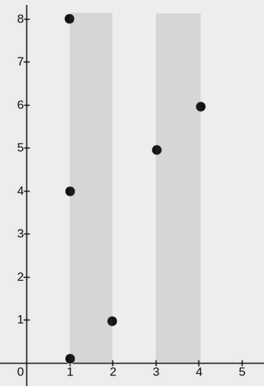
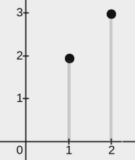

# 3111. 覆盖所有点的最少矩形数目

Medium · 难度分 1401 · [力扣原题](https://leetcode.cn/problems/minimum-rectangles-to-cover-points/)

所在刷题路径：灵神题单·贪心与思维

| 作者 | 题解 | 动画讲解 |
|---|---|---|
| 灵茶山艾府 | [📄 题解](灵茶山艾府.md) | [▶︎ 3111 覆盖所有点的最少矩形数目 · 灵茶山艾府.mp4](3111%20覆盖所有点的最少矩形数目%20·%20灵茶山艾府.mp4) |
| yiduobo | [📄 题解](yiduobo.md) | [▶︎ 3111 覆盖所有点的最少矩形数目 · yiduobo.mp4](3111%20覆盖所有点的最少矩形数目%20·%20yiduobo.mp4) |

## 题目描述

给你一个二维整数数组 `point` ，其中 `points[i] = [x_i, y_i]` 表示二维平面内的一个点。同时给你一个整数 `w` 。你需要用矩形 **覆盖所有** 点。

每个矩形的左下角在某个点 `(x₁, 0)` 处，且右上角在某个点 `(x₂, y₂)` 处，其中 `x₁ <= x₂` 且 `y₂ >= 0` ，同时对于每个矩形都 **必须** 满足 `x₂ - x₁ <= w` 。

如果一个点在矩形内或者在边上，我们说这个点被矩形覆盖了。

请你在确保每个点都 **至少** 被一个矩形覆盖的前提下，**最少** 需要多少个矩形。

**注意：**一个点可以被多个矩形覆盖。

**示例 1：**

**输入：**`points = [[2,1],[1,0],[1,4],[1,8],[3,5],[4,6]], w = 1`

**输出：**`2`

**解释：**

上图展示了一种可行的矩形放置方案：

- 一个矩形的左下角在 `(1, 0)` ，右上角在 `(2, 8)` 。

- 一个矩形的左下角在 `(3, 0)` ，右上角在 `(4, 8)` 。

**示例 2：**

**输入：**`points = [[0,0],[1,1],[2,2],[3,3],[4,4],[5,5],[6,6]], w = 2`

**输出：**`3`

**解释：**

上图展示了一种可行的矩形放置方案：

- 一个矩形的左下角在 `(0, 0)` ，右上角在 `(2, 2)` 。

- 一个矩形的左下角在 `(3, 0)` ，右上角在 `(5, 5)` 。

- 一个矩形的左下角在 `(6, 0)` ，右上角在 `(6, 6)` 。

**示例 3：**

**输入：**`points = [[2,3],[1,2]], w = 0`

**输出：**`2`

**解释：**

上图展示了一种可行的矩形放置方案：

- 一个矩形的左下角在 `(1, 0)` ，右上角在 `(1, 2)` 。

- 一个矩形的左下角在 `(2, 0)` ，右上角在 `(2, 3)` 。

**提示：**

- `1 <= points.length <= 10⁵`

- `points[i].length == 2`

- `0 <= x_i == points[i][0] <= 10⁹`

- `0 <= y_i == points[i][1] <= 10⁹`

- `0 <= w <= 10⁹`

- 所有点坐标 `(x_i, y_i)` 互不相同。

---
[↑ 返回 3100-3199](../README.md) · [总索引](../../../索引.md) · [仓库首页](../../../README.md)
