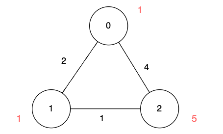
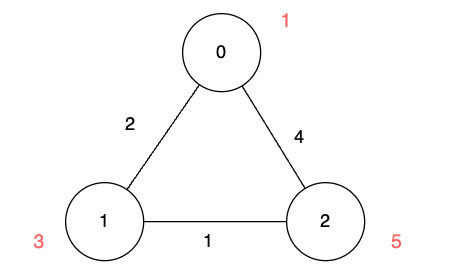

# Dijkstra 算法（Python/Java/C++/Go/JS/Rust）

> **[3112. 访问消失节点的最少时间](https://leetcode.cn/problems/minimum-time-to-visit-disappearing-nodes/solutions/2738888/dijkstra-suan-fa-pythonjavacgo-by-endles-7q6u/) · Medium · 难度分 1757**

> **所属题单**
> - [图论算法 · 三、最短路](../../../刷题路径/灵神原版题单/图论算法/三、最短路.md) · §3.1 单源最短路：Dijkstra 算法

> **题目描述**
> 给你一个二维数组 `edges` 表示一个 `n` 个点的无向图，其中 `edges[i] = [u_i, v_i, length_i]` 表示节点 `u_i` 和节点 `v_i` 之间有一条需要 `length_i` 单位时间通过的无向边。
>
> 同时给你一个数组 `disappear` ，其中 `disappear[i]` 表示节点 `i` 从图中消失的时间点，在那一刻及以后，你无法再访问这个节点。
>
> **注意**，图有可能一开始是不连通的，两个节点之间也可能有多条边。
>
> 请你返回数组 `answer` ，`answer[i]` 表示从节点 `0` 到节点 `i` 需要的 **最少** 单位时间。如果从节点 `0` 出发 **无法** 到达节点 `i` ，那么 `answer[i]` 为 `-1` 。
>
> **示例 1：**
>
> 
>
> **输入：**`n = 3, edges = [[0,1,2],[1,2,1],[0,2,4]], disappear = [1,1,5]`
>
> **输出：**`[0,-1,4]`
>
> **解释：**
>
> 我们从节点 0 出发，目的是用最少的时间在其他节点消失之前到达它们。
>
> - 对于节点 0 ，我们不需要任何时间，因为它就是我们的起点。
>
> - 对于节点 1 ，我们需要至少 2 单位时间，通过 `edges[0]` 到达。但当我们到达的时候，它已经消失了，所以我们无法到达它。
>
> - 对于节点 2 ，我们需要至少 4 单位时间，通过 `edges[2]` 到达。
>
> **示例 2：**
>
> 
>
> **输入：**`n = 3, edges = [[0,1,2],[1,2,1],[0,2,4]], disappear = [1,3,5]`
>
> **输出：**`[0,2,3]`
>
> **解释：**
>
> 我们从节点 0 出发，目的是用最少的时间在其他节点消失之前到达它们。
>
> - 对于节点 0 ，我们不需要任何时间，因为它就是我们的起点。
>
> - 对于节点 1 ，我们需要至少 2 单位时间，通过 `edges[0]` 到达。
>
> - 对于节点 2 ，我们需要至少 3 单位时间，通过 `edges[0]` 和 `edges[1]` 到达。
>
> **示例 3：**
>
> **输入：**`n = 2, edges = [[0,1,1]], disappear = [1,1]`
>
> **输出：**`[0,-1]`
>
> **解释：**
>
> 当我们到达节点 1 的时候，它恰好消失，所以我们无法到达节点 1 。
>
> **提示：**
>
> - `1 <= n <= 5 * 10⁴`
>
> - `0 <= edges.length <= 10⁵`
>
> - `edges[i] == [u_i, v_i, length_i]`
>
> - `0 <= u_i, v_i <= n - 1`
>
> - `1 <= length_i <= 10⁵`
>
> - `disappear.length == n`
>
> - `1 <= disappear[i] <= 10⁵`

> **题解**
> **请先阅读** [Dijkstra 算法介绍](../../0700-0799/0743%20网络延迟时间/灵茶山艾府.md)。
>
> 对于本题，$\textit{answer}$ 几乎就是 $\textit{dis}$ 数组。只需要在 Dijkstra 算法的过程中，添加一个判断：
>
> - 在更新最短路之前，如果最短路长度 $\ge \textit{disappear}[i]$，说明无法及时到达节点 $i$，不更新。
>
> 请看 [视频讲解](https://www.bilibili.com/video/BV1et42177VM/) 第三题，欢迎点赞关注！
>
> ### 答疑
>
> **问**：我是这样做的，先不管 $\textit{disappear}$，用 Dijkstra 算法模板求出 $\textit{dis}$ 数组，然后把其中 $\textit{dis}[i]\ge \textit{disappear}[i]$ 的 $\textit{dis}[i]$ 改成 $-1$。这个做法是否正确？
>
> **答**：这个做法是错的。考虑这样的数据：离节点 $0$ 近的节点 $x$，其 $\textit{disappear}[x]$ 很小；离节点 $0$ 远的节点 $y$，其 $\textit{disappear}[y]$ 很大。由于 $\textit{disappear}[x]$ 很小，我们无法通过节点 $x$，所以远处的节点 $y$ 实际上也无法到达。但错误做法会因为 $\textit{dis}[y] < \textit{disappear}[y]$，误认为节点 $y$ 可以到达，最终返回错误的答案。
>
> ```python
> class Solution:
>     def minimumTime(self, n: int, edges: List[List[int]], disappear: List[int]) -> List[int]:
>         g = [[] for _ in range(n)]  # 稀疏图用邻接表
>         for x, y, wt in edges:
>             g[x].append((y, wt))
>             g[y].append((x, wt))
>
>         dis = [-1] * n
>         dis[0] = 0
>         h = [(0, 0)]
>         while h:
>             dx, x = heappop(h)
>             if dx > dis[x]:  # x 之前出堆过
>                 continue
>             for y, wt in g[x]:
>                 new_dis = dx + wt
>                 if new_dis < disappear[y] and (dis[y] < 0 or new_dis < dis[y]):
>                     dis[y] = new_dis  # 更新 x 的邻居的最短路
>                     heappush(h, (new_dis, y))
>         return dis
> ```
>
>
> #### 复杂度分析
>
> - 时间复杂度：$\mathcal{O}(n+m\log m)$，其中 $m$ 为 $\textit{edges}$ 的长度。注意堆中会有重复节点，所以至多有 $\mathcal{O}(m)$ 个元素，单次操作的复杂度是 $\mathcal{O}(\log m)$，不是 $\mathcal{O}(\log n)$。
> - 空间复杂度：$\mathcal{O}(n+m)$。
>
> ## 分类题单
>
> [如何科学刷题？](https://leetcode.cn/circle/discuss/RvFUtj/)
>
> 1. [滑动窗口与双指针（定长/不定长/单序列/双序列/三指针/分组循环）](https://leetcode.cn/circle/discuss/0viNMK/)
> 2. [二分算法（二分答案/最小化最大值/最大化最小值/第K小）](https://leetcode.cn/circle/discuss/SqopEo/)
> 3. [单调栈（基础/矩形面积/贡献法/最小字典序）](https://leetcode.cn/circle/discuss/9oZFK9/)
> 4. [网格图（DFS/BFS/综合应用）](https://leetcode.cn/circle/discuss/YiXPXW/)
> 5. [位运算（基础/性质/拆位/试填/恒等式/思维）](https://leetcode.cn/circle/discuss/dHn9Vk/)
> 6. [图论算法（DFS/BFS/拓扑排序/基环树/最短路/最小生成树/网络流）](https://leetcode.cn/circle/discuss/01LUak/)
> 7. [动态规划（入门/背包/划分/状态机/区间/状压/数位/数据结构优化/树形/博弈/概率期望）](https://leetcode.cn/circle/discuss/tXLS3i/)
> 8. [常用数据结构（前缀和/差分/栈/队列/堆/字典树/并查集/树状数组/线段树）](https://leetcode.cn/circle/discuss/mOr1u6/)
> 9. [数学算法（数论/组合/概率期望/博弈/计算几何/随机算法）](https://leetcode.cn/circle/discuss/IYT3ss/)
> 10. [贪心与思维（基本贪心策略/反悔/区间/字典序/数学/思维/脑筋急转弯/构造）](https://leetcode.cn/circle/discuss/g6KTKL/)
> 11. [链表、二叉树与回溯（前后指针/快慢指针/DFS/BFS/直径/LCA/一般树）](https://leetcode.cn/circle/discuss/K0n2gO/)
> 12. [字符串（KMP/Z函数/Manacher/字符串哈希/AC自动机/后缀数组/子序列自动机）](https://leetcode.cn/circle/discuss/SJFwQI/)
>
> [我的题解精选（已分类）](https://github.com/EndlessCheng/codeforces-go/blob/master/leetcode/SOLUTIONS.md)
>
> 欢迎关注 [B站@灵茶山艾府](https://space.bilibili.com/206214)
