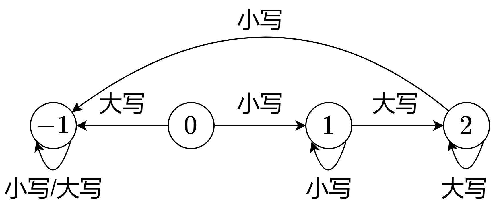

# 两种方法：状态机 / 位运算（Python/Java/C++/Go）

> **[3121. 统计特殊字母的数量 II](https://leetcode.cn/problems/count-the-number-of-special-characters-ii/solutions/2749235/zhuang-tai-ji-on-yi-ci-bian-li-pythonjav-ajaz/) · Medium**

> **题目描述**
> 给你一个字符串 `word`。如果 `word` 中同时出现某个字母 `c` 的小写形式和大写形式，并且 **每个** 小写形式的 `c` 都出现在第一个大写形式的 `c` 之前，则称字母 `c` 是一个 **特殊字母** 。
>
> 返回 `word` 中 **特殊字母** 的数量。
>
> **示例 1:**
>
> **输入：**`word = "aaAbcBC"`
>
> **输出：**`3`
>
> **解释：**
>
> 特殊字母是 `'a'`、`'b'` 和 `'c'`。
>
> **示例 2:**
>
> **输入：**`word = "abc"`
>
> **输出：**`0`
>
> **解释：**
>
> `word` 中不存在特殊字母。
>
> **示例 3:**
>
> **输入：**`word = "AbBCab"`
>
> **输出：**`0`
>
> **解释：**
>
> `word` 中不存在特殊字母。
>
> **提示：**
>
> - `1 <= word.length <= 2 * 10⁵`
>
> - `word` 仅由小写和大写英文字母组成。

> **题解**
> ## 分析
>
> 对于同一种字母，其所有小写形式都必须在其所有大写形式之前。例如所有的 $\texttt{a}$ 都必须在所有的 $\texttt{A}$ 左边。
>
> 这意味着，在遍历字符串 $\textit{word}$ 的过程中，对于同一种字母，一定要先遍历到其小写形式，再遍历到其大写形式，且遇到大写形式后，不能再遍历到其小写形式。
>
> ## 方法一：状态机（一次遍历）
>
> 对于每种字母，定义如下四种状态：
>
> - $0$：初始状态。如果遇到小写字母，转到状态 $1$，否则不合法，转到状态 $-1$。
> - $1$：如果遇到小写字母则不变，遇到大写字母则转到状态 $2$。
> - $2$：如果遇到大写字母则不变，遇到小写字母则转到状态 $-1$。
> - $-1$：遇到任何字母都不再变化。
>
> {:width=500px}
>
> 答案为状态为 $2$ 的字母种数。注意题目要求同一种字母的大小写形式都得有。
>
> 附 ASCII 字符的性质：
>
> - 对于大写英文字母：二进制从右往左第 $6$ 个比特一定是 $0$。
> - 对于小写英文字母：二进制从右往左第 $6$ 个比特一定是 $1$。
> - 对于任何英文字母：小写字母的二进制低 $5$ 位，等于其大写字母的二进制低 $5$ 位。
>
> [本题视频讲解](https://www.bilibili.com/video/BV1gu4m1F7B8/?t=8m21s)，欢迎点赞关注~
>
> ```python
> class Solution:
>     def numberOfSpecialChars(self, word: str) -> int:
>         ans = 0
>         state = [0] * 27
>         for c in map(ord, word):
>             x = c & 31  # 转成数字 1~26
>             if c & 32:  # 小写字母
>                 if state[x] == 0:
>                     state[x] = 1
>                 elif state[x] == 2:  # 大写的后面不能有小写
>                     state[x] = -1
>                     ans -= 1
>             else:  # 大写字母
>                 if state[x] == 0:  # 还没遇到小写，就先遇到大写了
>                     state[x] = -1
>                 elif state[x] == 1:
>                     state[x] = 2
>                     ans += 1
>         return ans
> ```
>
>
> #### 复杂度分析
>
> - 时间复杂度：$\mathcal{O}(n+|\Sigma|)$，其中 $n$ 是 $\textit{word}$ 的长度，$|\Sigma|=26$ 为字符集合的大小。注意创建大小为 $\mathcal{O}(|\Sigma|)$ 的数组需要 $\mathcal{O}(|\Sigma|)$ 时间。
> - 空间复杂度：$\mathcal{O}(|\Sigma|)$。
>
> ## 方法二：位运算（一次遍历）
>
> 把小写字母加到集合 $\textit{lower}$ 中，大写字母（转成小写后）加到集合 $\textit{upper}$ 中。
>
> 如果遍历到小写字母 $c$ 时，发现 $c$ 也在 $\textit{upper}$ 中，说明大写字母在小写字母的左边，那么把 $c$ 加到集合 $\textit{invalid}$ 中。
>
> 最后计算 $\textit{lower}$ 和 $\textit{upper}$ 的交集，并从交集中去掉 $\textit{invalid}$ 中的元素，剩下的元素个数即为答案。
>
> 代码实现时，用二进制表示集合，用位运算实现集合操作，具体请看 [从集合论到位运算，常见位运算技巧分类总结](https://leetcode.cn/circle/discuss/CaOJ45/)。
>
> ```python
> # 不用位运算的写法见【Python3 set】
> class Solution:
>     def numberOfSpecialChars(self, word: str) -> int:
>         lower = upper = invalid = 0
>         for c in map(ord, word):
>             bit = 1 << (c & 31)
>             if c & 32:  # 小写字母
>                 lower |= bit
>                 if upper & bit:  # c 也在 upper 中
>                     invalid |= bit  # 不合法
>             else:  # 大写字母
>                 upper |= bit
>         # 从 lower 和 upper 的交集中去掉不合法的字母 invalid
>         return (lower & upper & ~invalid).bit_count()
> ```
>
> > [!example]- Python3 set
> > ```python
> > class Solution:
> >     def numberOfSpecialChars(self, word: str) -> int:
> >         lower = set()
> >         upper = set()
> >         invalid = set()
> >         for c in word:
> >             if c.islower():  # 小写字母
> >                 lower.add(c)
> >                 if c in upper:  # 大写的后面不能有小写
> >                     invalid.add(c)  # 不合法
> >             else:  # 大写字母
> >                 upper.add(c.lower())
> >         # 从 lower 和 upper 的交集中去掉不合法的字母 invalid
> >         return len((lower & upper) - invalid)
> > ```
>
>
> #### 复杂度分析
>
> - 时间复杂度：$\mathcal{O}(n)$，其中 $n$ 是 $\textit{word}$ 的长度。
> - 空间复杂度：$\mathcal{O}(1)$。
>
> ## 分类题单
>
> [如何科学刷题？](https://leetcode.cn/circle/discuss/RvFUtj/)
>
> 1. [滑动窗口与双指针（定长/不定长/单序列/双序列/三指针/分组循环）](https://leetcode.cn/circle/discuss/0viNMK/)
> 2. [二分算法（二分答案/最小化最大值/最大化最小值/第K小）](https://leetcode.cn/circle/discuss/SqopEo/)
> 3. [单调栈（基础/矩形面积/贡献法/最小字典序）](https://leetcode.cn/circle/discuss/9oZFK9/)
> 4. [网格图（DFS/BFS/综合应用）](https://leetcode.cn/circle/discuss/YiXPXW/)
> 5. [位运算（基础/性质/拆位/试填/恒等式/思维）](https://leetcode.cn/circle/discuss/dHn9Vk/)
> 6. [图论算法（DFS/BFS/拓扑排序/基环树/最短路/最小生成树/网络流）](https://leetcode.cn/circle/discuss/01LUak/)
> 7. [动态规划（入门/背包/划分/状态机/区间/状压/数位/数据结构优化/树形/博弈/概率期望）](https://leetcode.cn/circle/discuss/tXLS3i/)
> 8. [常用数据结构（前缀和/差分/栈/队列/堆/字典树/并查集/树状数组/线段树）](https://leetcode.cn/circle/discuss/mOr1u6/)
> 9. [数学算法（数论/组合/概率期望/博弈/计算几何/随机算法）](https://leetcode.cn/circle/discuss/IYT3ss/)
> 10. [贪心与思维（基本贪心策略/反悔/区间/字典序/数学/思维/脑筋急转弯/构造）](https://leetcode.cn/circle/discuss/g6KTKL/)
> 11. [链表、树与回溯（前后指针/快慢指针/DFS/BFS/直径/LCA）](https://leetcode.cn/circle/discuss/K0n2gO/)
> 12. [字符串（KMP/Z函数/Manacher/字符串哈希/AC自动机/后缀数组/子序列自动机）](https://leetcode.cn/circle/discuss/SJFwQI/)
>
> [我的题解精选（已分类）](https://github.com/EndlessCheng/codeforces-go/blob/master/leetcode/SOLUTIONS.md)
>
> 欢迎关注 [B站@灵茶山艾府](https://space.bilibili.com/206214)
