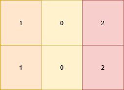
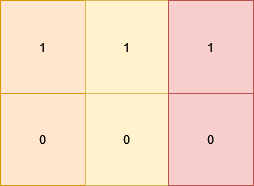
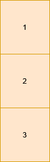

# 两种方法：记忆化搜索/递推（Python/Java/C++/Go）

> **[3122. 使矩阵满足条件的最少操作次数](https://leetcode.cn/problems/minimum-number-of-operations-to-satisfy-conditions/solutions/2749283/ji-yi-hua-sou-suo-pythonjavacgo-by-endle-8i0e/) · Medium · 难度分 1905**

> **所属题单**
> - [动态规划 · 七、其他线性 DP](../../../刷题路径/灵神原版题单/动态规划/七、其他线性%20DP.md) · §7.6 多维 DP

> **题目描述**
> 给你一个大小为 `m x n` 的二维矩形 `grid` 。每次 **操作** 中，你可以将 **任一** 格子的值修改为 **任意** 非负整数。完成所有操作后，你需要确保每个格子 `grid[i][j]` 的值满足：
>
> - 如果下面相邻格子存在的话，它们的值相等，也就是 `grid[i][j] == grid[i + 1][j]`（如果存在）。
>
> - 如果右边相邻格子存在的话，它们的值不相等，也就是 `grid[i][j] != grid[i][j + 1]`（如果存在）。
>
> 请你返回需要的 **最少** 操作数目。
>
> **示例 1：**
>
> **输入：**`grid = [[1,0,2],[1,0,2]]`
>
> **输出：**0
>
> **解释：**
>
> 
>
> 矩阵中所有格子已经满足要求。
>
> **示例 2：**
>
> **输入：**`grid = [[1,1,1],[0,0,0]]`
>
> **输出：**3
>
> **解释：**
>
> 
>
> 将矩阵变成 `[[1,0,1],[1,0,1]]` ，它满足所有要求，需要 3 次操作：
>
> - 将 `grid[1][0]` 变为 1 。
>
> - 将 `grid[0][1]` 变为 0 。
>
> - 将 `grid[1][2]` 变为 1 。
>
> **示例 3：**
>
> **输入：**`grid = [[1],[2],[3]]`
>
> **输出：**2
>
> **解释：**
>
> 
>
> 这个矩阵只有一列，我们可以通过 2 次操作将所有格子里的值变为 1 。
>
> **提示：**
>
> - `1 <= n, m <= 1000`
>
> - `0 <= grid[i][j] <= 9`

> **题解**
> 请看 [视频讲解](https://www.bilibili.com/video/BV1gu4m1F7B8/) 第三题，欢迎点赞关注~
>
> ## 方法一：记忆化搜索
>
> 反向思考，计算**保留多少个数不变**。用 $mn$ 减去最多保留不变的元素个数，就是最少需要修改的元素个数。
>
> 首先统计每一列的每种元素的出现次数到 $\textit{cnt}$ 数组中，其中 $\textit{cnt}[i][x]$ 表示第 $i$ 列元素 $x$ 的出现次数。
>
> 对于第 $i$ 列，我们需要知道上一列都变成了什么数，比如上一列都变成了 $1$，那么第 $i$ 列就必须都变成不等于 $1$ 的数，比如 $2$，那么第 $i$ 列就可以保留 $\textit{cnt}[i][2]$ 个元素不变。
>
> 枚举每一列变成哪个数，就可以枚举到所有的情况。
>
> 定义 $\textit{dfs}(i,j)$ 表示考虑前 $i$ 列，且第 $i+1$ 列都变成 $j$ 时的最大保留不变元素个数。
>
> 用「枚举选哪个」思考。枚举第 $i$ 列的元素都变成 $k$，则有
>
> $$
> \textit{dfs}(i,j) = \max\limits_{k} \textit{dfs}(i-1,k) + \textit{cnt}[i][k]
> $$
>
> 在 $[0,9]$ 中枚举不等于 $j$ 的 $k$，取最大值即为 $\textit{dfs}(i,j)$。
>
> 递归边界：$\textit{dfs}(-1,j) = 0$。
>
> 答案：$mn - \textit{dfs}(n-1,10)$。注意初始 $j$ 是一个不在 $[0,9]$ 中的数。
>
> 关于**记忆化搜索**，请看 [动态规划入门：从记忆化搜索到递推](https://www.bilibili.com/video/BV1Xj411K7oF/)，其中包含如何把记忆化搜索 1:1 翻译成递推的技巧。
>
> ```python
> class Solution:
>     def minimumOperations(self, grid: List[List[int]]) -> int:
>         m, n = len(grid), len(grid[0])
>         cnt = [[0] * 10 for _ in range(n)]
>         for row in grid:
>             for j, x in enumerate(row):
>                 cnt[j][x] += 1
>
>         @cache
>         def dfs(i: int, j: int) -> int:
>             if i < 0:
>                 return 0
>             return max(dfs(i - 1, k) + c for k, c in enumerate(cnt[i]) if k != j)
>
>         return m * n - dfs(n - 1, 10)
> ```
>
>
> #### 复杂度分析
>
> - 时间复杂度：$\mathcal{O}(mn + nU^2)$，其中 $m$ 和 $n$ 分别为 $\textit{grid}$ 的行数和列数，$U$ 为元素种类数，即 $10$。由于每个状态只会计算一次，动态规划的时间复杂度 $=$ 状态个数 $\times$ 单个状态的计算时间。本题状态个数等于 $\mathcal{O}(nU)$，单个状态的计算时间为 $\mathcal{O}(U)$，所以动态规划的时间复杂度为 $\mathcal{O}(nU^2)$。
> - 空间复杂度：$\mathcal{O}(nU)$。
>
> ## 方法二：递推 + 优化
>
> 从左到右一列一列地递推。
>
> 定义：
>
> - 前 $i-1$ 列的**最优解**是在第 $i-1$ 列保留元素 $\textit{pre}$，注意最优解保留元素 $\textit{pre}$，并不意味着 $\textit{pre}$ 是第 $i-1$ 列出现次数最多的元素。
> - 第 $i-1$ 列在保留元素 $\textit{pre}$ 时，前 $i-1$ 列最多保留 $f_0$ 个元素（**最优解**）。
> - 第 $i-1$ 列在不保留元素 $\textit{pre}$ 时，前 $i-1$ 列最多保留 $f_1$ 个元素（**次优解**）。
>
> 枚举第 $i$ 列保留元素 $v$：
>
> - 如果 $v\ne \textit{pre}$，那么从最优解 $f_0$ 转移过来，加上 $v$ 的出现次数。
> - 如果 $v= \textit{pre}$，那么从次优解 $f_1$ 转移过来，加上 $v$ 的出现次数。
> - 这个过程中更新前 $i$ 列的最优解和次优解。
>
> 答案为 $mn$ 减去前 $n$ 列的 $f_0$。
>
> 对于 Python，在代码实现时，考虑到第 $i$ 列可能只有一种元素 $v$，如果 $v=\textit{pre}$ 那么我们只会从次优解 $f_1$ 转移过来，忽略了最优解。我们可以选择不保留任何数字（都变成 $-1$），这样就可以从最优解 $f_0$ 转移过来。其它语言由于枚举的是 $[0,9]$，一定存在从最优解转移的情况。
>
> ```python
> class Solution:
>     def minimumOperations(self, grid: List[List[int]]) -> int:
>         f0, f1, pre = 0, 0, -1
>         for col in zip(*grid):
>             mx, mx2, x = f0, 0, -1  # 不保留任何数字
>             for v, c in Counter(col).items():
>                 res = (f0 if v != pre else f1) + c  # 保留元素 v
>                 if res > mx:  # 更新最优解和次优解
>                     mx, mx2, x = res, mx, v
>                 elif res > mx2:  # 更新次优解
>                     mx2 = res
>             f0, f1, pre = mx, mx2, x
>         return len(grid) * len(grid[0]) - f0
> ```
>
>
> #### 复杂度分析
>
> - 时间复杂度：$\mathcal{O}(mn)$ 或 $\mathcal{O}(n(m + U))$，其中 $m$ 和 $n$ 分别为 $\textit{grid}$ 的行数和列数，$U$ 为元素种类数，至多为 $10$。Python 使用的是哈希表，所以时间复杂度为 $\mathcal{O}(mn)$。
> - 空间复杂度：$\mathcal{O}(U)$。Python 忽略 `zip(*grid)` 的空间。
>
> ## 分类题单
>
> 1. [滑动窗口（定长/不定长/多指针）](https://leetcode.cn/circle/discuss/0viNMK/)
> 2. [二分算法（二分答案/最小化最大值/最大化最小值/第K小）](https://leetcode.cn/circle/discuss/SqopEo/)
> 3. [单调栈（矩形系列/字典序最小/贡献法）](https://leetcode.cn/circle/discuss/9oZFK9/)
> 4. [网格图（DFS/BFS/综合应用）](https://leetcode.cn/circle/discuss/YiXPXW/)
> 5. [位运算（基础/性质/拆位/试填/恒等式/贪心/脑筋急转弯）](https://leetcode.cn/circle/discuss/dHn9Vk/)
> 6. [图论算法（DFS/BFS/拓扑排序/最短路/最小生成树/二分图/基环树/欧拉路径）](https://leetcode.cn/circle/discuss/01LUak/)
> 7. [动态规划（入门/背包/状态机/划分/区间/状压/数位/数据结构优化/树形/博弈/概率期望）](https://leetcode.cn/circle/discuss/tXLS3i/)
>
> 更多题单，点我个人主页 - 讨论发布。
>
> [我的题解精选（已分类）](https://github.com/EndlessCheng/codeforces-go/blob/master/leetcode/SOLUTIONS.md)
