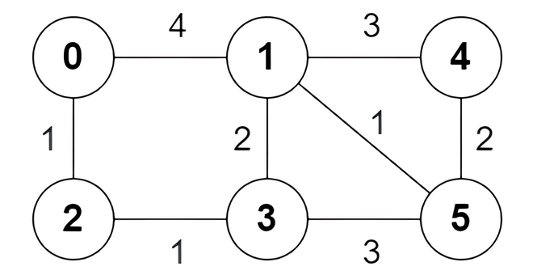

# 3123. 最短路径中的边

Hard · 难度分 2093 · [力扣原题](https://leetcode.cn/problems/find-edges-in-shortest-paths/)

所在刷题路径：灵神题单·图论算法

| 作者 | 题解 | 动画讲解 |
|---|---|---|
| 灵茶山艾府 | [📄 题解](灵茶山艾府.md) | [▶︎ 动画（GIF）](3123%20最短路径中的边%20·%20灵茶山艾府.gif) · [mp4 文件](3123%20最短路径中的边%20·%20灵茶山艾府.mp4) |
| yiduobo | [📄 题解](yiduobo.md) | [▶︎ 动画（GIF）](3123%20最短路径中的边%20·%20yiduobo.gif) · [mp4 文件](3123%20最短路径中的边%20·%20yiduobo.mp4) |

## 动画讲解

> 动图会循环播放；想暂停、拖进度条请下载上面表格里的 mp4 文件。

### 灵茶山艾府

### yiduobo

## 题目描述

给你一个 `n` 个节点的无向带权图，节点编号为 `0` 到 `n - 1` 。图中总共有 `m` 条边，用二维数组 `edges` 表示，其中 `edges[i] = [a_i, b_i, w_i]` 表示节点 `a_i` 和 `b_i` 之间有一条边权为 `w_i` 的边。

对于节点 `0` 为出发点，节点 `n - 1` 为结束点的所有最短路，你需要返回一个长度为 `m` 的 **boolean** 数组 `answer` ，如果 `edges[i]` **至少** 在其中一条最短路上，那么 `answer[i]` 为 `true` ，否则 `answer[i]` 为 `false` 。

请你返回数组 `answer` 。

**注意**，图可能不连通。

**示例 1：**

**输入：**`n = 6, edges = [[0,1,4],[0,2,1],[1,3,2],[1,4,3],[1,5,1],[2,3,1],[3,5,3],[4,5,2]]`

**输出：**`[true,true,true,false,true,true,true,false]`

**解释：**

以下为节点 0 出发到达节点 5 的 **所有** 最短路：

- 路径 `0 -> 1 -> 5` ：边权和为 `4 + 1 = 5` 。

- 路径 `0 -> 2 -> 3 -> 5` ：边权和为 `1 + 1 + 3 = 5` 。

- 路径 `0 -> 2 -> 3 -> 1 -> 5` ：边权和为 `1 + 1 + 2 + 1 = 5` 。

**示例 2：**

**输入：**`n = 4, edges = [[2,0,1],[0,1,1],[0,3,4],[3,2,2]]`

**输出：**`[true,false,false,true]`

**解释：**

只有一条从节点 0 出发到达节点 3 的最短路 `0 -> 2 -> 3` ，边权和为 `1 + 2 = 3` 。

**提示：**

- `2 <= n <= 5 * 10⁴`

- `m == edges.length`

- `1 <= m <= min(5 * 10⁴, n * (n - 1) / 2)`

- `0 <= a_i, b_i < n`

- `a_i != b_i`

- `1 <= w_i <= 10⁵`

- 图中没有重边。

---
[↑ 返回 3100-3199](../README.md) · [总索引](../../../索引.md) · [仓库首页](../../../README.md)
