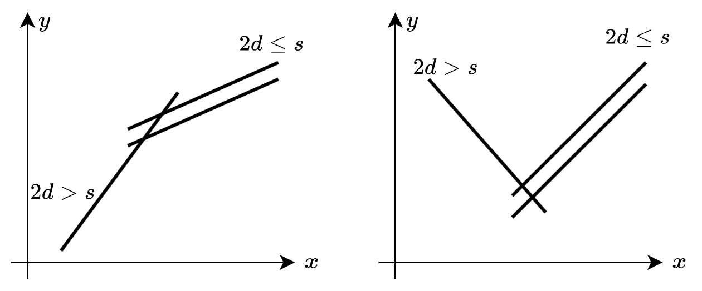

# 分类讨论，O(n) 做法（Python/Java/C++/Go）

> **[3139. 使数组中所有元素相等的最小开销](https://leetcode.cn/problems/minimum-cost-to-equalize-array/solutions/2766600/fen-lei-tao-lun-on-zuo-fa-pythonjavacgo-9bsb4/) · Hard · 难度分 2666**

> **所属题单**
> - [贪心算法 · 一、贪心策略](../../../刷题路径/灵神原版题单/贪心算法/一、贪心策略.md) · §1.8 相邻不同
> - [贪心算法 · 五、思维题](../../../刷题路径/灵神原版题单/贪心算法/五、思维题.md) · §5.8 分类讨论

> **题目描述**
> 给你一个整数数组 `nums` 和两个整数 `cost1` 和 `cost2` 。你可以执行以下 **任一** 操作 **任意** 次：
>
> - 从 `nums` 中选择下标 `i` 并且将 `nums[i]` **增加** `1` ，开销为 `cost1`。
>
> - 选择 `nums` 中两个 **不同** 下标 `i` 和 `j` ，并且将 `nums[i]` 和 `nums[j]` 都 **增加** `1` ，开销为 `cost2` 。
>
> 你的目标是使数组中所有元素都 **相等** ，请你返回需要的 **最小开销** 之和。
>
> 由于答案可能会很大，请你将它对 `10⁹ + 7` **取余** 后返回。
>
> **示例 1：**
>
> **输入：**`nums = [4,1], cost1 = 5, cost2 = 2`
>
> **输出：**`15`
>
> **解释：**
>
> 执行以下操作可以使数组中所有元素相等：
>
> - 将 `nums[1]` 增加 1 ，开销为 5 ，`nums` 变为 `[4,2]` 。
>
> - 将 `nums[1]` 增加 1 ，开销为 5 ，`nums` 变为 `[4,3]` 。
>
> - 将 `nums[1]` 增加 1 ，开销为 5 ，`nums` 变为 `[4,4]` 。
>
> 总开销为 15 。
>
> **示例 2：**
>
> **输入：**`nums = [2,3,3,3,5], cost1 = 2, cost2 = 1`
>
> **输出：**`6`
>
> **解释：**
>
> 执行以下操作可以使数组中所有元素相等：
>
> - 将 `nums[0]` 和 `nums[1]` 同时增加 1 ，开销为 1 ，`nums` 变为 `[3,4,3,3,5]` 。
>
> - 将 `nums[0]` 和 `nums[2]` 同时增加 1 ，开销为 1 ，`nums` 变为 `[4,4,4,3,5]` 。
>
> - 将 `nums[0]` 和 `nums[3]` 同时增加 1 ，开销为 1 ，`nums` 变为 `[5,4,4,4,5]` 。
>
> - 将 `nums[1]` 和 `nums[2]` 同时增加 1 ，开销为 1 ，`nums` 变为 `[5,5,5,4,5]` 。
>
> - 将 `nums[3]` 增加 1 ，开销为 2 ，`nums` 变为 `[5,5,5,5,5]` 。
>
> 总开销为 6 。
>
> **示例 3：**
>
> **输入：**`nums = [3,5,3], cost1 = 1, cost2 = 3`
>
> **输出：**`4`
>
> **解释：**
>
> 执行以下操作可以使数组中所有元素相等：
>
> - 将 `nums[0]` 增加 1 ，开销为 1 ，`nums` 变为 `[4,5,3]` 。
>
> - 将 `nums[0]` 增加 1 ，开销为 1 ，`nums` 变为 `[5,5,3]` 。
>
> - 将 `nums[2]` 增加 1 ，开销为 1 ，`nums` 变为 `[5,5,4]` 。
>
> - 将 `nums[2]` 增加 1 ，开销为 1 ，`nums` 变为 `[5,5,5]` 。
>
> 总开销为 4 。
>
> **提示：**
>
> - `1 <= nums.length <= 10⁵`
>
> - `1 <= nums[i] <= 10⁶`
>
> - `1 <= cost1 <= 10⁶`
>
> - `1 <= cost2 <= 10⁶`

> **题解**
> ## 前言
>
> 为方便描述，将 $\textit{cost}_1$ 和 $\textit{cost}_2$ 简记为 $c_1$ 和 $c_2$。 
>
> 设 $m = \min(\textit{nums}),\ M=\max(\textit{nums})$。
>
> 本题看上去把所有数都变成 $M$ 即可，但请看 $[1,3,4,4]$ 这个例子：
>
> - 全部变成 $4$：用操作二把数字 $1$ 和 $3$ 都加一，现在数组为 $[2,4,4,4]$；然后用操作一把数字 $2$ 加二，现在数组为 $[4,4,4,4]$。总开销为 $2c_1 + c_2$。
> - 全部变成 $5$：只用操作二，把数字 $1$ 和 $3$ 加一两次，现在数组为 $[3,5,4,4]$；然后把数字 $3$ 和 $4$ 加一，现在数组为 $[4,5,5,4]$；然后把数字 $4$ 和 $4$ 加一，现在数组为 $[5,5,5,5]$。总开销为 $4c_2$。
>
> 这意味着，在 $c_1$ 很大 $c_2$ 很小的情况下（比如 $c_1=999,\ c_2=1$），变成一个比 $M$ 更大的数，可能得到一个更小的总开销。
>
> 假设都变成 $x\ (x\ge M)$，那么当 $x$ 取多少时，可以得到最小的总开销？
>
> 要枚举 $x$ 吗？假如 $x=10$，具体要如何操作呢？知道怎么操作就知道怎么算总开销。
>
> ## 情况一
>
> 如果 $n\le 2$，那么只能用操作一，最小总开销为
>
> $$
> (M-m)\cdot c_1
> $$
>
> 下面的讨论中，$n\ge 3$。
>
> ## 情况二
>
> 如果 $2c_1\le c_2$，用一次操作二不如用两次操作一，所以只需用操作一，把每个数都变成 $M$ 的总开销是最小的。
>
> 总共需要执行
>
> $$
> \begin{aligned}
>     & (M - \textit{nums}[0]) + (M - \textit{nums}[1]) + \cdots + (M - \textit{nums}[n-1])      \\
> ={} & nM - (\textit{nums}[0] + \textit{nums}[1] + \cdots + \textit{nums}[n-1])        \\
> \end{aligned}
> $$
>
> 次操作一。
>
> 设
>
> $$
> \textit{base} = nM - (\textit{nums}[0] + \textit{nums}[1] + \cdots + \textit{nums}[n-1])
> $$
>
> 那么最小总开销为
>
> $$
> \textit{base}\cdot c_1
> $$
>
> ## 情况三
>
> 如果 $2c_1> c_2$，用操作二更划算，所以应当**尽量多地使用操作二**。
>
> 假设都变成 $x\ (x\ge M)$，那么所有数都需要在 $M$ 的基础上额外增加 $x-M$，总共要增加
>
> $$
> s = \textit{base} + (x - M) \cdot n
> $$
>
> 具体要如何操作呢？
>
> 为方便大家理解，想象有 $n$ 个盒子，第 $i$ 个盒子装有 $x-\textit{nums}[i]$ 个小球，这是 $\textit{nums}[i]$ 需要加一的次数。
>
> 操作一相当于从一个非空盒子中取出一个球，操作二相当于从两个不同的非空盒子中各取一个小球。
>
> 我们需要计算最多能执行多少次操作二。
>
> 设总共有 $s$ 个小球，其中装有小球数最多的盒子，装了 $d = x - m$ 个小球。
>
> **结论**：最多执行 $\min\left(\left\lfloor\dfrac{s}{2}\right\rfloor,s-d\right)$ 次操作二。
>
> [证明+具体操作方案](https://zhuanlan.zhihu.com/p/1945782212176909162)
>
> 根据结论，计算都变成 $x$ 的总开销 $f(x)$：
>
> - 如果 $2d\le s$，那么先执行 $\left\lfloor\dfrac{s}{2}\right\rfloor$ 次操作二，然后执行 $s\bmod 2$ 次操作一，总开销为
>    $$
>    f(x) = \left\lfloor\dfrac{s}{2}\right\rfloor\cdot c_2 + s\bmod 2\cdot c_1 
>    $$
> - 如果 $2d> s$，那么先执行 $s-d$ 次操作二，然后执行 $s - 2(s-d) = 2d-s$ 次操作一，总开销为
>    $$
>    f(x) = (s-d)\cdot c_2 + (2d-s)\cdot c_1
>    $$
>
> 两种情况可以合并为
>
> $$
> f(x) = \max\left(\left\lfloor\dfrac{s}{2}\right\rfloor\cdot c_2 + s\bmod 2\cdot c_1, (s-d)\cdot c_2 + (2d-s)\cdot c_1\right)
> $$
>
> 枚举 $x$，取 $f(x)$ 的最小值，即为最小总开销。
>
> ## 至多枚举到哪？
>
> 最后还剩下一个问题：$x$ 至多要枚举到哪个数为止？
>
> 注意到，$x$ 增加 $1$，$d$ 只增大 $1$，而 $s$ 增大 $n$。所以 $n>1$ 时我们会先满足 $2d>s$，然后再满足 $2d\le s$。而当 $2d\le s$ 时，总开销只和 $s$ 有关，$x$ 越大 $s$ 越大，至多再枚举一次就无需继续枚举了。至多再枚举一次是因为如果 $s$ 是奇数，额外有 $c_1$ 的开销。多枚举一次可以让 $s$ 从奇数变成偶数，可能得到更小的总开销。
>
> 由 $2d\le s$ 可得
>
> $$
> 2(x-m)\le \textit{base} + (x - M) \cdot n
> $$
>
> 移项得
>
> $$
> (n-2)x\ge nM-2m-\textit{base}
> $$
>
> 解得
>
> $$
> x\ge \left\lceil\dfrac{nM-2m-\textit{base}}{n-2}\right\rceil
> $$
>
> 所以 $x$ 至多枚举到
>
> $$
> \max\left(\left\lceil\dfrac{nM-2m-\textit{base}}{n-2}\right\rceil, M\right) + 1
> $$
>
> 加一可以保证我们一定可以枚举到 $s$ 是偶数的情况。
>
> > 注意当 $n\ge 3$ 时，上式 $\le 2M$，所以枚举到 $2M$ 的做法是正确的。
>
> ## 优化
>
> 
>
> 如上图所示：
>
> - $2d>s$ 对应 $(s-d)\cdot c_2 + (2d-s)\cdot c_1$，可以视作一条斜率或正或负（还可能为零）的一次函数。
> - $2d\le s$ 对应 $\left\lfloor\dfrac{s}{2}\right\rfloor\cdot c_2 + s\bmod 2\cdot c_1$，根据 $s$ 的奇偶性，可以视作两条斜率为正的一次函数。
>
> 如果函数交点横坐标 $\le M$，$x$ 只需枚举 $M$ 和 $M+1$；否则 $x$ 应当枚举交点横坐标附近的数（右图），以及 $M$（左图）。
>
> 设 $i = \left\lceil\dfrac{nM-2m-\textit{base}}{n-2}\right\rceil = \left\lfloor\dfrac{nM-2m-\textit{base}+n-3}{n-2}\right\rfloor$，最小总开销为
>
> $$
> \begin{cases} 
> \min(f(M),f(M+1)),&i\le M\\
> \min(f(M),f(i-1),f(i),f(i+1)),&i> M
> \end{cases}
> $$
>
> 请看 [视频讲解](https://www.bilibili.com/video/BV1Nf421U7em/) 第四题，欢迎点赞关注！
>
> ```python
> class Solution:
>     def minCostToEqualizeArray(self, nums: List[int], c1: int, c2: int) -> int:
>         MOD = 1_000_000_007
>         n = len(nums)
>         m = min(nums)
>         M = max(nums)
>         base = n * M - sum(nums)
>         if n <= 2 or c1 * 2 <= c2:
>             return base * c1 % MOD
>
>         def f(x: int) -> int:
>             s = base + (x - M) * n
>             d = x - m
>             return max(s // 2 * c2 + s % 2 * c1, (s - d) * c2 + (d * 2 - s) * c1)
>
>         i = (n * M - m * 2 - base + n - 3) // (n - 2)
>         return min(f(M), f(M + 1)) % MOD if i <= M else \
>                min(f(M), f(i - 1), f(i), f(i + 1)) % MOD
> ```
>
>
> #### 复杂度分析
>
> - 时间复杂度：$\mathcal{O}(n)$，其中 $n$ 为 $\textit{nums}$ 的长度。瓶颈在计算 $m,M,\textit{base}$ 上，如果已知这些数据，则时间复杂度为 $\mathcal{O}(1)$。
> - 空间复杂度：$\mathcal{O}(1)$。
>
> ## 专题训练
>
> 见下面贪心题单的「**§1.8 相邻不同**」。
>
> ## 分类题单
>
> [如何科学刷题？](https://leetcode.cn/circle/discuss/RvFUtj/)
>
> 1. [滑动窗口与双指针（定长/不定长/单序列/双序列/三指针/分组循环）](https://leetcode.cn/circle/discuss/0viNMK/)
> 2. [二分算法（二分答案/最小化最大值/最大化最小值/第K小）](https://leetcode.cn/circle/discuss/SqopEo/)
> 3. [单调栈（基础/矩形面积/贡献法/最小字典序）](https://leetcode.cn/circle/discuss/9oZFK9/)
> 4. [网格图（DFS/BFS/综合应用）](https://leetcode.cn/circle/discuss/YiXPXW/)
> 5. [位运算（基础/性质/拆位/试填/恒等式/思维）](https://leetcode.cn/circle/discuss/dHn9Vk/)
> 6. [图论算法（DFS/BFS/拓扑排序/基环树/最短路/最小生成树/网络流）](https://leetcode.cn/circle/discuss/01LUak/)
> 7. [动态规划（入门/背包/划分/状态机/区间/状压/数位/数据结构优化/树形/博弈/概率期望）](https://leetcode.cn/circle/discuss/tXLS3i/)
> 8. [常用数据结构（前缀和/差分/栈/队列/堆/字典树/并查集/树状数组/线段树）](https://leetcode.cn/circle/discuss/mOr1u6/)
> 9. [数学算法（数论/组合/概率期望/博弈/计算几何/随机算法）](https://leetcode.cn/circle/discuss/IYT3ss/)
> 10. [贪心与思维（基本贪心策略/反悔/区间/字典序/数学/思维/脑筋急转弯/构造）](https://leetcode.cn/circle/discuss/g6KTKL/)
> 11. [链表、二叉树与回溯（前后指针/快慢指针/DFS/BFS/直径/LCA/一般树）](https://leetcode.cn/circle/discuss/K0n2gO/)
> 12. [字符串（KMP/Z函数/Manacher/字符串哈希/AC自动机/后缀数组/子序列自动机）](https://leetcode.cn/circle/discuss/SJFwQI/)
>
> [我的题解精选（已分类）](https://github.com/EndlessCheng/codeforces-go/blob/master/leetcode/SOLUTIONS.md)
>
> 欢迎关注 [B站@灵茶山艾府](https://space.bilibili.com/206214)
