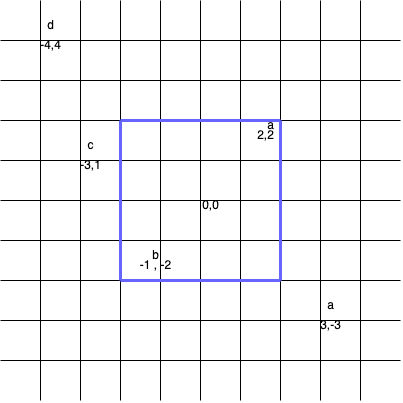
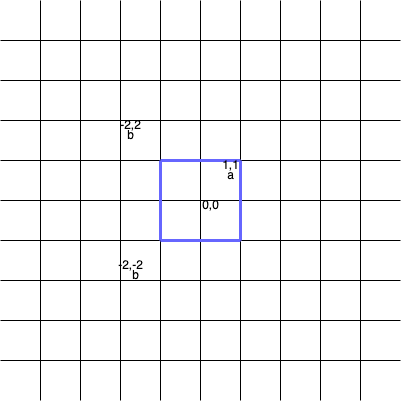

# 3143. 正方形中的最多点数

Medium · 难度分 1697 · [力扣原题](https://leetcode.cn/problems/maximum-points-inside-the-square/)

所在刷题路径：灵神核心路线、灵神题单·二分算法

| 作者 | 题解 | 动画讲解 |
|---|---|---|
| 灵茶山艾府 | [📄 题解](灵茶山艾府.md) | [▶︎ 动画（GIF）](3143%20正方形中的最多点数%20·%20灵茶山艾府.gif) · [mp4 文件](3143%20正方形中的最多点数%20·%20灵茶山艾府.mp4) |
| yiduobo | [📄 题解](yiduobo.md) | [▶︎ 动画（GIF）](3143%20正方形中的最多点数%20·%20yiduobo.gif) · [mp4 文件](3143%20正方形中的最多点数%20·%20yiduobo.mp4) |

## 动画讲解

> 动图会循环播放；想暂停、拖进度条请下载上面表格里的 mp4 文件。

### 灵茶山艾府

### yiduobo

## 题目描述

给你一个二维数组 `points` 和一个字符串 `s` ，其中 `points[i]` 表示第 `i` 个点的坐标，`s[i]` 表示第 `i` 个点的 **标签** 。

如果一个正方形的中心在 `(0, 0)` ，所有边都平行于坐标轴，且正方形内 **不** 存在标签相同的两个点，那么我们称这个正方形是 **合法** 的。

请你返回 **合法** 正方形中可以包含的 **最多** 点数。

**注意：**

- 如果一个点位于正方形的边上或者在边以内，则认为该点位于正方形内。

- 正方形的边长可以为零。

**示例 1：**

**输入：**`points = [[2,2],[-1,-2],[-4,4],[-3,1],[3,-3]], s = "abdca"`

**输出：**`2`

**解释：**

边长为 4 的正方形包含两个点 `points[0]` 和 `points[1]` 。

**示例 2：**

**输入：**`points = [[1,1],[-2,-2],[-2,2]], s = "abb"`

**输出：**`1`

**解释：**

边长为 2 的正方形包含 1 个点 `points[0]` 。

**示例 3：**

**输入：**`points = [[1,1],[-1,-1],[2,-2]], s = "ccd"`

**输出：**`0`

**解释：**

任何正方形都无法只包含 `points[0]` 和 `points[1]` 中的一个点，所以合法正方形中都不包含任何点。

**提示：**

- `1 <= s.length, points.length <= 10⁵`

- `points[i].length == 2`

- `-10⁹ <= points[i][0], points[i][1] <= 10⁹`

- `s.length == points.length`

- `points` 中的点坐标互不相同。

- `s` 只包含小写英文字母。

---
[↑ 返回 3100-3199](../README.md) · [总索引](../../../索引.md) · [仓库首页](../../../README.md)
