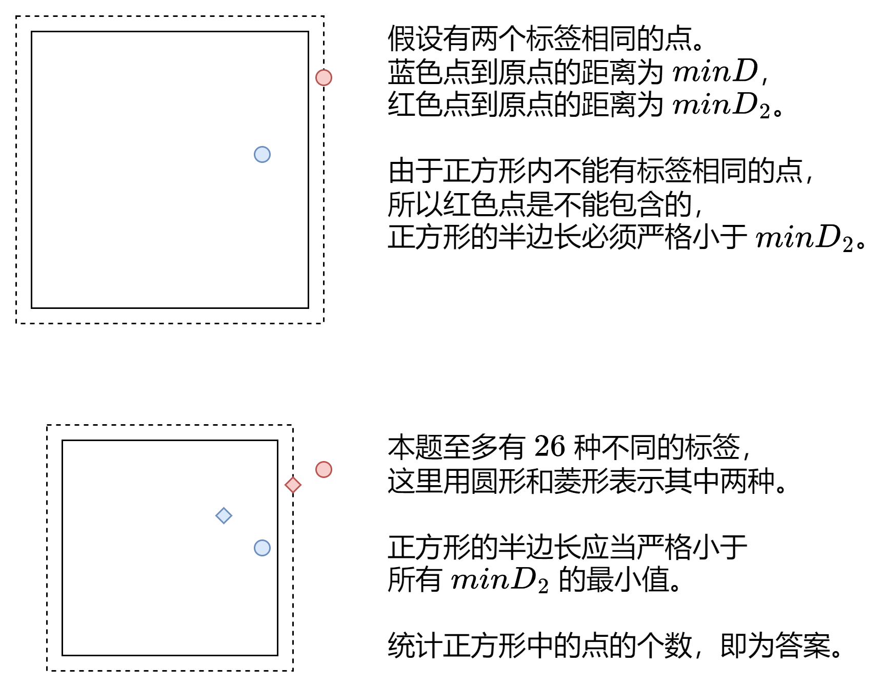

# 两种方法：从 O(nlog) 到 O(n)（Python/Java/C++/Go）

> **[3143. 正方形中的最多点数](https://leetcode.cn/problems/maximum-points-inside-the-square/solutions/2775310/er-fen-bian-chang-tong-shi-ji-lu-da-an-z-92w5/) · Medium · 难度分 1697**

> **所属题单**
> - [二分算法 · 二、二分答案](../../../刷题路径/灵神原版题单/二分算法/二、二分答案.md) · §2.3 二分间接值

> **题目描述**
> 给你一个二维数组 `points` 和一个字符串 `s` ，其中 `points[i]` 表示第 `i` 个点的坐标，`s[i]` 表示第 `i` 个点的 **标签** 。
>
> 如果一个正方形的中心在 `(0, 0)` ，所有边都平行于坐标轴，且正方形内 **不** 存在标签相同的两个点，那么我们称这个正方形是 **合法** 的。
>
> 请你返回 **合法** 正方形中可以包含的 **最多** 点数。
>
> **注意：**
>
> - 如果一个点位于正方形的边上或者在边以内，则认为该点位于正方形内。
>
> - 正方形的边长可以为零。
>
> **示例 1：**
>
> 
>
> **输入：**`points = [[2,2],[-1,-2],[-4,4],[-3,1],[3,-3]], s = "abdca"`
>
> **输出：**`2`
>
> **解释：**
>
> 边长为 4 的正方形包含两个点 `points[0]` 和 `points[1]` 。
>
> **示例 2：**
>
> 
>
> **输入：**`points = [[1,1],[-2,-2],[-2,2]], s = "abb"`
>
> **输出：**`1`
>
> **解释：**
>
> 边长为 2 的正方形包含 1 个点 `points[0]` 。
>
> **示例 3：**
>
> **输入：**`points = [[1,1],[-1,-1],[2,-2]], s = "ccd"`
>
> **输出：**`0`
>
> **解释：**
>
> 任何正方形都无法只包含 `points[0]` 和 `points[1]` 中的一个点，所以合法正方形中都不包含任何点。
>
> **提示：**
>
> - `1 <= s.length, points.length <= 10⁵`
>
> - `points[i].length == 2`
>
> - `-10⁹ <= points[i][0], points[i][1] <= 10⁹`
>
> - `s.length == points.length`
>
> - `points` 中的点坐标互不相同。
>
> - `s` 只包含小写英文字母。

> **题解**
> ## 方法一：二分间接值
>
> 由于正方形边长越大，越不合法，有单调性，所以可以**二分边长的一半**。
>
> 在二分中统计遇到的字符，如果没有遇到重复的字符，说明正方形合法，用字符个数更新答案的最大值。
>
> 关于二分算法的原理，请看 [二分查找 红蓝染色法【基础算法精讲 04】](https://www.bilibili.com/video/BV1AP41137w7/)
>
> 代码用到了一些位运算技巧，原理请看 [从集合论到位运算，常见位运算技巧分类总结！](https://leetcode.cn/circle/discuss/CaOJ45/)
>
> ⚠**注意**：虽然本题 $\text{check}(0)$ 一定是 $\texttt{true}$，但由于代码的做法是在 $\text{check}$ 中更新答案，为了保证在正方形边长为 $0$ 的情况下也能更新答案，二分范围要包含 $0$。
>
> #### 答疑
>
> **问**：为什么可以直接更新 $\textit{ans}$，为什么不需要写 `ans = max(ans, ...)`？
>
> **答**：更新 $\textit{ans}$ 时必然会伴随着二分区间左边界 $\textit{left}$ 的更新，那么下一次更新 $\textit{ans}$ 的时候，正方形的边长一定更长，包含的点数不会变少，所以可以直接更新，无需写 `max`。
>
> ```python
> class Solution:
>     def maxPointsInsideSquare(self, points: List[List[int]], s: str) -> int:
>         ans = 0
>         def check(size: int) -> bool:
>             vis = set()
>             for (x, y), c in zip(points, s):
>                 if abs(x) <= size and abs(y) <= size:  # 点在正方形中
>                     if c in vis:
>                         return True
>                     vis.add(c)
>             nonlocal ans
>             ans = len(vis)
>             return False
>
>         # 注意 range 并不会创建 list，它是 O(1) 的
>         bisect_left(range(1_000_000_001), True, key=check)
>         return ans
> ```
>
>
> #### 复杂度分析
>
> - 时间复杂度：$\mathcal{O}(n\log U)$，其中 $n$ 为 $s$ 的长度，$U=\max(|x_i|,|y_i|)$。
> - 空间复杂度：$\mathcal{O}(|\Sigma|)$ 或 $\mathcal{O}(1)$。其中 $|\Sigma|$ 为字符集合的大小，本题字符均为小写字母，所以 $|\Sigma|=26$。
>
> ## 方法二：维护次小距离的最小值
>
> 定义点 $(x,y)$ 到 $(0,0)$ 的**切比雪夫距离**为
>
> $$
> \max(|x|,|y|)
> $$
>
> 定义 $\textit{minD}[c]$ 为标签为 $c$ 的所有点到 $(0,0)$ 的**最小**切比雪夫距离。
>
> 定义 $\textit{minD}_2[c]$ 为标签为 $c$ 的所有点到 $(0,0)$ 的**次小**切比雪夫距离。
>
> 
>
> 换句话说，可以在正方形中的点需要满足
>
> $$
> \textit{minD}[c] < \textit{min}_2
> $$
>
> 代码实现时，无需维护 $\textit{minD}_2[c]$，而是直接维护 $\textit{min}_2$。
>
> ```python
> class Solution:
>     def maxPointsInsideSquare(self, points: List[List[int]], s: str) -> int:
>         min_d = defaultdict(lambda: inf)
>         min2 = inf
>         for (x, y), c in zip(points, s):
>             d = max(abs(x), abs(y))
>             if d < min_d[c]:
>                 # d 是目前最小的，那么 min_d[c] 是次小的
>                 min2 = min(min2, min_d[c])
>                 min_d[c] = d
>             else:
>                 # d 可能是次小的
>                 min2 = min(min2, d)
>         return sum(d < min2 for d in min_d.values())
> ```
>
>
> #### 复杂度分析
>
> - 时间复杂度：$\mathcal{O}(n+|\Sigma|)$，其中 $n$ 为 $s$ 的长度，$|\Sigma|$ 为字符集合的大小，本题字符均为小写字母，所以 $|\Sigma|=26$。
> - 空间复杂度：$\mathcal{O}(|\Sigma|)$。
>
> ## 分类题单
>
> [如何科学刷题？](https://leetcode.cn/circle/discuss/RvFUtj/)
>
> 1. [滑动窗口（定长/不定长/多指针）](https://leetcode.cn/circle/discuss/0viNMK/)
> 2. [二分算法（二分答案/最小化最大值/最大化最小值/第K小）](https://leetcode.cn/circle/discuss/SqopEo/)
> 3. [单调栈（基础/矩形面积/贡献法/最小字典序）](https://leetcode.cn/circle/discuss/9oZFK9/)
> 4. [网格图（DFS/BFS/综合应用）](https://leetcode.cn/circle/discuss/YiXPXW/)
> 5. [位运算（基础/性质/拆位/试填/恒等式/思维）](https://leetcode.cn/circle/discuss/dHn9Vk/)
> 6. [图论算法（DFS/BFS/拓扑排序/最短路/最小生成树/二分图/基环树/欧拉路径）](https://leetcode.cn/circle/discuss/01LUak/)
> 7. [动态规划（入门/背包/状态机/划分/区间/状压/数位/数据结构优化/树形/博弈/概率期望）](https://leetcode.cn/circle/discuss/tXLS3i/)
> 8. [常用数据结构（前缀和/差分/栈/队列/堆/字典树/并查集/树状数组/线段树）](https://leetcode.cn/circle/discuss/mOr1u6/)
> 9. [数学算法（数论/组合/概率期望/博弈/计算几何/随机算法）](https://leetcode.cn/circle/discuss/IYT3ss/)
> 10. [贪心算法（基本贪心策略/反悔/区间/字典序/数学/思维/脑筋急转弯/构造）](https://leetcode.cn/circle/discuss/g6KTKL/)
>
> [我的题解精选（已分类）](https://github.com/EndlessCheng/codeforces-go/blob/master/leetcode/SOLUTIONS.md)
>
> 欢迎关注 [B站@灵茶山艾府](https://space.bilibili.com/206214)
