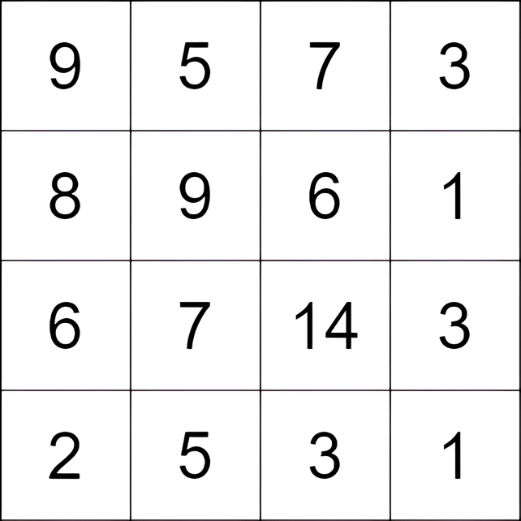
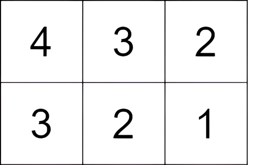

# 脑筋急转弯+二维前缀最小值（Python/Java/C++/Go）

> **[3148. 矩阵中的最大得分](https://leetcode.cn/problems/maximum-difference-score-in-a-grid/solutions/2774823/nao-jin-ji-zhuan-wan-dppythonjavacgo-by-swux7/) · Medium · 难度分 1820**

> **所属题单**
> - [常用数据结构 · 一、前缀和](../../../刷题路径/灵神原版题单/常用数据结构/一、前缀和.md) · §1.6 二维前缀和
> - [动态规划 · 七、其他线性 DP](../../../刷题路径/灵神原版题单/动态规划/七、其他线性%20DP.md) · §7.5 子矩形 DP
> - [贪心算法 · 五、思维题](../../../刷题路径/灵神原版题单/贪心算法/五、思维题.md) · §5.2 脑筋急转弯

> **题目描述**
> 给你一个由 **正整数** 组成、大小为 `m x n` 的矩阵 `grid`。你可以从矩阵中的任一单元格移动到另一个位于正下方或正右侧的任意单元格（不必相邻）。从值为 `c1` 的单元格移动到值为 `c2` 的单元格的得分为 `c2 - c1` 。
>
> 你可以从 **任一** 单元格开始，并且必须至少移动一次。
>
> 返回你能得到的 **最大** 总得分。
>
> **示例 1：**
>
> 
>
> **输入：**`grid = [[9,5,7,3],[8,9,6,1],[6,7,14,3],[2,5,3,1]]`
>
> **输出：**`9`
>
> **解释：**从单元格 `(0, 1)` 开始，并执行以下移动：
>
> - 从单元格 `(0, 1)` 移动到 `(2, 1)`，得分为 `7 - 5 = 2` 。
>
> - 从单元格 `(2, 1)` 移动到 `(2, 2)`，得分为 `14 - 7 = 7` 。
>
> 总得分为 `2 + 7 = 9` 。
>
> **示例 2：**
>
> 
>
> **输入：**`grid = [[4,3,2],[3,2,1]]`
>
> **输出：**`-1`
>
> **解释：**从单元格 `(0, 0)` 开始，执行一次移动：从 `(0, 0)` 到 `(0, 1)` 。得分为 `3 - 4 = -1` 。
>
> **提示：**
>
> - `m == grid.length`
>
> - `n == grid[i].length`
>
> - `2 <= m, n <= 1000`
>
> - `4 <= m * n <= 10⁵`
>
> - `1 <= grid[i][j] <= 10⁵`

> **题解**
> 把 $\textit{grid}[i][j]$ 视作**海拔高度**，把得分视作**重力势能的变化量**。从高度 $c_1$ 移动到高度 $c_2$，重力势能增加了 $c_2-c_1$。注意 $c_2-c_1$ 可能是负数。
>
> 题目相当于计算重力势能的变化量之和，也就是**终点与起点的海拔高度之差**。
>
> 枚举终点位置 $(i,j)$，那么起点的海拔高度越小越好。由于我们只能向右和向下走，所以起点只能在 $(i,j)$ 的左上方向（可以是 $(i,j)$ 的正左方向或正上方向）。
>
> 按照[【图解】一张图秒懂二维前缀和](../../0300-0399/0304%20二维区域和检索%20-%20矩阵不可变/灵茶山艾府.md) 的思路，定义 $f[i+1][j+1]$ 表示左上角在 $(0,0)$，右下角在 $(i,j)$ 的子矩阵的**最小值**。
>
> 类似二维前缀和，$f[i+1][j+1]$ 可以递推计算：
>
> $$
> f[i+1][j+1] = \min(f[i+1][j],f[i][j+1], \textit{grid}[i][j])
> $$
>
> 注意题目要求至少移动一次，也就是起点与终点不能重合。如果终点在 $(i,j)$，那么起点的海拔高度最小值为
>
> $$
> \min(f[i+1][j],f[i][j+1])
> $$
>
> 终点与起点的海拔高度之差为
>
> $$
> \textit{grid}[i][j] - \min(f[i+1][j],f[i][j+1])
> $$
>
> 上式的最大值即为答案。
>
> 请看 [视频讲解](https://www.bilibili.com/video/BV1bx4y1i7rP/) 第三题，欢迎点赞关注！
>
> ```python
> class Solution:
>     def maxScore(self, grid: List[List[int]]) -> int:
>         ans = -inf
>         m, n = len(grid), len(grid[0])
>         f = [[inf] * (n + 1) for _ in range(m + 1)]
>         for i, row in enumerate(grid):
>             for j, x in enumerate(row):
>                 mn = min(f[i + 1][j], f[i][j + 1])
>                 ans = max(ans, x - mn)
>                 f[i + 1][j + 1] = min(mn, x)
>         return ans
> ```
>
>
> #### 复杂度分析
>
> - 时间复杂度：$\mathcal{O}(mn)$，其中 $m$ 和 $n$ 分别为 $\textit{mat}$ 的行数和列数。
> - 空间复杂度：$\mathcal{O}(mn)$。
>
> ## 优化
>
> 也可以维护每列的最小值 $\textit{colMin}$，这样空间复杂度更小。
>
> ```python
> class Solution:
>     def maxScore(self, grid: List[List[int]]) -> int:
>         ans = -inf
>         col_min = [inf] * len(grid[0])
>         for row in grid:
>             pre_min = inf  # col_min[0..j] 的最小值
>             for j, x in enumerate(row):
>                 ans = max(ans, x - min(pre_min, col_min[j]))
>                 col_min[j] = min(col_min[j], x)
>                 pre_min = min(pre_min, col_min[j])
>         return ans
> ```
>
>
> #### 复杂度分析
>
> - 时间复杂度：$\mathcal{O}(mn)$，其中 $m$ 和 $n$ 分别为 $\textit{mat}$ 的行数和列数。
> - 空间复杂度：$\mathcal{O}(n)$。
>
> ## 分类题单
>
> [如何科学刷题？](https://leetcode.cn/circle/discuss/RvFUtj/)
>
> 1. [滑动窗口（定长/不定长/多指针）](https://leetcode.cn/circle/discuss/0viNMK/)
> 2. [二分算法（二分答案/最小化最大值/最大化最小值/第K小）](https://leetcode.cn/circle/discuss/SqopEo/)
> 3. [单调栈（基础/矩形面积/贡献法/最小字典序）](https://leetcode.cn/circle/discuss/9oZFK9/)
> 4. [网格图（DFS/BFS/综合应用）](https://leetcode.cn/circle/discuss/YiXPXW/)
> 5. [位运算（基础/性质/拆位/试填/恒等式/思维）](https://leetcode.cn/circle/discuss/dHn9Vk/)
> 6. [图论算法（DFS/BFS/拓扑排序/最短路/最小生成树/二分图/基环树/欧拉路径）](https://leetcode.cn/circle/discuss/01LUak/)
> 7. [动态规划（入门/背包/状态机/划分/区间/状压/数位/数据结构优化/树形/博弈/概率期望）](https://leetcode.cn/circle/discuss/tXLS3i/)
> 8. [常用数据结构（前缀和/差分/栈/队列/堆/字典树/并查集/树状数组/线段树）](https://leetcode.cn/circle/discuss/mOr1u6/)
> 9. [数学算法（数论/组合/概率期望/博弈/计算几何/随机算法）](https://leetcode.cn/circle/discuss/IYT3ss/)
> 10. [贪心算法（基本贪心策略/反悔/区间/字典序/数学/思维/脑筋急转弯/构造）](https://leetcode.cn/circle/discuss/g6KTKL/)
> 11. [链表、二叉树与一般树（前后指针/快慢指针/DFS/BFS/直径/LCA）](https://leetcode.cn/circle/discuss/K0n2gO/)
>
> [我的题解精选（已分类）](https://github.com/EndlessCheng/codeforces-go/blob/master/leetcode/SOLUTIONS.md)
>
> 欢迎关注 [B站@灵茶山艾府](https://space.bilibili.com/206214)
