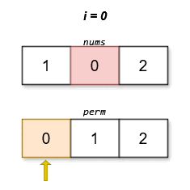

# 3149. 找出分数最低的排列

Hard · 难度分 2642 · [力扣原题](https://leetcode.cn/problems/find-the-minimum-cost-array-permutation/)

所在刷题路径：灵神题单·动态规划

| 作者 | 题解 | 动画讲解 |
|---|---|---|
| 灵茶山艾府 | [📄 题解](灵茶山艾府.md) | [▶︎ 动画（GIF）](3149%20找出分数最低的排列%20·%20灵茶山艾府.gif) · [mp4 文件](3149%20找出分数最低的排列%20·%20灵茶山艾府.mp4) |
| yiduobo | [📄 题解](yiduobo.md) | [▶︎ 动画（GIF）](3149%20找出分数最低的排列%20·%20yiduobo.gif) · [mp4 文件](3149%20找出分数最低的排列%20·%20yiduobo.mp4) |

## 动画讲解

> 动图会循环播放；想暂停、拖进度条请下载上面表格里的 mp4 文件。

### 灵茶山艾府

### yiduobo

## 题目描述

给你一个数组 `nums` ，它是 `[0, 1, 2, ..., n - 1]` 的一个排列 。对于任意一个 `[0, 1, 2, ..., n - 1]` 的排列 `perm` ，其 **分数** 定义为：

`score(perm) = |perm[0] - nums[perm[1]]| + |perm[1] - nums[perm[2]]| + ... + |perm[n - 1] - nums[perm[0]]|`

返回具有 **最低** 分数的排列 `perm` 。如果存在多个满足题意且分数相等的排列，则返回其中字典序最小的一个。

**示例 1：**

**输入：**`nums = [1,0,2]`

**输出：**`[0,1,2]`

**解释：**

字典序最小且分数最低的排列是 `[0,1,2]`。这个排列的分数是 `|0 - 0| + |1 - 2| + |2 - 1| = 2` 。

**示例 2：**

**输入：**`nums = [0,2,1]`

**输出：**`[0,2,1]`

**解释：**

字典序最小且分数最低的排列是 `[0,2,1]`。这个排列的分数是 `|0 - 1| + |2 - 2| + |1 - 0| = 2` 。

**提示：**

- `2 <= n == nums.length <= 14`

- `nums` 是 `[0, 1, 2, ..., n - 1]` 的一个排列。

---
[↑ 返回 3100-3199](../README.md) · [总索引](../../../索引.md) · [仓库首页](../../../README.md)
