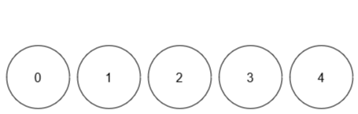

# 哈希表模拟（Python/Java/C++/Go）

> **[3160. 所有球里面不同颜色的数目](https://leetcode.cn/problems/find-the-number-of-distinct-colors-among-the-balls/solutions/2790364/ha-xi-biao-mo-ni-pythonjavacgo-by-endles-wza6/) · Medium**

> **题目描述**
> 给你一个整数 `limit` 和一个大小为 `n x 2` 的二维数组 `queries` 。
>
> 总共有 `limit + 1` 个球，每个球的编号为 `[0, limit]` 中一个 **互不相同** 的数字。一开始，所有球都没有颜色。`queries` 中每次操作的格式为 `[x, y]` ，你需要将球 `x` 染上颜色 `y` 。每次操作之后，你需要求出所有球颜色的数目。
>
> 请你返回一个长度为 `n` 的数组 `result` ，其中 `result[i]` 是第 `i` 次操作以后颜色的数目。
>
> **注意** ，没有染色的球不算作一种颜色。
>
> **示例 1：**
>
> **输入：**`limit = 4, queries = [[1,4],[2,5],[1,3],[3,4]]`
>
> **输出：**`[1,2,2,3]`
>
> **解释：**
>
> 
>
> - 操作 0 后，球 1 颜色为 4 。
>
> - 操作 1 后，球 1 颜色为 4 ，球 2 颜色为 5 。
>
> - 操作 2 后，球 1 颜色为 3 ，球 2 颜色为 5 。
>
> - 操作 3 后，球 1 颜色为 3 ，球 2 颜色为 5 ，球 3 颜色为 4 。
>
> **示例 2：**
>
> **输入：**`limit = 4, queries = [[0,1],[1,2],[2,2],[3,4],[4,5]]`
>
> **输出：**`[1,2,2,3,4]`
>
> **解释：**
>
> 
>
> - 操作 0 后，球 0 颜色为 1 。
>
> - 操作 1 后，球 0 颜色为 1 ，球 1 颜色为 2 。
>
> - 操作 2 后，球 0 颜色为 1 ，球 1 和 2 颜色为 2 。
>
> - 操作 3 后，球 0 颜色为 1 ，球 1 和 2 颜色为 2 ，球 3 颜色为 4 。
>
> - 操作 4 后，球 0 颜色为 1 ，球 1 和 2 颜色为 2 ，球 3 颜色为 4 ，球 4 颜色为 5 。
>
> **提示：**
>
> - `1 <= limit <= 10⁹`
>
> - `1 <= n == queries.length <= 10⁵`
>
> - `queries[i].length == 2`
>
> - `0 <= queries[i][0] <= limit`
>
> - `1 <= queries[i][1] <= 10⁹`

> **题解**
> 用哈希表 $\textit{color}$ 维护第 $x$ 个球的颜色，哈希表 $\textit{cnt}$ 维护每种颜色的出现次数。
>
> 当把球 $x$ 的颜色改成 $y$ 时：
>
> 1. 如果 $x$ 在 $\textit{color}$ 中，设 $c=\textit{color}[x]$，先把 $\textit{cnt}[c]$ 减少一，如果 $\textit{cnt}[c]$ 变成 $0$，则从 $\textit{cnt}$ 中删除 $c$。
> 2. 更新 $\textit{color}[x] = y$。
> 3. 把 $\textit{cnt}[y]$ 增加一。
> 4. 把 $\textit{cnt}$ 的大小加入答案。
>
> 具体请看 [视频讲解](https://www.bilibili.com/video/BV1SU411d7wj/) 第三题，欢迎点赞关注！
>
> ```python
> class Solution:
>     def queryResults(self, _: int, queries: List[List[int]]) -> List[int]:
>         ans = []
>         color = {}
>         cnt = defaultdict(int)
>         for x, y in queries:
>             if x in color:
>                 c = color[x]
>                 cnt[c] -= 1
>                 if cnt[c] == 0:
>                     del cnt[c]
>             color[x] = y
>             cnt[y] += 1
>             ans.append(len(cnt))
>         return ans
> ```
>
>
> #### 复杂度分析
>
> - 时间复杂度：$\mathcal{O}(q)$，其中 $q$ 是 $\textit{queries}$ 的长度。
> - 空间复杂度：$\mathcal{O}(q)$。
>
> ## 分类题单
>
> [如何科学刷题？](https://leetcode.cn/circle/discuss/RvFUtj/)
>
> 1. [滑动窗口（定长/不定长/多指针）](https://leetcode.cn/circle/discuss/0viNMK/)
> 2. [二分算法（二分答案/最小化最大值/最大化最小值/第K小）](https://leetcode.cn/circle/discuss/SqopEo/)
> 3. [单调栈（基础/矩形面积/贡献法/最小字典序）](https://leetcode.cn/circle/discuss/9oZFK9/)
> 4. [网格图（DFS/BFS/综合应用）](https://leetcode.cn/circle/discuss/YiXPXW/)
> 5. [位运算（基础/性质/拆位/试填/恒等式/思维）](https://leetcode.cn/circle/discuss/dHn9Vk/)
> 6. [图论算法（DFS/BFS/拓扑排序/最短路/最小生成树/二分图/基环树/欧拉路径）](https://leetcode.cn/circle/discuss/01LUak/)
> 7. [动态规划（入门/背包/状态机/划分/区间/状压/数位/数据结构优化/树形/博弈/概率期望）](https://leetcode.cn/circle/discuss/tXLS3i/)
> 8. [常用数据结构（前缀和/差分/栈/队列/堆/字典树/并查集/树状数组/线段树）](https://leetcode.cn/circle/discuss/mOr1u6/)
> 9. [数学算法（数论/组合/概率期望/博弈/计算几何/随机算法）](https://leetcode.cn/circle/discuss/IYT3ss/)
> 10. [贪心算法（基本贪心策略/反悔/区间/字典序/数学/思维/脑筋急转弯/构造）](https://leetcode.cn/circle/discuss/g6KTKL/)
>
> [我的题解精选（已分类）](https://github.com/EndlessCheng/codeforces-go/blob/master/leetcode/SOLUTIONS.md)
>
> 欢迎关注 [B站@灵茶山艾府](https://space.bilibili.com/206214)
