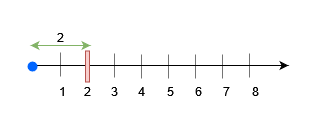
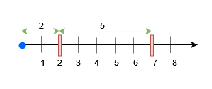

# 三种方法：线段树/树状数组/并查集（Python/Java/C++/Go）

> **[3161. 物块放置查询](https://leetcode.cn/problems/block-placement-queries/solutions/2790395/ping-heng-shu-xian-duan-shu-pythonjavacg-8klz/) · Hard · 难度分 2513**

> **所属题单**
> - [常用数据结构 · 八、树状数组和线段树](../../../刷题路径/灵神原版题单/常用数据结构/八、树状数组和线段树.md) · §8.3 线段树（无区间更新）

> **题目描述**
> 有一条无限长的数轴，原点在 0 处，沿着 x 轴 **正** 方向无限延伸。
>
> 给你一个二维数组 `queries` ，它包含两种操作：
>
> 1. 操作类型 1 ：`queries[i] = [1, x]` 。在距离原点 `x` 处建一个障碍物。数据保证当操作执行的时候，位置 `x` 处 **没有** 任何障碍物。
>
> 2. 操作类型 2 ：`queries[i] = [2, x, sz]` 。判断在数轴范围 `[0, x]` 内是否可以放置一个长度为 `sz` 的物块，这个物块需要 **完全** 放置在范围 `[0, x]` 内。如果物块与任何障碍物有重合，那么这个物块 **不能** 被放置，但物块可以与障碍物刚好接触。注意，你只是进行查询，并 **不是** 真的放置这个物块。每个查询都是相互独立的。
>
> 请你返回一个 boolean 数组`results` ，如果第 `i` 个操作类型 2 的操作你可以放置物块，那么 `results[i]` 为 `true` ，否则为 `false` 。
>
> **示例 1：**
>
> **输入：**`queries = [[1,2],[2,3,3],[2,3,1],[2,2,2]]`
>
> **输出：**`[false,true,true]`
>
> **解释：**
>
> 
>
> 查询 0 ，在 `x = 2` 处放置一个障碍物。在 `x = 3` 之前任何大小不超过 2 的物块都可以被放置。
>
> **示例 2：**
>
> **输入：**queries = \[\[1,7],[2,7,6],[1,2],[2,7,5],[2,7,6]]
>
> **输出：**[true,true,false]
>
> **解释：**
>
> 
>
> - 查询 0 在 `x = 7` 处放置一个障碍物。在 `x = 7` 之前任何大小不超过 7 的物块都可以被放置。
>
> - 查询 2 在 `x = 2` 处放置一个障碍物。现在，在 `x = 7` 之前任何大小不超过 5 的物块可以被放置，`x = 2` 之前任何大小不超过 2 的物块可以被放置。
>
> **提示：**
>
> - `1 <= queries.length <= 15 * 10⁴`
>
> - `2 <= queries[i].length <= 3`
>
> - `1 <= queries[i][0] <= 2`
>
> - `1 <= x, sz <= min(5 * 10⁴, 3 * queries.length)`
>
> - 输入保证操作 1 中，`x` 处不会有障碍物。
>
> - 输入保证至少有一个操作类型 2 。

> **题解**
> ## 方法一：正序回答询问+有序集合+线段树
>
> 
>
> 看示例 2：
>
> - 首先，在 $x=7$ 处放置一个障碍物。这会产生一个长度为 $7$ 的没有障碍物的区间 $[0,7]$（边界上的障碍物不计入）。
> - 然后，在 $x=2$ 处放置一个障碍物。移除原来的长度 $7$，分裂成两个长度分别为 $2,5$ 的没有障碍物的区间 $[0,2],[2,7]$。
>
> 这个过程中的区间长度 $7,2,5$ 应该保存在哪些位置上，从而方便我们查询？
>
> 例如 $x=8$，也就是查询的范围是 $[0,8]$。在上图中，$8$ 左侧最近障碍物的位置为 $7$。我们可以把这个查询分成两个部分：
>
> 1. 查询「完整」的没有障碍物的区间，这有 $[0,2],[2,7]$ 两段。问题变成计算这两个区间的最大长度。
> 2. 查询「不完整」的没有障碍物的区间，也就是 $[7,8]$ 这一段。问题变成计算这个区间的长度，也就是 $x$ 到其左侧最近障碍物的距离。
>
> 如果二者的最大值 $\ge \textit{sz}$，那么可以放入长为 $\textit{sz}$ 的物块。
>
> 由于**右端点**在 $[0,x]$ 中的区间是「完整」的，所以要把区间的长度保存在区间的右端点处。如此一来，计算最长长度，就变成一个 RMQ（区间最值查询）问题。
>
> 设 $d[x]$ 是右端点为 $x$ 的区间的长度。这也是当 $x$ 为障碍物时，$x$ 到其左侧最近障碍物的距离。
>
> - 如果 $x$ 处没有障碍物，那么 $d[x]=0$。
> - 否则 $d[x]$ 等于 $x$ 到其左侧最近障碍物的距离。
>
> 为方便讨论，假设 $x=0$ 处有障碍物。
>
> 在示例 2 中：
>
> - 一开始没放障碍物，所有 $d[x]=0$。
> - 首先，在 $x=7$ 处放置一个障碍物，现在 $d[7]=7$。
> - 然后，在 $x=2$ 处放置一个障碍物，现在 $d[2]=2,\ d[7]=5$。
>
> 如何维护和查询 $d$ 数组？我们需要一个数据结构，支持单点更新（修改 $d[i]$），区间查询（查询 $d$ 的子数组的最大值）。这可以用**线段树**解决。
>
> 此外，我们还需要知道在 $x$ 左右最近的障碍物位置（处理操作 1 需要知道右边最近的障碍物位置），这可以用有序集合维护。
>
> [本题视频讲解](https://www.bilibili.com/video/BV1SU411d7wj/?t=7m56s)，欢迎点赞关注~
>
> ```python
> class Solution:
>     def getResults(self, queries: List[List[int]]) -> List[bool]:
>         m = max(q[1] for q in queries) + 1
>         t = [0] * (2 << m.bit_length())
>
>         # 把 i 处的值改成 val
>         def update(o: int, l: int, r: int, i: int, val: int) -> None:
>             if l == r:
>                 t[o] = val
>                 return
>             m = (l + r) // 2
>             if i <= m:
>                 update(o * 2, l, m, i, val)
>             else:
>                 update(o * 2 + 1, m + 1, r, i, val)
>             t[o] = max(t[o * 2], t[o * 2 + 1])
>
>         # 查询 [0,R] 中的最大值
>         def query(o: int, l: int, r: int, R: int) -> int:
>             if r <= R:
>                 return t[o]
>             m = (l + r) // 2
>             if R <= m:
>                 return query(o * 2, l, m, R)
>             return max(t[o * 2], query(o * 2 + 1, m + 1, r, R))
>
>         sl = SortedList([0, m])  # 哨兵
>         ans = []
>         for q in queries:
>             x = q[1]
>             i = sl.bisect_left(x)
>             pre = sl[i - 1]  # x 左侧最近障碍物的位置
>             if q[0] == 1:
>                 nxt = sl[i]  # x 右侧最近障碍物的位置
>                 sl.add(x)
>                 update(1, 0, m, x, x - pre)    # 更新 d[x] = x - pre
>                 update(1, 0, m, nxt, nxt - x)  # 更新 d[nxt] = nxt - x
>             else:
>                 # 最大长度要么是 [0,pre] 中的最大 d，要么是 [pre,x] 这一段的长度
>                 max_gap = max(query(1, 0, m, pre), x - pre)
>                 ans.append(max_gap >= q[2])
>         return ans
> ```
>
>
> #### 复杂度分析
>
> - 时间复杂度：$\mathcal{O}(U + q\log U)$，其中 $q$ 是 $\textit{queries}$ 的长度，$U$ 是 $\textit{x}$ 的最大值。注意题目保证 $U\le 3q$。
> - 空间复杂度：$\mathcal{O}(U)$。
>
> 注：如果要做到值域无关，可以用动态开点线段树。
>
> ## 方法二：倒序回答询问+有序集合+树状数组
>
> 倒序回答询问，在 $x$ 处添加障碍物就变成删除障碍物了。
>
> 设 $x$ 左右最近元素分别为 $\textit{pre}$ 和 $\textit{nxt}$。
>
> 删除后，需要把 $d[\textit{nxt}]$ 更新为 $\textit{nxt}-\textit{pre}$。注意这会让 $d[\textit{nxt}]$ 增加。
>
> 由于询问的是前缀，并且 $d$ 不会变小，所以可以用树状数组维护 $d$。
>
> ```python
> class Solution:
>     def getResults(self, queries: List[List[int]]) -> List[bool]:
>         m = max(q[1] for q in queries) + 1
>         t = [0] * m
>
>         def update(i: int, val: int) -> None:
>             while i < m:
>                 t[i] = max(t[i], val)
>                 i += i & -i
>
>         def pre_max(i: int) -> int:
>             res = 0
>             while i:
>                 res = max(res, t[i])
>                 i &= i - 1
>             return res
>
>         pos = [0] + sorted(q[1] for q in queries if q[0] == 1)
>         for p, q in pairwise(pos):
>             update(q, q - p)
>         sl = SortedList(pos)
>         sl.add(m)  # 哨兵
>
>         ans = []
>         for q in reversed(queries):
>             x = q[1]
>             i = sl.bisect_left(x)
>             pre = sl[i - 1]  # x 左侧最近障碍物的位置
>             if q[0] == 1:
>                 sl.discard(x)
>                 nxt = sl[i]  # x 右侧最近障碍物的位置
>                 update(nxt, nxt - pre)  # 更新 d[nxt] = nxt - pre
>             else:
>                 # 最大长度要么是 [0,pre] 中的最大 d，要么是 [pre,x] 这一段的长度
>                 max_gap = max(pre_max(pre), x - pre)
>                 ans.append(max_gap >= q[2])
>
>         ans.reverse()
>         return ans
> ```
>
>
> #### 复杂度分析
>
> - 时间复杂度：$\mathcal{O}(U + q\log U)$，其中 $q$ 是 $\textit{queries}$ 的长度，$U$ 是 $\textit{x}$ 的最大值。注意题目保证 $U\le 3q$。
> - 空间复杂度：$\mathcal{O}(U)$。
>
> ## 方法三：倒序回答询问+并查集+树状数组
>
> 用并查集实现方法二中有序集合的删除、查找前驱和查找后继。
>
> 需要维护两个并查集，分别记作 $\textit{left}$ 和 $\textit{right}$。
>
> - 删除 $x$：把 $\textit{left}$ 中的 $x$ 指向 $x-1$，把 $\textit{right}$ 中的 $x$ 指向 $x+1$。如果要批量删除开区间 $(p,q)$ 中的元素 $x$，可以把 $\textit{left}$ 中的 $x$ 指向 $p$，把 $\textit{right}$ 中的 $x$ 指向 $q$。
> - 查找 $x$ 的前驱：$x-1$ 在 $\textit{left}$ 中的代表元。
> - 查找 $x$ 的后继：$x+1$ 在 $\textit{right}$ 中的代表元。如果 $x$ 已经删除，也可以查询 $x$ 在 $\textit{right}$ 中的代表元。
>
> ```python
> class Solution:
>     def getResults(self, queries: List[List[int]]) -> List[bool]:
>         m = max(q[1] for q in queries) + 1
>         t = [0] * m
>
>         def update(i: int, val: int) -> None:
>             while i < m:
>                 t[i] = max(t[i], val)
>                 i += i & -i
>
>         def pre_max(i: int) -> int:
>             res = 0
>             while i:
>                 res = max(res, t[i])
>                 i &= i - 1
>             return res
>
>         left = list(range(m + 1))
>         right = left.copy()
>
>         def find(fa: List[int], x: int) -> int:
>             if fa[x] != x:
>                 fa[x] = find(fa, fa[x])
>             return fa[x]
>
>         pos = [0] + sorted(q[1] for q in queries if q[0] == 1)
>         for p, q in pairwise(pos):
>             update(q, q - p)
>             for j in range(p + 1, q):
>                 left[j] = p  # 删除 j
>                 right[j] = q
>         for j in range(pos[-1] + 1, m):
>             left[j] = pos[-1]  # 删除 j
>             right[j] = m
>
>         ans = []
>         for q in reversed(queries):
>             x = q[1]
>             pre = find(left, x - 1)  # x 左侧最近障碍物的位置
>             if q[0] == 1:
>                 left[x] = x - 1  # 删除 x
>                 right[x] = x + 1
>                 nxt = find(right, x)  # x 右侧最近障碍物的位置
>                 update(nxt, nxt - pre)  # 更新 d[nxt] = nxt - pre
>             else:
>                 # 最大长度要么是 [0,pre] 中的最大 d，要么是 [pre,x] 这一段的长度
>                 max_gap = max(pre_max(pre), x - pre)
>                 ans.append(max_gap >= q[2])
>
>         ans.reverse()
>         return ans
> ```
>
>
> #### 复杂度分析
>
> - 时间复杂度：$\mathcal{O}(U + q\log U)$，其中 $q$ 是 $\textit{queries}$ 的长度，$U$ 是 $\textit{x}$ 的最大值。注意题目保证 $U\le 3q$。
> - 空间复杂度：$\mathcal{O}(U)$。
>
> ## 思考题
>
> 改成在 $[\textit{left},x]$ 区间内询问，要怎么做？
>
> 欢迎在评论区分享你的思路/代码。
>
> ## 分类题单
>
> [如何科学刷题？](https://leetcode.cn/circle/discuss/RvFUtj/)
>
> 1. [滑动窗口与双指针（定长/不定长/单序列/双序列/三指针/分组循环）](https://leetcode.cn/circle/discuss/0viNMK/)
> 2. [二分算法（二分答案/最小化最大值/最大化最小值/第K小）](https://leetcode.cn/circle/discuss/SqopEo/)
> 3. [单调栈（基础/矩形面积/贡献法/最小字典序）](https://leetcode.cn/circle/discuss/9oZFK9/)
> 4. [网格图（DFS/BFS/综合应用）](https://leetcode.cn/circle/discuss/YiXPXW/)
> 5. [位运算（基础/性质/拆位/试填/恒等式/思维）](https://leetcode.cn/circle/discuss/dHn9Vk/)
> 6. [图论算法（DFS/BFS/拓扑排序/基环树/最短路/最小生成树/网络流）](https://leetcode.cn/circle/discuss/01LUak/)
> 7. [动态规划（入门/背包/划分/状态机/区间/状压/数位/数据结构优化/树形/博弈/概率期望）](https://leetcode.cn/circle/discuss/tXLS3i/)
> 8. [常用数据结构（前缀和/差分/栈/队列/堆/字典树/并查集/树状数组/线段树）](https://leetcode.cn/circle/discuss/mOr1u6/)
> 9. [数学算法（数论/组合/概率期望/博弈/计算几何/随机算法）](https://leetcode.cn/circle/discuss/IYT3ss/)
> 10. [贪心与思维（基本贪心策略/反悔/区间/字典序/数学/思维/脑筋急转弯/构造）](https://leetcode.cn/circle/discuss/g6KTKL/)
> 11. [链表、树与回溯（前后指针/快慢指针/DFS/BFS/直径/LCA）](https://leetcode.cn/circle/discuss/K0n2gO/)
> 12. [字符串（KMP/Z函数/Manacher/字符串哈希/AC自动机/后缀数组/子序列自动机）](https://leetcode.cn/circle/discuss/SJFwQI/)
>
> [我的题解精选（已分类）](https://github.com/EndlessCheng/codeforces-go/blob/master/leetcode/SOLUTIONS.md)
>
> 欢迎关注 [B站@灵茶山艾府](https://space.bilibili.com/206214)
