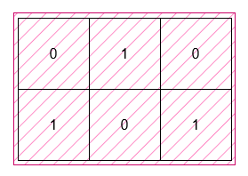
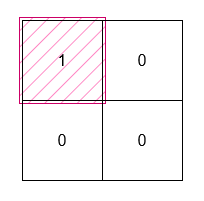

# 3195. 包含所有 1 的最小矩形面积 I

Medium · [力扣原题](https://leetcode.cn/problems/find-the-minimum-area-to-cover-all-ones-i/)

| 作者 | 题解 | 动画讲解 |
|---|---|---|
| 灵茶山艾府 | [📄 题解](灵茶山艾府.md) | [▶︎ 3195 包含所有 1 的最小矩形面积 I · 灵茶山艾府.mp4](3195%20包含所有%201%20的最小矩形面积%20I%20·%20灵茶山艾府.mp4) |
| yiduobo | [📄 题解](yiduobo.md) | [▶︎ 3195 包含所有 1 的最小矩形面积 I · yiduobo.mp4](3195%20包含所有%201%20的最小矩形面积%20I%20·%20yiduobo.mp4) |

## 题目描述

给你一个二维 **二进制** 数组 `grid`。请你找出一个边在水平方向和竖直方向上、面积 **最小** 的矩形，并且满足 `grid` 中所有的 1 都在矩形的内部。

返回这个矩形可能的 **最小** 面积。

**示例 1：**

**输入：** `grid = [[0,1,0],[1,0,1]]`

**输出：** `6`

**解释：**

这个最小矩形的高度为 2，宽度为 3，因此面积为 `2 * 3 = 6`。

**示例 2：**

**输入：** `grid = [[0,0],[1,0]]`

**输出：** `1`

**解释：**

这个最小矩形的高度和宽度都是 1，因此面积为 `1 * 1 = 1`。

**提示：**

- `1 <= grid.length, grid[i].length <= 1000`

- `grid[i][j]` 是 0 或 1。

- 输入保证 `grid` 中至少有一个 1 。

---
[↑ 返回 3100-3199](../README.md) · [总索引](../../../索引.md) · [仓库首页](../../../README.md)
