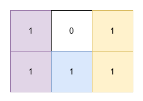

# 3197. 包含所有 1 的最小矩形面积 II

Hard · 难度分 2541 · [力扣原题](https://leetcode.cn/problems/find-the-minimum-area-to-cover-all-ones-ii/)

所在刷题路径：灵神题单·动态规划、灵神题单·常用数据结构、灵神题单·贪心与思维

| 作者 | 题解 | 动画讲解 |
|---|---|---|
| 灵茶山艾府 | [📄 题解](灵茶山艾府.md) | [▶︎ 3197 包含所有 1 的最小矩形面积 II · 灵茶山艾府.mp4](3197%20包含所有%201%20的最小矩形面积%20II%20·%20灵茶山艾府.mp4) |
| yiduobo | [📄 题解](yiduobo.md) | [▶︎ 3197 包含所有 1 的最小矩形面积 II · yiduobo.mp4](3197%20包含所有%201%20的最小矩形面积%20II%20·%20yiduobo.mp4) |

## 题目描述

给你一个二维 **二进制** 数组 `grid`。你需要找到 3 个 **不重叠**、面积 **非零** 、边在水平方向和竖直方向上的矩形，并且满足 `grid` 中所有的 1 都在这些矩形的内部。

返回这些矩形面积之和的 **最小** 可能值。

**注意**，这些矩形可以相接。

**示例 1：**

**输入：** `grid = [[1,0,1],[1,1,1]]`

**输出：** `5`

**解释：**

- 位于 `(0, 0)` 和 `(1, 0)` 的 1 被一个面积为 2 的矩形覆盖。

- 位于 `(0, 2)` 和 `(1, 2)` 的 1 被一个面积为 2 的矩形覆盖。

- 位于 `(1, 1)` 的 1 被一个面积为 1 的矩形覆盖。

**示例 2：**

**输入：** `grid = [[1,0,1,0],[0,1,0,1]]`

**输出：** `5`

**解释：**

- 位于 `(0, 0)` 和 `(0, 2)` 的 1 被一个面积为 3 的矩形覆盖。

- 位于 `(1, 1)` 的 1 被一个面积为 1 的矩形覆盖。

- 位于 `(1, 3)` 的 1 被一个面积为 1 的矩形覆盖。

**提示：**

- `1 <= grid.length, grid[i].length <= 30`

- `grid[i][j]` 是 0 或 1。

- 输入保证 `grid` 中至少有三个 1 。

---
[↑ 返回 3100-3199](../README.md) · [总索引](../../../索引.md) · [仓库首页](../../../README.md)
