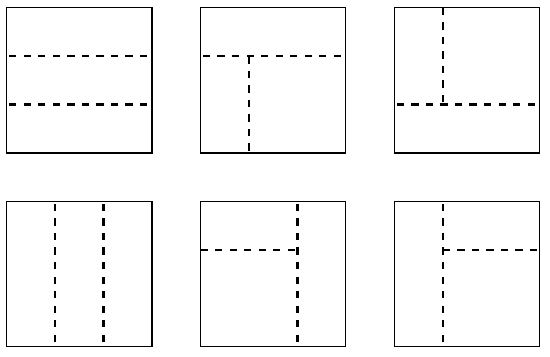

# 两种方法：O((mn)^2) 暴力 / O(mn) 动态规划（Python/Java/C++/Go）

> **[3197. 包含所有 1 的最小矩形面积 II](https://leetcode.cn/problems/find-the-minimum-area-to-cover-all-ones-ii/solutions/2819357/mei-ju-pythonjavacgo-by-endlesscheng-uu5p/) · Hard · 难度分 2541**

> **所属题单**
> - [常用数据结构 · 编程能力强化训练](../../../刷题路径/灵神原版题单/常用数据结构/编程能力强化训练.md) · Part C
> - [动态规划 · 七、其他线性 DP](../../../刷题路径/灵神原版题单/动态规划/七、其他线性%20DP.md) · §7.5 子矩形 DP
> - [贪心算法 · 五、思维题](../../../刷题路径/灵神原版题单/贪心算法/五、思维题.md) · §5.8 分类讨论

> **题目描述**
> 给你一个二维 **二进制** 数组 `grid`。你需要找到 3 个 **不重叠**、面积 **非零** 、边在水平方向和竖直方向上的矩形，并且满足 `grid` 中所有的 1 都在这些矩形的内部。
>
> 返回这些矩形面积之和的 **最小** 可能值。
>
> **注意**，这些矩形可以相接。
>
> **示例 1：**
>
> **输入：** `grid = [[1,0,1],[1,1,1]]`
>
> **输出：** `5`
>
> **解释：**
>
> 
>
> - 位于 `(0, 0)` 和 `(1, 0)` 的 1 被一个面积为 2 的矩形覆盖。
>
> - 位于 `(0, 2)` 和 `(1, 2)` 的 1 被一个面积为 2 的矩形覆盖。
>
> - 位于 `(1, 1)` 的 1 被一个面积为 1 的矩形覆盖。
>
> **示例 2：**
>
> **输入：** `grid = [[1,0,1,0],[0,1,0,1]]`
>
> **输出：** `5`
>
> **解释：**
>
> 
>
> - 位于 `(0, 0)` 和 `(0, 2)` 的 1 被一个面积为 3 的矩形覆盖。
>
> - 位于 `(1, 1)` 的 1 被一个面积为 1 的矩形覆盖。
>
> - 位于 `(1, 3)` 的 1 被一个面积为 1 的矩形覆盖。
>
> **提示：**
>
> - `1 <= grid.length, grid[i].length <= 30`
>
> - `grid[i][j]` 是 0 或 1。
>
> - 输入保证 `grid` 中至少有三个 1 。

> **题解**
> ## 方法一：暴力枚举
>
> 问题相当于把 $\textit{grid}$ 划分成三个区域，每个区域计算 [3195. 包含所有 1 的最小矩形面积 I](https://leetcode.cn/problems/find-the-minimum-area-to-cover-all-ones-i/)。
>
> 有如下六种划分方案。
>
> {:width=500px}
>
> 暴力枚举分割线的位置，把矩形划分成三个区域，每个区域用 3195 题的暴力方法求解。
>
> 只需实现图中上面三种方案，下面三种方案可以通过把 $\textit{grid}$ 顺时针旋转 $90^\circ$ 得到，从而复用同一段代码逻辑。
>
> 具体请看 [视频讲解](https://www.bilibili.com/video/BV1MZ421M74P/) 第四题，欢迎点赞关注~
>
> ```python
> # 把矩阵 a 顺时针旋转 90°
> def rotate(a: List[List[int]]) -> List[List[int]]:
>     return list(zip(*reversed(a)))
>
> class Solution:
>     def minimumSum(self, grid: List[List[int]]) -> int:
>         return min(self.solve(grid), self.solve(rotate(grid)))
>
>     def solve(self, a: List[List[int]]) -> int:
>         # 3195. 包含所有 1 的最小矩形面积 I
>         # 限定在 a 的 [l,r) 列中
>         def minimumArea(a: List[List[int]], l: int, r: int) -> int:
>             left = top = inf
>             right = bottom = 0
>             for i, row in enumerate(a):
>                 for j, x in enumerate(row[l:r]):
>                     if x:
>                         left = min(left, j)
>                         right = max(right, j)
>                         top = min(top, i)
>                         bottom = i
>             return (right - left + 1) * (bottom - top + 1)
>
>         ans = inf
>         m, n = len(a), len(a[0])
>
>         if m >= 3:
>             for i in range(1, m):
>                 for j in range(i + 1, m):
>                     # 图片上左
>                     area = minimumArea(a[:i], 0, n)
>                     area += minimumArea(a[i:j], 0, n)
>                     area += minimumArea(a[j:], 0, n)
>                     ans = min(ans, area)
>
>         if m >= 2 and n >= 2:
>             for i in range(1, m):
>                 for j in range(1, n):
>                     # 图片上中
>                     area = minimumArea(a[:i], 0, n)
>                     area += minimumArea(a[i:], 0, j)
>                     area += minimumArea(a[i:], j, n)
>                     ans = min(ans, area)
>
>                     # 图片上右
>                     area = minimumArea(a[:i], 0, j)
>                     area += minimumArea(a[:i], j, n)
>                     area += minimumArea(a[i:], 0, n)
>                     ans = min(ans, area)
>         return ans
> ```
>
>
> #### 复杂度分析
>
> - 时间复杂度：$\mathcal{O}((mn)^2)$，其中 $m$ 和 $n$ 分别为 $\textit{grid}$ 的行数和列数。
> - 空间复杂度：$\mathcal{O}(mn)$。
>
> ## 方法二：动态规划
>
> 方法一过于暴力了，大量的时间都花在遍历矩阵元素上，同一个元素会被反复遍历 $\mathcal{O}(mn)$ 次。
>
> 有重复计算的地方，就有优化。
>
> 回想一下你之前写过的一些二维 DP，比如网格图 DP、[二维前缀和](../../0300-0399/0304%20二维区域和检索%20-%20矩阵不可变/灵茶山艾府.md) 等。这类 DP 的特点是，可以从 $\textit{grid}$ 的一个角（比如左上角）开始，递推得到**包含这个角的所有子矩形的信息**。
>
> 在六种划分方案中，右边四种每个区域都包含 $\textit{grid}$ 的一个角。尝试 DP。
>
> {:width=500px}
>
> 定义 $f[i+1][j+1]$ 表示考虑「左上角为 $(0,0)$ 右下角为 $(i,j)$ 的子矩形」，包含这个子矩形中的所有 $1$ 的最小矩形面积。（我们算的是这个子矩形中的子矩形）
>
> 定义 $\textit{border}[i+1][j+1]$ 包含三个数，分别表示上述最小矩形的上边界、左边界和右边界。（下边界无需记录）
>
> 从上到下，从左到右遍历 $\textit{grid}$。设当前遍历到 $\textit{grid}[i]$ 这一行。在 $\textit{grid}[i][0]$ 到 $\textit{grid}[i][j]$ 中，设最左边的 $1$ 的列号为 $\textit{left}$（不存在则为 $-1$），最右边的 $1$ 的列号为 $\textit{right}$。注意 $\textit{left}$ 和 $\textit{right}$ 会随着我们遍历 $\textit{grid}[i]$ 这一行而发生变化。
>
> 分类讨论：
>
> - 如果 $\textit{grid}[i]$ 这一行包含 $1$，且 $0$ 到 $i-1$ 行全为 $0$，那么 $f[i+1][j+1] = \textit{right}-\textit{left}+1,\ \textit{border}[i+1][j+1]=(i,\textit{left},\textit{right})$。
> - 如果 $\textit{grid}[i]$ 这一行全为 $0$，那么包含「左上角为 $(0,0)$ 右下角为 $(i,j)$ 的子矩形」中的所有 $1$ 的最小矩形面积，等于包含「左上角为 $(0,0)$ 右下角为 $(i-1,j)$ 的子矩形」中的所有 $1$ 的最小矩形面积，即 $f[i+1][j+1] = f[i][j+1]$。同理有 $\textit{border}[i+1][j+1]=\textit{border}[i][j+1]$。
> - 如果 $\textit{grid}[i]$ 这一行包含 $1$，且 $0$ 到 $i-1$ 行中也有 $1$，那么最小矩形：
>   - 上边界是包含「左上角为 $(0,0)$ 右下角为 $(i-1,j)$ 的子矩形」中的所有 $1$ 的最小矩形的上边界，即 $\textit{border}[i][j+1]$ 的上边界，记作 $t$。
>   - 左边界是 $\textit{border}[i][j+1]$ 的左边界与 $\textit{left}$ 的最小值，记作 $l$。
>   - 右边界是 $\textit{border}[i][j+1]$ 的右边界与 $\textit{right}$ 的最大值，记作 $r$。
>   - 下边界是 $i$。
>   - 面积 $f[i+1][j+1] = (r - l + 1) \cdot (i - t + 1)$。
>   - 边界 $\textit{border}[i+1][j+1]=(t,l,r)$。
>
> 代码实现时，$\textit{border}$ 可以用一个长为 $n$ 的数组滚动计算。
>
> 按照上述方法，预处理：
>
> - 包含「左上角为 $(0,0)$ 右下角为 $(i,j)$ 的子矩形」中的所有 $1$ 的最小矩形面积。
> - 包含「左下角为 $(m-1,0)$ 右上角为 $(i,j)$ 的子矩形」中的所有 $1$ 的最小矩形面积。
> - 包含「右下角为 $(m-1,n-1)$ 左上角为 $(i,j)$ 的子矩形」中的所有 $1$ 的最小矩形面积。
> - 包含「右上角为 $(0,n-1)$ 左下角为 $(i,j)$ 的子矩形」中的所有 $1$ 的最小矩形面积。
>
> 这样就能快速计算六种划分方案中的右边四种。
>
> 对于左边两种，中间区域的最小矩形面积怎么算？
>
> 优化一下暴力的过程即可：
>
> - 首先预处理每行最左最右的 $1$ 的列号。
> - 然后在枚举两条分割线的同时，维护中间区域的最左最右 $1$ 的列号（最左取最小值，最右取最大值），以及最上最下的 $1$ 的行号。
>
> ```python
> def rotate(a: List[List[int]]) -> List[List[int]]:
>     return list(zip(*reversed(a)))
>
> class Solution:
>     def minimumSum(self, grid: List[List[int]]) -> int:
>         return min(self.solve(grid), self.solve(rotate(grid)))
>
>     def solve(self, a: List[List[int]]) -> int:
>         m, n = len(a), len(a[0])
>
>         def minimumArea(a: List[List[int]]) -> List[List[int]]:
>             m, n = len(a), len(a[0])
>             # f[i+1][j+1] 表示包含【左上角为 (0,0) 右下角为 (i,j) 的子矩形】中的所有 1 的最小矩形面积
>             f = [[0] * (n + 1) for _ in range(m + 1)]
>             border = [(-1, 0, 0)] * n
>             for i, row in enumerate(a):
>                 left, right = -1, 0
>                 for j, x in enumerate(row):
>                     if x:
>                         if left < 0:
>                             left = j
>                         right = j
>                     pre_top, pre_left, pre_right = border[j]
>                     if left < 0:  # 这一排目前全是 0
>                         f[i + 1][j + 1] = f[i][j + 1]  # 等于上面的结果
>                     elif pre_top < 0:  # 这一排有 1，上面全是 0
>                         f[i + 1][j + 1] = right - left + 1
>                         border[j] = (i, left, right)
>                     else:  # 这一排有 1，上面也有 1
>                         l = min(pre_left, left)
>                         r = max(pre_right, right)
>                         f[i + 1][j + 1] = (r - l + 1) * (i - pre_top + 1)
>                         border[j] = (pre_top, l, r)
>             return f
>
>         # 预处理每一行最左最右 1 的列号，用于中间区域最小矩形面积的计算
>         lr = [None] * m
>         for i in range(m):
>             l, r = -1, 0
>             for j in range(n):
>                 if a[i][j]:
>                     if l < 0:
>                         l = j
>                     r = j
>             lr[i] = (l, r)
>
>         # lt[i+1][j+1] = 包含【左上角为 (0,0) 右下角为 (i,j) 的子矩形】中的所有 1 的最小矩形面积
>         lt = minimumArea(a)
>         a = rotate(a)
>         # lb[i][j+1] = 包含【左下角为 (m-1,0) 右上角为 (i,j) 的子矩形】中的所有 1 的最小矩形面积
>         lb = rotate(rotate(rotate(minimumArea(a))))
>         a = rotate(a)
>         # rb[i][j] = 包含【右下角为 (m-1,n-1) 左上角为 (i,j) 的子矩形】中的所有 1 的最小矩形面积
>         rb = rotate(rotate(minimumArea(a)))
>         a = rotate(a)
>         # rt[i+1][j] = 包含【右上角为 (0,n-1) 左下角为 (i,j) 的子矩形】中的所有 1 的最小矩形面积
>         rt = rotate(minimumArea(a))
>
>         ans = inf
>         if m >= 3:
>             for i in range(1, m):
>                 left, right, top, bottom = n, -1, m, -1
>                 for j in range(i + 1, m):
>                     l, r = lr[j - 1]
>                     if l >= 0:
>                         left = min(left, l)
>                         right = max(right, r)
>                         top = min(top, j - 1)
>                         bottom = j - 1
>                     # 图片上左
>                     ans = min(ans, lt[i][n] + (right - left + 1) * (bottom - top + 1) + lb[j][n])
>
>         if m >= 2 and n >= 2:
>             for i in range(1, m):
>                 for j in range(1, n):
>                     # 图片上中
>                     ans = min(ans, lt[i][n] + lb[i][j] + rb[i][j])
>                     # 图片上右
>                     ans = min(ans, lt[i][j] + rt[i][j] + lb[i][n])
>         return ans
> ```
>
>
> #### 复杂度分析
>
> - 时间复杂度：$\mathcal{O}(mn)$，其中 $m$ 和 $n$ 分别为 $\textit{grid}$ 的行数和列数。
> - 空间复杂度：$\mathcal{O}(mn)$。
>
> ## 思考题
>
> 把题目中的 $3$ 改成 $4$ 呢？
>
> ## 分类题单
>
> [如何科学刷题？](https://leetcode.cn/circle/discuss/RvFUtj/)
>
> 1. [滑动窗口与双指针（定长/不定长/单序列/双序列/三指针/分组循环）](https://leetcode.cn/circle/discuss/0viNMK/)
> 2. [二分算法（二分答案/最小化最大值/最大化最小值/第K小）](https://leetcode.cn/circle/discuss/SqopEo/)
> 3. [单调栈（基础/矩形面积/贡献法/最小字典序）](https://leetcode.cn/circle/discuss/9oZFK9/)
> 4. [网格图（DFS/BFS/综合应用）](https://leetcode.cn/circle/discuss/YiXPXW/)
> 5. [位运算（基础/性质/拆位/试填/恒等式/思维）](https://leetcode.cn/circle/discuss/dHn9Vk/)
> 6. [图论算法（DFS/BFS/拓扑排序/基环树/最短路/最小生成树/网络流）](https://leetcode.cn/circle/discuss/01LUak/)
> 7. [动态规划（入门/背包/划分/状态机/区间/状压/数位/数据结构优化/树形/博弈/概率期望）](https://leetcode.cn/circle/discuss/tXLS3i/)
> 8. [常用数据结构（前缀和/差分/栈/队列/堆/字典树/并查集/树状数组/线段树）](https://leetcode.cn/circle/discuss/mOr1u6/)
> 9. [数学算法（数论/组合/概率期望/博弈/计算几何/随机算法）](https://leetcode.cn/circle/discuss/IYT3ss/)
> 10. [贪心与思维（基本贪心策略/反悔/区间/字典序/数学/思维/脑筋急转弯/构造）](https://leetcode.cn/circle/discuss/g6KTKL/)
> 11. [链表、二叉树与回溯（前后指针/快慢指针/DFS/BFS/直径/LCA/一般树）](https://leetcode.cn/circle/discuss/K0n2gO/)
> 12. [字符串（KMP/Z函数/Manacher/字符串哈希/AC自动机/后缀数组/子序列自动机）](https://leetcode.cn/circle/discuss/SJFwQI/)
>
> [我的题解精选（已分类）](https://github.com/EndlessCheng/codeforces-go/blob/master/leetcode/SOLUTIONS.md)
>
> 欢迎关注 [B站@灵茶山艾府](https://space.bilibili.com/206214)
