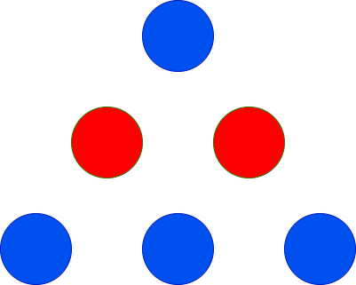
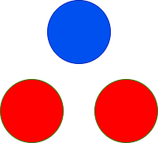

# 3200. 三角形的最大高度

Easy · [力扣原题](https://leetcode.cn/problems/maximum-height-of-a-triangle/)

| 作者 | 题解 | 动画讲解 |
|---|---|---|
| 灵茶山艾府 | [📄 题解](灵茶山艾府.md) | [▶︎ 动画（GIF）](3200%20三角形的最大高度%20·%20灵茶山艾府.gif) · [mp4 文件](3200%20三角形的最大高度%20·%20灵茶山艾府.mp4) |
| yiduobo | [📄 题解](yiduobo.md) | [▶︎ 动画（GIF）](3200%20三角形的最大高度%20·%20yiduobo.gif) · [mp4 文件](3200%20三角形的最大高度%20·%20yiduobo.mp4) |

## 动画讲解

> 动图会循环播放；想暂停、拖进度条请下载上面表格里的 mp4 文件。

### 灵茶山艾府

### yiduobo

## 题目描述

给你两个整数 `red` 和 `blue`，分别表示红色球和蓝色球的数量。你需要使用这些球来组成一个三角形，满足第 1 行有 1 个球，第 2 行有 2 个球，第 3 行有 3 个球，依此类推。

每一行的球必须是 **相同** 颜色，且相邻行的颜色必须 **不同**。

返回可以实现的三角形的 **最大** 高度。

**示例 1：**

**输入：** `red = 2, blue = 4`

**输出：** 3

**解释：**

上图显示了唯一可能的排列方式。

**示例 2：**

**输入：** `red = 2, blue = 1`

**输出：** `2`

**解释：**

上图显示了唯一可能的排列方式。

**示例 3：**

**输入：** `red = 1, blue = 1`

**输出：** `1`

**示例 4：**

**输入：** `red = 10, blue = 1`

**输出：** `2`

**解释：**

上图显示了唯一可能的排列方式。

**提示：**

- `1 <= red, blue <= 100`

---
[↑ 返回 3200-3299](../README.md) · [总索引](../../../索引.md) · [仓库首页](../../../README.md)
