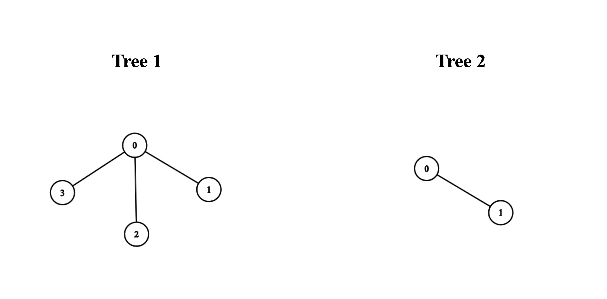
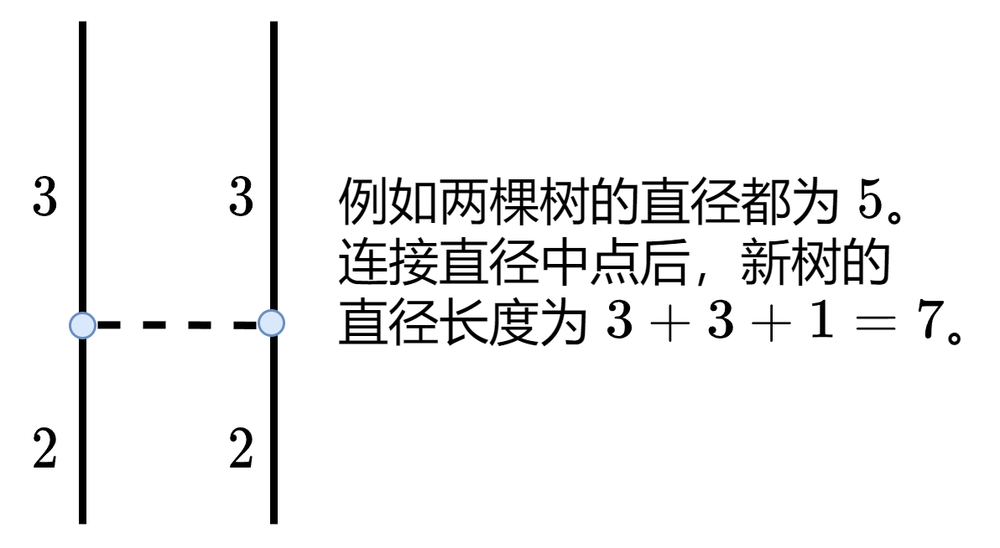

# 连接直径中点（Python/Java/C++/Go）

> **[3203. 合并两棵树后的最小直径](https://leetcode.cn/problems/find-minimum-diameter-after-merging-two-trees/solutions/2826587/lian-jie-zhi-jing-zhong-dian-pythonjavac-0e1c/) · Hard · 难度分 2266**

> **所属题单**
> - [链表、二叉树与回溯 · 三、一般树](../../../刷题路径/灵神原版题单/链表、二叉树与回溯/三、一般树.md) · §3.5 树的直径
> - [动态规划 · 十二、树形 DP](../../../刷题路径/灵神原版题单/动态规划/十二、树形%20DP.md) · §12.1 树的直径

> **题目描述**
> 给你两棵 **无向** 树，分别有 `n` 和 `m` 个节点，节点编号分别为 `0` 到 `n - 1` 和 `0` 到 `m - 1` 。给你两个二维整数数组 `edges1` 和 `edges2` ，长度分别为 `n - 1` 和 `m - 1` ，其中 `edges1[i] = [a_i, b_i]` 表示在第一棵树中节点 `a_i` 和 `b_i` 之间有一条边，`edges2[i] = [u_i, v_i]` 表示在第二棵树中节点 `u_i` 和 `v_i` 之间有一条边。
>
> 你必须在第一棵树和第二棵树中分别选一个节点，并用一条边连接它们。
>
> 请你返回添加边后得到的树中，**最小直径** 为多少。
>
> 一棵树的 **直径** 指的是树中任意两个节点之间的最长路径长度。
>
> **示例 1：**
>
> 
>
> **输入：**`edges1 = [[0,1],[0,2],[0,3]], edges2 = [[0,1]]`
>
> **输出：**`3`
>
> **解释：**
>
> 将第一棵树中的节点 0 与第二棵树中的任意节点连接，得到一棵直径为 3 的树。
>
> 示例 2：
>
> 
>
> **输入：**`edges1 = [[0,1],[0,2],[0,3],[2,4],[2,5],[3,6],[2,7]], edges2 = [[0,1],[0,2],[0,3],[2,4],[2,5],[3,6],[2,7]]`
>
> **输出：**`5`
>
> **解释：**
>
> 将第一棵树中的节点 0 和第二棵树中的节点 0 连接，可以得到一棵直径为 5 的树。
>
> **提示：**
>
> - `1 <= n, m <= 10⁵`
>
> - `edges1.length == n - 1`
>
> - `edges2.length == m - 1`
>
> - `edges1[i].length == edges2[i].length == 2`
>
> - `edges1[i] = [a_i, b_i]`
>
> - `0 <= a_i, b_i < n`
>
> - `edges2[i] = [u_i, v_i]`
>
> - `0 <= u_i, v_i < m`
>
> - 输入保证 `edges1` 和 `edges2` 分别表示一棵合法的树。

> **题解**
> **前置知识**：[树形 DP：树的直径【基础算法精讲 23】](https://www.bilibili.com/video/BV17o4y187h1/)
>
> 设 $d_1,d_2$ 分别为两棵树的直径长度。答案有三种情况：
>
> - 第一棵树的直径特别长。那么连边后，新树的直径仍然为第一棵树的直径，答案为 $d_1$。
> - 第二棵树的直径特别长。那么连边后，新树的直径仍然为第二棵树的直径，答案为 $d_2$。
> - 新树的直径经过添加的边。假设我们连接了第一棵树的节点 $x_1$ 与第二棵树的节点 $x_2$，那么新树的直径相当于以下三部分之和：
>   - $x_1$ 到第一棵树最远点的距离。由直径的定义可知，选 $x_1$ 为第一棵树的直径中点，可以让 $x_1$ 到第一棵树最远点的距离**最小**。
>   - $x_2$ 到第二棵树最远点的距离。由直径的定义可知，选 $x_2$ 为第二棵树的直径中点，可以让 $x_2$ 到第二棵树最远点的距离**最小**。
>   - $x_1\text{-}x_2$ 这条边的长度，即 $1$。
>   - 三部分之和为
>
> $$
> \begin{align}
>     & \left\lceil\dfrac{d_1}{2}\right\rceil + \left\lceil\dfrac{d_2}{2}\right\rceil + 1   \\
> ={} & \left\lfloor\dfrac{d_1+1}{2}\right\rfloor + \left\lfloor\dfrac{d_2+1}{2}\right\rfloor + 1       \\
> \end{align}
> $$
>
> 
>
> 三种情况取最大值，答案为
>
> $$
> \max\left\{d_1,d_2, \left\lfloor\dfrac{d_1+1}{2}\right\rfloor + \left\lfloor\dfrac{d_2+1}{2}\right\rfloor + 1  \right\}
> $$
>
> 具体请看 [视频讲解](https://www.bilibili.com/video/BV16w4m1e7y3/) 第四题，包括更详细的证明，欢迎点赞关注！
>
> ```python
> class Solution:
>     def diameter(self, edges: List[List[int]]) -> int:
>         g = [[] for _ in range(len(edges) + 1)]
>         for x, y in edges:
>             g[x].append(y)
>             g[y].append(x)
>
>         res = 0
>         def dfs(x: int, fa: int) -> int:
>             nonlocal res
>             max_len = 0
>             for y in g[x]:
>                 if y != fa:
>                     sub_len = dfs(y, x) + 1
>                     res = max(res, max_len + sub_len)
>                     max_len = max(max_len, sub_len)
>             return max_len
>         dfs(0, -1)
>         return res
>
>     def minimumDiameterAfterMerge(self, edges1: List[List[int]], edges2: List[List[int]]) -> int:
>         d1 = self.diameter(edges1)
>         d2 = self.diameter(edges2)
>         return max(d1, d2, (d1 + 1) // 2 + (d2 + 1) // 2 + 1)
> ```
>
>
> #### 复杂度分析
>
> - 时间复杂度：$\mathcal{O}(n+m)$，其中 $n$ 是 $\textit{edges}_1$ 的长度，$m$ 是 $\textit{edges}_2$ 的长度。
> - 空间复杂度：$\mathcal{O}(n+m)$。
>
> #### 相似题目
>
> 见 [动态规划题单](https://leetcode.cn/circle/discuss/tXLS3i/) 中的「**§12.1 树的直径**」。
>
> ## 分类题单
>
> 以下题单没有特定的顺序，可以按照个人喜好刷题。
>
> 1. [滑动窗口（定长/不定长/多指针）](https://leetcode.cn/circle/discuss/0viNMK/)
> 2. [二分算法（二分答案/最小化最大值/最大化最小值/第K小）](https://leetcode.cn/circle/discuss/SqopEo/)
> 3. [单调栈（基础/矩形面积/贡献法/最小字典序）](https://leetcode.cn/circle/discuss/9oZFK9/)
> 4. [网格图（DFS/BFS/综合应用）](https://leetcode.cn/circle/discuss/YiXPXW/)
> 5. [位运算（基础/性质/拆位/试填/恒等式/贪心/脑筋急转弯）](https://leetcode.cn/circle/discuss/dHn9Vk/)
> 6. [图论算法（DFS/BFS/拓扑排序/最短路/最小生成树/二分图/基环树/欧拉路径）](https://leetcode.cn/circle/discuss/01LUak/)
> 7. [动态规划（入门/背包/状态机/划分/区间/状压/数位/数据结构优化/树形/博弈/概率期望）](https://leetcode.cn/circle/discuss/tXLS3i/)
> 8. [常用数据结构（前缀和/差分/栈/队列/堆/字典树/并查集/树状数组/线段树）](https://leetcode.cn/circle/discuss/mOr1u6/)
> 9. [数学算法（数论/组合/概率期望/博弈/计算几何/随机算法）](https://leetcode.cn/circle/discuss/IYT3ss/)
> 10. [贪心算法（基本贪心策略/反悔/区间/字典序/数学/思维/构造）](https://leetcode.cn/circle/discuss/g6KTKL/)
>
> [我的题解精选（已分类）](https://github.com/EndlessCheng/codeforces-go/blob/master/leetcode/SOLUTIONS.md)
