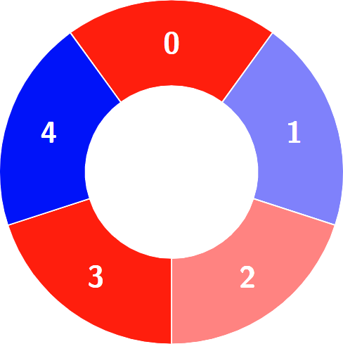

# 3206. 交替组 I

Easy · [力扣原题](https://leetcode.cn/problems/alternating-groups-i/)

| 作者 | 题解 | 动画讲解 |
|---|---|---|
| 灵茶山艾府 | [📄 题解](灵茶山艾府.md) | 灵神这篇题解指向 3208 题的题解，请看那道题的视频：[▶︎ 3208 交替组 II · 灵茶山艾府.mp4](../3208%20交替组%20II/3208%20交替组%20II%20·%20灵茶山艾府.mp4) |
| yiduobo | [📄 题解](yiduobo.md) | [▶︎ 3206 交替组 I · yiduobo.mp4](3206%20交替组%20I%20·%20yiduobo.mp4) |

## 题目描述

给你一个整数数组 `colors` ，它表示一个由红色和蓝色瓷砖组成的环，第 `i` 块瓷砖的颜色为 `colors[i]` ：

- `colors[i] == 0` 表示第 `i` 块瓷砖的颜色是 **红色** 。

- `colors[i] == 1` 表示第 `i` 块瓷砖的颜色是 **蓝色** 。

环中连续 3 块瓷砖的颜色如果是 **交替** 颜色（也就是说中间瓷砖的颜色与它 **左边** 和 **右边** 的颜色都不同），那么它被称为一个 **交替** 组。

请你返回 **交替** 组的数目。

**注意** ，由于 `colors` 表示一个 **环** ，**第一块** 瓷砖和 **最后一块** 瓷砖是相邻的。

**示例 1：**

**输入：**`colors = [1,1,1]`

**输出：**`0`

**解释：**

**示例 2：**

**输入：**`colors = [0,1,0,0,1]`

**输出：**3

**解释：**

交替组包括：

**提示：**

- `3 <= colors.length <= 100`

- `0 <= colors[i] <= 1`

---
[↑ 返回 3200-3299](../README.md) · [总索引](../../../索引.md) · [仓库首页](../../../README.md)
