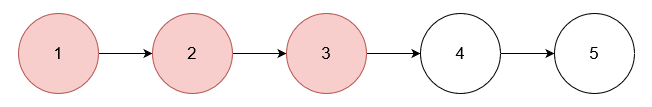
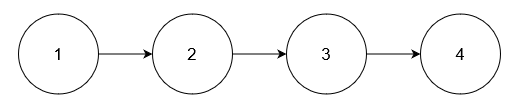

# 3217. 从链表中移除在数组中存在的节点

Medium · [力扣原题](https://leetcode.cn/problems/delete-nodes-from-linked-list-present-in-array/)

所在刷题路径：灵神题单·链表树与回溯

| 作者 | 题解 | 动画讲解 |
|---|---|---|
| 灵茶山艾府 | [📄 题解](灵茶山艾府.md) | [▶︎ 动画（GIF）](3217%20从链表中移除在数组中存在的节点%20·%20灵茶山艾府.gif) · [mp4 文件](3217%20从链表中移除在数组中存在的节点%20·%20灵茶山艾府.mp4) |
| yiduobo | [📄 题解](yiduobo.md) | [▶︎ 动画（GIF）](3217%20从链表中移除在数组中存在的节点%20·%20yiduobo.gif) · [mp4 文件](3217%20从链表中移除在数组中存在的节点%20·%20yiduobo.mp4) |

## 动画讲解

> 动图会循环播放；想暂停、拖进度条请下载上面表格里的 mp4 文件。

### 灵茶山艾府

### yiduobo

## 题目描述

给你一个整数数组 `nums` 和一个链表的头节点 `head`。从链表中**移除**所有存在于 `nums` 中的节点后，返回修改后的链表的头节点。

**示例 1：**

**输入：** `nums = [1,2,3], head = [1,2,3,4,5]`

**输出：** `[4,5]`

**解释：**

移除数值为 1, 2 和 3 的节点。

**示例 2：**

**输入：** `nums = [1], head = [1,2,1,2,1,2]`

**输出：** `[2,2,2]`

**解释：**

移除数值为 1 的节点。

**示例 3：**

**输入：** `nums = [5], head = [1,2,3,4]`

**输出：** `[1,2,3,4]`

**解释：**

链表中不存在值为 5 的节点。

**提示：**

- `1 <= nums.length <= 10⁵`

- `1 <= nums[i] <= 10⁵`

- `nums` 中的所有元素都是唯一的。

- 链表中的节点数在 `[1, 10⁵]` 的范围内。

- `1 <= Node.val <= 10⁵`

- 输入保证链表中至少有一个值没有在 `nums` 中出现过。

---
[↑ 返回 3200-3299](../README.md) · [总索引](../../../索引.md) · [仓库首页](../../../README.md)
