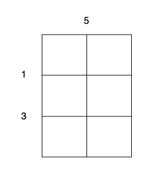
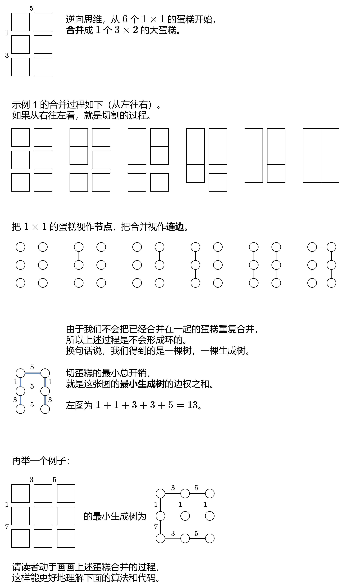

# 【图解】逆向思维+最小生成树（Python/Java/C++/C/Go/JS/Rust）

> **[3219. 切蛋糕的最小总开销 II](https://leetcode.cn/problems/minimum-cost-for-cutting-cake-ii/solutions/2843063/tan-xin-ji-qi-zheng-ming-jiao-huan-lun-z-ivtn/) · Hard**

> **所属题单**
> - [图论算法 · 四、最小生成树](../../../刷题路径/灵神原版题单/图论算法/四、最小生成树.md)

> **题目描述**
> 有一个 `m x n` 大小的矩形蛋糕，需要切成 `1 x 1` 的小块。
>
> 给你整数 `m` ，`n` 和两个数组：
>
> - `horizontalCut` 的大小为 `m - 1` ，其中 `horizontalCut[i]` 表示沿着水平线 `i` 切蛋糕的开销。
>
> - `verticalCut` 的大小为 `n - 1` ，其中 `verticalCut[j]` 表示沿着垂直线 `j` 切蛋糕的开销。
>
> 一次操作中，你可以选择任意不是 `1 x 1` 大小的矩形蛋糕并执行以下操作之一：
>
> 1. 沿着水平线 `i` 切开蛋糕，开销为 `horizontalCut[i]` 。
>
> 2. 沿着垂直线 `j` 切开蛋糕，开销为 `verticalCut[j]` 。
>
> 每次操作后，这块蛋糕都被切成两个独立的小蛋糕。
>
> 每次操作的开销都为最开始对应切割线的开销，并且不会改变。
>
> 请你返回将蛋糕全部切成 `1 x 1` 的蛋糕块的 **最小** 总开销。
>
> **示例 1：**
>
> **输入：**`m = 3, n = 2, horizontalCut = [1,3], verticalCut = [5]`
>
> **输出：**`13`
>
> **解释：**
>
> 
>
> - 沿着垂直线 0 切开蛋糕，开销为 5 。
>
> - 沿着水平线 0 切开 `3 x 1` 的蛋糕块，开销为 1 。
>
> - 沿着水平线 0 切开 `3 x 1` 的蛋糕块，开销为 1 。
>
> - 沿着水平线 1 切开 `2 x 1` 的蛋糕块，开销为 3 。
>
> - 沿着水平线 1 切开 `2 x 1` 的蛋糕块，开销为 3 。
>
> 总开销为 `5 + 1 + 1 + 3 + 3 = 13` 。
>
> **示例 2：**
>
> **输入：**`m = 2, n = 2, horizontalCut = [7], verticalCut = [4]`
>
> **输出：**`15`
>
> **解释：**
>
> - 沿着水平线 0 切开蛋糕，开销为 7 。
>
> - 沿着垂直线 0 切开 `1 x 2` 的蛋糕块，开销为 4 。
>
> - 沿着垂直线 0 切开 `1 x 2` 的蛋糕块，开销为 4 。
>
> 总开销为 `7 + 4 + 4 = 15` 。
>
> **提示：**
>
> - `1 <= m, n <= 10⁵`
>
> - `horizontalCut.length == m - 1`
>
> - `verticalCut.length == n - 1`
>
> - `1 <= horizontalCut[i], verticalCut[i] <= 10³`

> **题解**
> 
>
> 根据最小生成树的 **Kruskal 算法**，先把边权从小到大排序，然后遍历边，如果边的两个点属于不同连通块，则合并。
>
> 在上图中：
>
> - 由于 $1$ 最小，把第一、二排的节点上下连边，也就是把 $3$ 条边权为 $1$ 的边加入生成树。
> - 对于 $3$，由于第一、二排的节点已经上下连边，所以只需把 $2$ 条边权为 $3$ 的边加入生成树。
> - $5$ 同理，把 $2$ 条边权为 $5$ 的边加入生成树。
> - 最后，对于 $7$，此时只剩下两个连通块，只需把 $1$ 条边权为 $7$ 的边加入生成树。
>
> 一般地，我们用**双指针**计算答案：
>
> - 从小到大排序两个数组。初始化 $i=j=0$。
> - 如果 $\textit{horizontalCut}[i] < \textit{verticalCut}[j]$，把 $n-j$ 条边权为 $\textit{horizontalCut}[i]$ 的边加入答案，然后 $i$ 加一。
> - 否则，把 $m-i$ 条边权为 $\textit{verticalCut}[j]$ 的边加入答案，然后 $j$ 加一。
> - 循环次数为两个数组的长度之和，即 $(m-1)+(n-1)=m+n-2$。
>
> ```python
> class Solution:
>     def minimumCost(self, m: int, n: int, horizontalCut: List[int], verticalCut: List[int]) -> int:
>         horizontalCut.sort()
>         verticalCut.sort()
>         ans = i = j = 0
>         for _ in range(m + n - 2):
>             if j == n - 1 or i < m - 1 and horizontalCut[i] < verticalCut[j]:
>                 ans += horizontalCut[i] * (n - j)  # 上下连边
>                 i += 1
>             else:
>                 ans += verticalCut[j] * (m - i)  # 左右连边
>                 j += 1
>         return ans
> ```
>
>
> #### 复杂度分析
>
> - 时间复杂度：$\mathcal{O}(m\log m + n\log n)$。瓶颈在排序上。
> - 空间复杂度：$\mathcal{O}(1)$。不计入排序的栈开销。
>
> ## 分类题单
>
> [如何科学刷题？](https://leetcode.cn/circle/discuss/RvFUtj/)
>
> 1. [滑动窗口与双指针（定长/不定长/单序列/双序列/三指针/分组循环）](https://leetcode.cn/circle/discuss/0viNMK/)
> 2. [二分算法（二分答案/最小化最大值/最大化最小值/第K小）](https://leetcode.cn/circle/discuss/SqopEo/)
> 3. [单调栈（基础/矩形面积/贡献法/最小字典序）](https://leetcode.cn/circle/discuss/9oZFK9/)
> 4. [网格图（DFS/BFS/综合应用）](https://leetcode.cn/circle/discuss/YiXPXW/)
> 5. [位运算（基础/性质/拆位/试填/恒等式/思维）](https://leetcode.cn/circle/discuss/dHn9Vk/)
> 6. [图论算法（DFS/BFS/拓扑排序/最短路/最小生成树/二分图/基环树/欧拉路径）](https://leetcode.cn/circle/discuss/01LUak/)
> 7. [动态规划（入门/背包/状态机/划分/区间/状压/数位/数据结构优化/树形/博弈/概率期望）](https://leetcode.cn/circle/discuss/tXLS3i/)
> 8. [常用数据结构（前缀和/差分/栈/队列/堆/字典树/并查集/树状数组/线段树）](https://leetcode.cn/circle/discuss/mOr1u6/)
> 9. [数学算法（数论/组合/概率期望/博弈/计算几何/随机算法）](https://leetcode.cn/circle/discuss/IYT3ss/)
> 10. [贪心与思维（基本贪心策略/反悔/区间/字典序/数学/思维/脑筋急转弯/构造）](https://leetcode.cn/circle/discuss/g6KTKL/)
> 11. [链表、二叉树与回溯（前后指针/快慢指针/DFS/BFS/直径/LCA/一般树）](https://leetcode.cn/circle/discuss/K0n2gO/)
> 12. [字符串（KMP/Z函数/Manacher/字符串哈希/AC自动机/后缀数组/子序列自动机）](https://leetcode.cn/circle/discuss/SJFwQI/)
>
> [我的题解精选（已分类）](https://github.com/EndlessCheng/codeforces-go/blob/master/leetcode/SOLUTIONS.md)
>
> 欢迎关注 [B站@灵茶山艾府](https://space.bilibili.com/206214)
