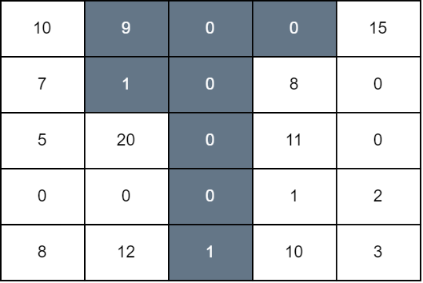
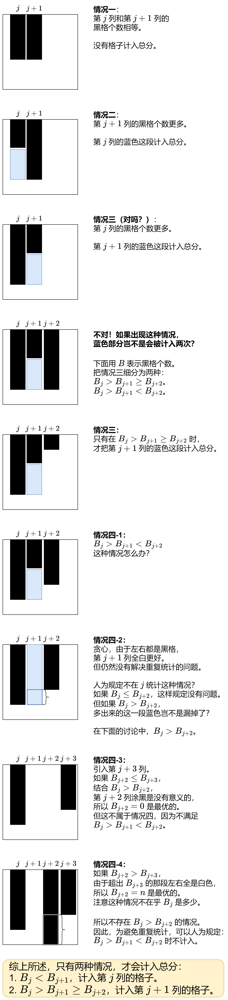

# 【图解】DP 及其优化：从 n^4 到 n^3 到 n^2（Python/Java/C++/Go）

> **[3225. 网格图操作后的最大分数](https://leetcode.cn/problems/maximum-score-from-grid-operations/solutions/2852362/tu-jie-dp-ji-qi-you-hua-by-endlesscheng-pco6/) · Hard · 难度分 3028**

> **所属题单**
> - [动态规划 · 七、其他线性 DP](../../../刷题路径/灵神原版题单/动态规划/七、其他线性%20DP.md) · §7.6 多维 DP

> **题目描述**
> 给你一个大小为 `n x n` 的二维矩阵 `grid` ，一开始所有格子都是白色的。一次操作中，你可以选择任意下标为 `(i, j)` 的格子，并将第 `j` 列中从最上面到第 `i` 行所有格子改成黑色。
>
> 如果格子 `(i, j)` 为白色，且左边或者右边的格子至少一个格子为黑色，那么我们将 `grid[i][j]` 加到最后网格图的总分中去。
>
> 请你返回执行任意次操作以后，最终网格图的 **最大** 总分数。
>
> **示例 1：**
>
> **输入：**`grid = [[0,0,0,0,0],[0,0,3,0,0],[0,1,0,0,0],[5,0,0,3,0],[0,0,0,0,2]]`
>
> **输出：**`11`
>
> **解释：**
>
> 
>
> 第一次操作中，我们将第 1 列中，最上面的格子到第 3 行的格子染成黑色。第二次操作中，我们将第 4 列中，最上面的格子到最后一行的格子染成黑色。最后网格图总分为 `grid[3][0] + grid[1][2] + grid[3][3]` 等于 11 。
>
> **示例 2：**
>
> **输入：**`grid = [[10,9,0,0,15],[7,1,0,8,0],[5,20,0,11,0],[0,0,0,1,2],[8,12,1,10,3]]`
>
> **输出：**`94`
>
> **解释：**
>
> 
>
> 我们对第 1 ，2 ，3 列分别从上往下染黑色到第 1 ，4， 0 行。最后网格图总分为 `grid[0][0] + grid[1][0] + grid[2][1] + grid[4][1] + grid[1][3] + grid[2][3] + grid[3][3] + grid[4][3] + grid[0][4]` 等于 94 。
>
> **提示：**
>
> - `1 <= n == grid.length <= 100`
>
> - `n == grid[i].length`
>
> - `0 <= grid[i][j] <= 10⁹`

> **题解**
> ## 一、从超时做法说起
>
> 从 $\mathcal{O}(n^4)$ 的 DP 开始。
>
> 要想知道第 $j$ 列的哪些行的 $\textit{grid}[i][j]$ 被计入总分，我们需要知道：
>
> - 第 $j+1$ 列有多少个黑色格子（下文简称为黑格）。
> - 第 $j$ 列有多少个黑格。
> - 第 $j-1$ 列有多少个黑格。
>
> 定义 $\textit{dfs}(j,\textit{cur},\textit{pre})$ 表示考虑第 $0$ 列到第 $j$ 列，其中第 $j+1$ 列有 $\textit{pre}$ 个黑格、第 $j$ 列有 $\textit{cur}$ 个黑格，返回在第 $0$ 列到第 $j$ 列中能得到的最大总分。
>
> 枚举第 $j-1$ 列有 $\textit{nxt}$ 个黑格，问题变成：
>
> - 考虑第 $0$ 列到第 $j-1$ 列，其中第 $j$ 列有 $\textit{cur}$ 个黑格，第 $j-1$ 列有 $\textit{nxt}$ 个黑格，在第 $0$ 列到第 $j-1$ 列中能得到最大总分，即 $\textit{dfs}(j-1,\textit{nxt},\textit{cur})$。
>
> 定义 $s$ 为 $\textit{grid}[\textit{cur}][j]$ 到 $\textit{grid}[\max(\textit{nxt},\textit{pre})-1][j]$ 的元素和，如果 $\max(\textit{nxt},\textit{pre}) \le \textit{cur}$ 则 $s=0$。
>
> 用 $\textit{dfs}(j-1,\textit{nxt},\textit{cur}) + s$ 更新 $\textit{dfs}(j,\textit{cur},\textit{pre})$ 的最大值。
>
> 递归边界：$j=0$ 时返回 $s$。
>
> 递归入口：$\max\limits_{i=0}^{n} \textit{dfs}(n-1,i,0)$。枚举第 $n-1$ 列有 $i$ 个黑格，取递归结果的最大值，作为答案。
>
> 由于做法超时，这里仅展示 Python 代码。
>
> ```python
> # 超时代码
> class Solution:
>     def maximumScore(self, grid: List[List[int]]) -> int:
>         n = len(grid)
>         # 每列的前缀和（从上到下）
>         col_sum = [list(accumulate(col, initial=0)) for col in zip(*grid)]
>
>         # cur 表示第 j 列的黑格个数
>         # pre 表示第 j+1 列的黑格个数
>         @cache
>         def dfs(j: int, cur: int, pre: int) -> int:
>             if j == 0:
>                 return col_sum[0][pre] - col_sum[0][cur] if pre > cur else 0
>             res = 0
>             # 枚举第 j-1 列有 nxt 个黑格
>             for nxt in range(n + 1):
>                 s = col_sum[j][max(nxt, pre)] - col_sum[j][cur] if max(nxt, pre) > cur else 0
>                 res = max(res, dfs(j - 1, nxt, cur) + s)
>             return res
>         # 枚举第 n-1 列有 i 个黑格
>         return max(dfs(n - 1, i, 0) for i in range(n + 1))
> ```
>
> #### 复杂度分析（超时）
>
> - 时间复杂度：$\mathcal{O}(n^4)$，其中 $n$ 是 $\textit{grid}$ 的长度。由于每个状态只会计算一次，动态规划的时间复杂度 $=$ 状态个数 $\times$ 单个状态的计算时间。本题状态个数等于 $\mathcal{O}(n^3)$，单个状态的计算时间为 $\mathcal{O}(n)$，所以动态规划的时间复杂度为 $\mathcal{O}(n^4)$。
> - 空间复杂度：$\mathcal{O}(n^3)$。
>
> ## 二、记忆化搜索
>
> 如果不考虑第 $j-1$ 列呢？不去枚举 $\textit{nxt}$，而是枚举 $\textit{cur}$ 呢？
>
> 我们的原则是，在从右往左递归的过程中，只把第 $j$ 列或者第 $j+1$ 列的格子计入总分，不考虑第 $j-1$ 列的格子。
>
> 如何**不重不漏**地统计呢？
>
> 
>
> 定义 $\textit{dfs}(j,\textit{pre},\textit{dec})$ 表示考虑第 $0$ 列到第 $j$ 列，其中：
>
> - 第 $j+1$ 列有 $\textit{pre}$ 个黑格；
> - 第 $j+1$ 列和第 $j+2$ 列的黑格个数的大小关系用布尔值 $\textit{dec}$ 表示，只有当第 $j+1$ 列的黑格个数小于第 $j+2$ 列的黑格个数时 $\textit{dec}$ 才为 $\texttt{true}$。
>
> 在上述约束下，返回第 $0$ 列到第 $j+1$ 列中能得到的最大总分。
>
> 枚举第 $j$ 列有 $\textit{cur}$ 个黑格，按照上图中的四种情况计算。
>
> 递归边界：$j=-1$ 时返回 $0$。
>
> 递归入口：$\max\limits_{i=0}^{n} \textit{dfs}(n-2,i,0)$。枚举第 $n-1$ 列有 $i$ 个黑格，取递归结果的最大值，作为答案。注意第 $n-1$ 列的格子会在 $j=n-2$ 中计入。
>
> ```python
> class Solution:
>     def maximumScore(self, grid: List[List[int]]) -> int:
>         n = len(grid)
>         # 每列的前缀和（从上到下）
>         col_sum = [list(accumulate(col, initial=0)) for col in zip(*grid)]
>
>         # pre 表示第 j+1 列的黑格个数
>         # dec=True 意味着第 j+1 列的黑格个数 (pre) < 第 j+2 列的黑格个数
>         @cache
>         def dfs(j: int, pre: int, dec: bool) -> int:
>             if j < 0:
>                 return 0
>             res = 0
>             # 枚举第 j 列有 cur 个黑格
>             for cur in range(n + 1):
>                 if cur == pre:  # 情况一：相等
>                     # 没有可以计入总分的格子
>                     res = max(res, dfs(j - 1, cur, False))
>                 elif cur < pre:  # 情况二：右边黑格多
>                     # 第 j 列的第 [cur, pre) 行的格子可以计入总分
>                     res = max(res, dfs(j - 1, cur, True) + col_sum[j][pre] - col_sum[j][cur])
>                 elif not dec:  # 情况三：cur > pre >= 第 j+2 列的黑格个数
>                     # 第 j+1 列的第 [pre, cur) 行的格子可以计入总分
>                     res = max(res, dfs(j - 1, cur, False) + col_sum[j + 1][cur] - col_sum[j + 1][pre])
>                 elif pre == 0:  # 情况四（凹形）：cur > pre < 第 j+2 列的黑格个数
>                     # 此时第 j+2 列全黑最优（递归过程中一定可以枚举到这种情况）
>                     # 第 j+1 列全白是最优的，所以只需考虑 pre=0 的情况
>                     # 由于第 j+1 列在 dfs(j+1) 的情况二中已经统计过，这里不重复统计
>                     res = max(res, dfs(j - 1, cur, False))
>             return res
>         # 枚举第 n-1 列有 i 个黑格
>         return max(dfs(n - 2, i, False) for i in range(n + 1))
> ```
>
>
> #### 复杂度分析
>
> - 时间复杂度：$\mathcal{O}(n^3)$，其中 $n$ 是 $\textit{grid}$ 的长度。由于每个状态只会计算一次，动态规划的时间复杂度 $=$ 状态个数 $\times$ 单个状态的计算时间。本题状态个数等于 $\mathcal{O}(n^2)$，单个状态的计算时间为 $\mathcal{O}(n)$，所以动态规划的时间复杂度为 $\mathcal{O}(n^3)$。
> - 空间复杂度：$\mathcal{O}(n^2)$。
>
> ## 三、1:1 翻译成递推
>
> 我们可以去掉递归中的「递」，只保留「归」的部分，即自底向上计算。
>
> 具体请看视频讲解 [动态规划入门：从记忆化搜索到递推](https://www.bilibili.com/video/BV1Xj411K7oF/)，其中包含把记忆化搜索 1:1 翻译成递推的技巧。
>
> $f[j+1][\textit{pre}][\textit{dec}]$ 的定义和 $\textit{dfs}(j,\textit{pre},\textit{dec})$ 的定义是一样的。注意这里是 $j+1$ 不是 $j$，因为要避免 $j=-1$ 时出现负数下标。
>
> 初始值 $f[0][\textit{pre}][\textit{dec}]=0$，翻译自递归边界。
>
> 答案为 $\max\limits_{i=0}^{n} f[n-1][i][0]$，翻译自递归入口。
>
> ```python
> class Solution:
>     def maximumScore(self, grid: List[List[int]]) -> int:
>         n = len(grid)
>         # 每列的前缀和（从上到下）
>         col_sum = [list(accumulate(col, initial=0)) for col in zip(*grid)]
>         f = [[[0, 0] for _ in range(n + 1)] for _ in range(n)]
>         for j in range(n - 1):
>             # pre 表示第 j+1 列的黑格个数
>             for pre in range(n + 1):
>                 # dec=1 意味着第 j+1 列的黑格个数 (pre) < 第 j+2 列的黑格个数
>                 for dec in range(2):
>                     res = 0
>                     # 枚举第 j 列有 cur 个黑格
>                     for cur in range(n + 1):
>                         if cur == pre:  # 情况一：相等
>                             # 没有可以计入总分的格子
>                             res = max(res, f[j][cur][0])
>                         elif cur < pre:  # 情况二：右边黑格多
>                             # 第 j 列的第 [cur, pre) 行的格子可以计入总分
>                             res = max(res, f[j][cur][1] + col_sum[j][pre] - col_sum[j][cur])
>                         elif dec == 0:  # 情况三：cur > pre >= 第 j+2 列的黑格个数
>                             # 第 j+1 列的第 [pre, cur) 行的格子可以计入总分
>                             res = max(res, f[j][cur][0] + col_sum[j + 1][cur] - col_sum[j + 1][pre])
>                         elif pre == 0:  # 情况四（凹形）：cur > pre < 第 j+2 列的黑格个数
>                             # 此时第 j+2 列全黑最优（递归过程中一定可以枚举到这种情况）
>                             # 第 j+1 列全白是最优的，所以只需考虑 pre=0 的情况
>                             # 由于第 j+1 列在 dfs(j+1) 的情况二中已经统计过，这里不重复统计
>                             res = max(res, f[j][cur][0])
>                     f[j + 1][pre][dec] = res
>         # 枚举第 n-1 列有 i 个黑格
>         return max(f[-1][i][0] for i in range(n + 1))
> ```
>
>
> #### 复杂度分析
>
> - 时间复杂度：$\mathcal{O}(n^3)$，其中 $n$ 是 $\textit{grid}$ 的长度。
> - 空间复杂度：$\mathcal{O}(n^2)$。
>
> ## 四、时间优化
>
> 把最内层的枚举 $\textit{cur}$ 的循环优化掉。
>
> 首先计算 $\textit{pre}>0$ 的状态，然后单独计算 $\textit{pre}=0$ 的状态。
>
> ### 1) pre > 0 且 dec = 1
>
> $\textit{pre}> 0$ 的状态，没有情况四。
>
> 对于 $f[j+1][\textit{pre}][1]$，需要计算 $f[j][\textit{pre}][0]$（情况一）与下式（情况二）的最大值：
>
> $$
> \begin{aligned}
>     & \max\limits_{\textit{cur}=0}^{\textit{pre}-1} \{f[j][\textit{cur}][1] + \textit{colSum}[j][\textit{pre}] - \textit{colSum}[j][\textit{cur}]\}      \\
> ={} & \textit{colSum}[j][\textit{pre}] +   \max\limits_{\textit{cur}=0}^{\textit{pre}-1} \{f[j][\textit{cur}][1] - \textit{colSum}[j][\textit{cur}]\}      \\
> \end{aligned}
> $$
>
> 其中 
>
> $$
> \max\limits_{\textit{cur}=0}^{\textit{pre}-1} \{f[j][\textit{cur}][1] - \textit{colSum}[j][\textit{cur}]\}
> $$
>
> 可以一边**从小到大**枚举 $\textit{pre}$，一边用一个变量 $\textit{preMax}$ 维护。
>
> ### 2) pre > 0 且 dec = 0
>
> 对于 $f[j+1][\textit{pre}][0]$，除了上面 $\textit{dec}=1$ 要计算的，这里也要计算外，还需要计算下式（情况三）的最大值：
>
> $$
> \begin{aligned}
> & \max\limits_{\textit{cur}=pre+1}^{n} \{ f[j][\textit{cur}][0] + \textit{colSum}[j + 1][\textit{cur}]  - \textit{colSum}[j + 1][\textit{pre}] \}      \\
> ={} & - \textit{colSum}[j + 1][\textit{pre}] +   \max\limits_{\textit{cur}=pre+1}^{n} \{ f[j][\textit{cur}][0] + \textit{colSum}[j + 1][\textit{cur}] \}       \\
> \end{aligned}
> $$
>
> 其中
>
> $$
> \max\limits_{\textit{cur}=pre+1}^{n} \{ f[j][\textit{cur}][0] + \textit{colSum}[j + 1][\textit{cur}] \}
> $$
>
> 可以一边**从大到小**枚举 $\textit{pre}$，一边用一个变量 $\textit{sufMax}$ 维护。
>
> ### 3) pre = 0 且 dec = 0
>
> $\textit{pre}=0$ 的状态，没有情况二。
>
> 对于 $f[j+1][0][0]$，需要计算 $f[j][0][0]$（情况一）与下式（情况三）的最大值：
>
> $$
> \max\limits_{\textit{cur}=1}^{n} \{ f[j][\textit{cur}][0] + \textit{colSum}[j + 1][\textit{cur}] \}
> $$
>
> 这正是上面循环结束后的 $\textit{sufMax}$。
>
> 此外，由于不可能连续三列全白，所以无需考虑从 $f[j][0][0]$（情况一）转移过来，因此
>
> $$
> f[j+1][0][0] = \textit{sufMax}
> $$
>
> ### 4) pre = 0 且 dec = 1
>
> 对于 $f[j+1][0][1]$，需要计算下式（情况一与情况四）的最大值：
>
> $$
> \max\limits_{\textit{cur}=0}^{n} f[j][\textit{cur}][0]
> $$
>
> 但在 $\textit{pre}=0$ 且 $\textit{dec}=1$ 的前提下，其实只需考虑第 $j$ 列全白（$\textit{cur}=0$）或全黑（$\textit{cur}=n$）两种情况。沿用上文图片中的证明方法，考虑第 $j-1$ 列的黑格个数 $B_{j-1}$：
>
> - 如果 $B_{j-1} \ge B_j$，第 $j$ 列全白更好。
> - 如果 $B_{j-1} < B_j$，第 $j$ 列多出的段左右都是白格，所以全黑更好。
>
> 因此
>
> $$
> f[j+1][0][1] = \max(f[j][0][0], f[j][n][0])
> $$
>
> ```python
> class Solution:
>     def maximumScore(self, grid: List[List[int]]) -> int:
>         n = len(grid)
>         col_sum = [list(accumulate(col, initial=0)) for col in zip(*grid)]
>
>         f = [[[0, 0] for _ in range(n + 1)] for _ in range(n)]
>         for j in range(n - 1):
>             # 用前缀最大值优化
>             pre_max = f[j][0][1] - col_sum[j][0]
>             for pre in range(1, n + 1):
>                 f[j + 1][pre][0] = f[j + 1][pre][1] = max(f[j][pre][0], pre_max + col_sum[j][pre])
>                 pre_max = max(pre_max, f[j][pre][1] - col_sum[j][pre])
>
>             # 用后缀最大值优化
>             suf_max = f[j][n][0] + col_sum[j + 1][n]
>             for pre in range(n - 1, 0, -1):
>                 f[j + 1][pre][0] = max(f[j + 1][pre][0], suf_max - col_sum[j + 1][pre])
>                 suf_max = max(suf_max, f[j][pre][0] + col_sum[j + 1][pre])
>
>             # 单独计算 pre=0 的状态
>             f[j + 1][0][0] = suf_max  # 无需考虑 f[j][0][0]，因为不能连续三列全白
>             f[j + 1][0][1] = max(f[j][0][0], f[j][n][0])  # 第 j 列要么全白，要么全黑
>
>         return max(f[-1][i][0] for i in range(n + 1))
> ```
>
>
> #### 复杂度分析
>
> - 时间复杂度：$\mathcal{O}(n^2)$，其中 $n$ 是 $\textit{grid}$ 的长度。这是本题的最优复杂度，因为遍历 $\textit{grid}$ 就需要 $\mathcal{O}(n^2)$ 的时间了。
> - 空间复杂度：$\mathcal{O}(n^2)$。
>
> > 注：空间复杂度可以进一步优化至 $\mathcal{O}(n)$，需要用到滚动数组，并在 DP 的过程中计算列的前缀和。
>
> ## 分类题单
>
> [如何科学刷题？](https://leetcode.cn/circle/discuss/RvFUtj/)
>
> 1. [滑动窗口（定长/不定长/多指针）](https://leetcode.cn/circle/discuss/0viNMK/)
> 2. [二分算法（二分答案/最小化最大值/最大化最小值/第K小）](https://leetcode.cn/circle/discuss/SqopEo/)
> 3. [单调栈（基础/矩形面积/贡献法/最小字典序）](https://leetcode.cn/circle/discuss/9oZFK9/)
> 4. [网格图（DFS/BFS/综合应用）](https://leetcode.cn/circle/discuss/YiXPXW/)
> 5. [位运算（基础/性质/拆位/试填/恒等式/思维）](https://leetcode.cn/circle/discuss/dHn9Vk/)
> 6. [图论算法（DFS/BFS/拓扑排序/最短路/最小生成树/二分图/基环树/欧拉路径）](https://leetcode.cn/circle/discuss/01LUak/)
> 7. [动态规划（入门/背包/状态机/划分/区间/状压/数位/数据结构优化/树形/博弈/概率期望）](https://leetcode.cn/circle/discuss/tXLS3i/)
> 8. [常用数据结构（前缀和/差分/栈/队列/堆/字典树/并查集/树状数组/线段树）](https://leetcode.cn/circle/discuss/mOr1u6/)
> 9. [数学算法（数论/组合/概率期望/博弈/计算几何/随机算法）](https://leetcode.cn/circle/discuss/IYT3ss/)
> 10. [贪心算法（基本贪心策略/反悔/区间/字典序/数学/思维/脑筋急转弯/构造）](https://leetcode.cn/circle/discuss/g6KTKL/)
>
> [我的题解精选（已分类）](https://github.com/EndlessCheng/codeforces-go/blob/master/leetcode/SOLUTIONS.md)
