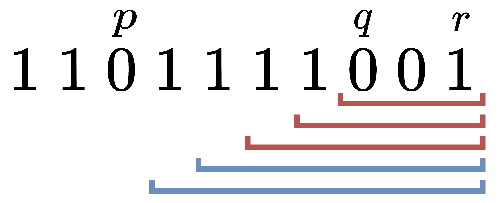

# 枚举子串中的 0 的个数（Python/Java/C++/C/Go/JS/Rust）

> **[3234. 统计 1 显著的字符串的数量](https://leetcode.cn/problems/count-the-number-of-substrings-with-dominant-ones/solutions/2860198/mei-ju-zi-chuan-zhong-de-0-de-ge-shu-pyt-c654/) · Medium · 难度分 2557**

> **所属题单**
> - [常用数据结构 · 十一、根号算法](../../../刷题路径/灵神原版题单/常用数据结构/十一、根号算法.md) · §11.4 其他

> **题目描述**
> 给你一个二进制字符串 `s`。
>
> 请你统计并返回其中 **1 显著**  的 子字符串 的数量。
>
> 如果字符串中 1 的数量 **大于或等于** 0 的数量的 **平方**，则认为该字符串是一个 **1 显著** 的字符串 。
>
> **示例 1：**
>
> **输入：**`s = "00011"`
>
> **输出：**`5`
>
> **解释：**
>
> 1 显著的子字符串如下表所示。
>
> 			i
> 			j
> 			s[i..j]
> 			0 的数量
> 			1 的数量
>
> 			3
> 			3
> 			1
> 			0
> 			1
>
> 			4
> 			4
> 			1
> 			0
> 			1
>
> 			2
> 			3
> 			01
> 			1
> 			1
>
> 			3
> 			4
> 			11
> 			0
> 			2
>
> 			2
> 			4
> 			011
> 			1
> 			2
>
> **示例 2：**
>
> **输入：**`s = "101101"`
>
> **输出：**`16`
>
> **解释：**
>
> 1 不显著的子字符串如下表所示。
>
> 总共有 21 个子字符串，其中 5 个是 1 不显著字符串，因此有 16 个 1 显著子字符串。
>
> 			i
> 			j
> 			s[i..j]
> 			0 的数量
> 			1 的数量
>
> 			1
> 			1
> 			0
> 			1
> 			0
>
> 			4
> 			4
> 			0
> 			1
> 			0
>
> 			1
> 			4
> 			0110
> 			2
> 			2
>
> 			0
> 			4
> 			10110
> 			2
> 			3
>
> 			1
> 			5
> 			01101
> 			2
> 			3
>
> **提示：**
>
> - `1 <= s.length <= 4 * 10⁴`
>
> - `s` 仅包含字符 `'0'` 和 `'1'`。

> **题解**
> ## 分析
>
> 设 $\textit{cnt}_0$ 为子串中的 $0$ 的个数，$\textit{cnt}_1$ 为子串中的 $1$ 的个数。
>
> 根据题意，$1$ 显著子串必须满足
>
> $$
> 0\le \textit{cnt}_0^2 \le \textit{cnt}_1 \le n
> $$
>
> 解得
>
> $$
> 0\le \textit{cnt}_0 \le \sqrt{n}
> $$
>
> 所以 $1$ 显著子串**至多**有 $\lfloor \sqrt{n}\rfloor$ 个 $0$。本题 $\lfloor \sqrt{n}\rfloor\le 200$。
>
> ## 核心思路
>
> 枚举子串右端点，分别计算：
>
> - **恰好**有 $0$ 个 $0$ 的子串有多少个？
> - **恰好**有 $1$ 个 $0$ 的子串有多少个？
> - **恰好**有 $2$ 个 $0$ 的子串有多少个？
> - ……
> - **恰好**有 $\lfloor \sqrt{n}\rfloor$ 个 $0$ 的子串有多少个？
>
> 记录 $s$ 中的 $0$ 的下标，方便计算子串个数。
>
> ## 详细思路
>
> 设子串右端点为 $r$。
>
> 设上一个 $0$ 的下标为 $i$。
>
> 那么右端点**固定**为 $r$ 的子串 $[i+1,r],[i+2,r],\ldots,[r,r]$ 都是不包含 $0$ 的，一定是 $1$ 显著子串，这有 $r-i$ 个。
>
> 设上上一个 $0$ 的下标为 $j$。
>
> 那么子串 $[j+1,r],[j+2,r],\ldots,[i,r]$ 都恰好有 $1$ 个 $0$。
>
> - 如果 $s_r = 1$，那么这些子串都至少有 $1$ 个 $1$，都是 $1$ 显著子串。
> - 如果 $s_r = 0$，也就是 $i = r$，那么最右边的 $[i,r]$ 不是 $1$ 显著子串。
>
> 这意味着我们还要考虑子串是否**有足够的** $1$。
>
> 下面考虑更一般的情况。
>
> {:width=600px}
>
> 上图用红线/蓝线标记的子串，右端点相同，左端点不同，都恰好有 $2$ 个 $0$。
>
> 子串 $1$ 的个数必须 $\ge$ 子串 $0$ 的个数的平方，也就是至少有 $2^2=4$ 个 $1$。上图中的红色子串不满足要求，蓝色子串满足要求。
>
> 在包含的 $0$ 的个数不变的前提下，子串左端点越小，$1$ 的个数越多，越满足要求；子串左端点越大，$1$ 的个数越少，越不满足要求。
>
> 算出**刚好满足要求**的那个蓝色子串的左端点（即左端点的最大值），以及更左边的 $0$ 的位置（图中的 $p$，加一得到左端点的最小值），就能算出蓝色子串的个数。
>
> 一般地，外层循环枚举子串右端点 $r=0,1,2,\ldots,n-1$，内层循环枚举子串**恰好**有 $\textit{cnt}_0 = 0,1,2,\ldots$ 个 $0$，如果 $\textit{cnt}_0^2$ 超过了 $[0,r]$ 中的 $1$ 的个数，则跳出枚举 $\textit{cnt}_0$ 的循环。
>
> 设当前枚举的 $\textit{cnt}_0$ 对应的左右两个 $0$ 的下标分别为 $p$ 和 $q$。
>
> 右端点为 $r$ 且恰好有 $\textit{cnt}_0$ 个 $0$ 的最短子串为 $[q,r]$，设其有 $\textit{cnt}_1$ 个 $1$。
>
> 分类讨论：
>
> - 如果 $\textit{cnt}_0^2\le \textit{cnt}_1$，那么子串左端点可以是 $p+1,p+2,\ldots, q$，一共 $q-p$ 个合法左端点。
> - 如果 $\textit{cnt}_0^2> \textit{cnt}_1$，那么还需要包含至少 $\textit{cnt}_0^2 - \textit{cnt}_1$ 个 $1$，所以子串左端点的最大值为 $q - (\textit{cnt}_0^2 - \textit{cnt}_1)$，最小值为 $p+1$，一共 $q - (\textit{cnt}_0^2 - \textit{cnt}_1) - p$ 个合法左端点。如果个数是负数，则没有合法左端点。
>
> 综合一下，合法左端点最小是 $p+1$，最大是 $q - \max(\textit{cnt}_0^2 - \textit{cnt}_1, 0)$，所以一共有
>
> $$
> q - \max(\textit{cnt}_0^2 - \textit{cnt}_1, 0) - p
> $$
>
> 个合法左端点。考虑到上式可能是负数，所以还要再与 $0$ 取最大值，得
>
> $$
> \max\left(q - \max(\textit{cnt}_0^2 - \textit{cnt}_1, 0) - p, 0\right)
> $$
>
> 累加上式，即为答案。
>
> 为了知道 $0$ 的下标，我们用一个列表记录遍历到的 $0$ 的下标。
>
> ```python
> # 手写 max 更快
> max = lambda a, b: b if b > a else a
>
> class Solution:
>     def numberOfSubstrings(self, s: str) -> int:
>         pos0 = [-1]  # 哨兵，方便处理 cnt0 达到最大时的计数
>         total1 = 0  # [0,r] 中的 1 的个数
>         ans = 0
>
>         for r, ch in enumerate(s):
>             if ch == '0':
>                 pos0.append(r)  # 记录 0 的下标
>             else:
>                 total1 += 1
>                 ans += r - pos0[-1]  # 单独计算不含 0 的子串个数
>
>             # 倒着遍历 pos0，就相当于在从小到大枚举 cnt0
>             for i in range(len(pos0) - 1, 0, -1):
>                 cnt0 = len(pos0) - i
>                 if cnt0 * cnt0 > total1:
>                     break
>                 p, q = pos0[i - 1], pos0[i]
>                 cnt1 = r - q + 1 - cnt0  # [q,r] 中的 1 的个数 = [q,r] 的长度 - cnt0
>                 ans += max(q - max(cnt0 * cnt0 - cnt1, 0) - p, 0)
>
>         return ans
> ```
>
>
> #### 复杂度分析
>
> - 时间复杂度：$\mathcal{O}(n\sqrt{n})$，其中 $n$ 是 $s$ 的长度。
> - 空间复杂度：$\mathcal{O}(n)$。
>
> **注**：使用队列，只保存 $r$ 及其左侧的 $\mathcal{O}(\sqrt{n})$ 个 $0$ 的下标，可以把空间复杂度优化到 $\mathcal{O}(\sqrt{n})$。
>
> ## 分类题单
>
> [如何科学刷题？](https://leetcode.cn/circle/discuss/RvFUtj/)
>
> 1. [滑动窗口与双指针（定长/不定长/单序列/双序列/三指针/分组循环）](https://leetcode.cn/circle/discuss/0viNMK/)
> 2. [二分算法（二分答案/最小化最大值/最大化最小值/第K小）](https://leetcode.cn/circle/discuss/SqopEo/)
> 3. [单调栈（基础/矩形面积/贡献法/最小字典序）](https://leetcode.cn/circle/discuss/9oZFK9/)
> 4. [网格图（DFS/BFS/综合应用）](https://leetcode.cn/circle/discuss/YiXPXW/)
> 5. [位运算（基础/性质/拆位/试填/恒等式/思维）](https://leetcode.cn/circle/discuss/dHn9Vk/)
> 6. [图论算法（DFS/BFS/拓扑排序/基环树/最短路/最小生成树/网络流）](https://leetcode.cn/circle/discuss/01LUak/)
> 7. [动态规划（入门/背包/划分/状态机/区间/状压/数位/数据结构优化/树形/博弈/概率期望）](https://leetcode.cn/circle/discuss/tXLS3i/)
> 8. [常用数据结构（前缀和/差分/栈/队列/堆/字典树/并查集/树状数组/线段树）](https://leetcode.cn/circle/discuss/mOr1u6/)
> 9. [数学算法（数论/组合/概率期望/博弈/计算几何/随机算法）](https://leetcode.cn/circle/discuss/IYT3ss/)
> 10. [贪心与思维（基本贪心策略/反悔/区间/字典序/数学/思维/脑筋急转弯/构造）](https://leetcode.cn/circle/discuss/g6KTKL/)
> 11. [链表、树与回溯（前后指针/快慢指针/DFS/BFS/直径/LCA）](https://leetcode.cn/circle/discuss/K0n2gO/)
> 12. [字符串（KMP/Z函数/Manacher/字符串哈希/AC自动机/后缀数组/子序列自动机）](https://leetcode.cn/circle/discuss/SJFwQI/)
>
> [我的题解精选（已分类）](https://github.com/EndlessCheng/codeforces-go/blob/master/leetcode/SOLUTIONS.md)
>
> 欢迎关注 [B站@灵茶山艾府](https://space.bilibili.com/206214)
