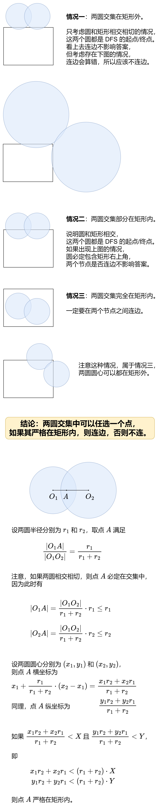
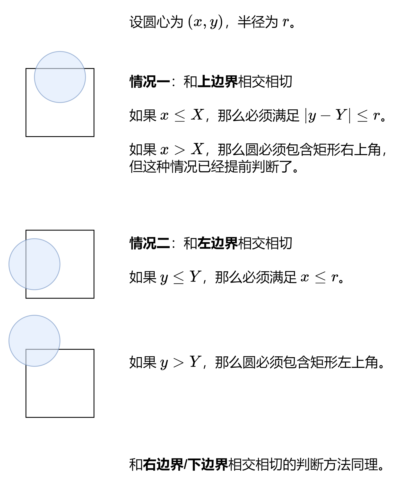

# 【图解】转换成图上 DFS + 避免浮点数的做法（Python/Java/C++/C/Go/JS/Rust）

> **[3235. 判断矩形的两个角落是否可达](https://leetcode.cn/problems/check-if-the-rectangle-corner-is-reachable/solutions/2860214/deng-jie-zhuan-huan-bing-cha-ji-pythonja-yf9y/) · Hard**

> **所属题单**
> - [常用数据结构 · 七、并查集](../../../刷题路径/灵神原版题单/常用数据结构/七、并查集.md) · §7.2 进阶
> - [数学算法 · 五、计算几何](../../../刷题路径/灵神原版题单/数学算法/五、计算几何.md) · §5.2 圆

> **题目描述**
> 给你两个正整数 `xCorner` 和 `yCorner` 和一个二维整数数组 `circles` ，其中 `circles[i] = [x_i, y_i, r_i]` 表示一个圆心在 `(x_i, y_i)` 半径为 `r_i` 的圆。
>
> 坐标平面内有一个左下角在原点，右上角在 `(xCorner, yCorner)` 的矩形。你需要判断是否存在一条从左下角到右上角的路径满足：路径 **完全** 在矩形内部，**不会** 触碰或者经过 **任何** 圆的内部和边界，同时 **只** 在起点和终点接触到矩形。
>
> 如果存在这样的路径，请你返回 `true` ，否则返回 `false` 。
>
> **示例 1：**
>
> **输入：**`X = 3, Y = 4, circles = [[2,1,1]]`
>
> **输出：**`true`
>
> **解释：**
>
> 
>
> 黑色曲线表示一条从 `(0, 0)` 到 `(3, 4)` 的路径。
>
> **示例 2：**
>
> **输入：**`X = 3, Y = 3, circles = [[1,1,2]]`
>
> **输出：**`false`
>
> **解释：**
>
> 
>
> 不存在从 `(0, 0)` 到 `(3, 3)` 的路径。
>
> **示例 3：**
>
> **输入：**`X = 3, Y = 3, circles = [[2,1,1],[1,2,1]]`
>
> **输出：**`false`
>
> **解释：**
>
> 
>
> 不存在从 `(0, 0)` 到 `(3, 3)` 的路径。
>
> **示例 4：**
>
> **输入：**`X = 4, Y = 4, circles = [[5,5,1]]`
>
> **输出：**`true`
>
> **解释：**
>
> 
>
> **提示：**
>
> - `3 <= xCorner, yCorner <= 10⁹`
>
> - `1 <= circles.length <= 1000`
>
> - `circles[i].length == 3`
>
> - `1 <= x_i, y_i, r_i <= 10⁹`

> **题解**
> 如果从矩形【上边界/左边界】到矩形【右边界/下边界】的路被圆堵死，则无法从矩形左下角移动到矩形右上角。
>
> 怎么判断呢？
>
> 首先考虑圆心都在矩形内部的情况。如果圆和圆相交或相切，则相当于在两个圆之间架起了一座桥。如果圆和矩形边界相交或相切，则相当于在矩形边界和圆之间架起了一座桥。如果可以从矩形【上边界/左边界】通过桥到达矩形【右边界/下边界】，则说明路被堵死，无法从矩形左下角移动到矩形右上角。
>
> 也可以把桥理解成切割线，如果能把从矩形左下角到矩形右上角的路径**切断**，则无法从矩形左下角移动到矩形右上角。
>
> 用图论的术语来说，就是把圆抽象成节点，在相交或相切的节点之间连边，得到一张无向图。如果从与【上边界/左边界】相交的节点出发，**DFS** 这张图，到达与【右边界/下边界】相交的节点，则说明无法从矩形左下角移动到矩形右上角。
>
> 需要注意，本题没有保证圆心一定在矩形内部，如何处理这种情况呢？
>
> 
>
> 注：把两圆的两个交点连起来，该线段与 $O_1O_2$ 相交得到的交点作为点 $A$ 也可以，但这种情况点 $A$ 横纵坐标的分母会是一个 $10^{18}$ 数量级的数，在与 $\textit{X}$ 或 $\textit{Y}$ 相乘时会产生 $10^{27}$ 数量级的数，超出了 64 位整数的范围，需要用大整数实现，更麻烦。
>
> 如何判断圆是否与矩形边界相交相切？
>
> 
>
> ⚠**注意**：$y>Y$ 的情况属于情况一，实际上无需判断。
>
> ### 具体做法
>
> 从与矩形【上边界/左边界】相交/相切的圆开始 DFS。
>
> 如果当前 DFS 到了圆 $i$：
>
> - 先判断其是否与矩形【右边界/下边界】相交或相切，如果是，则 DFS 返回 $\texttt{true}$。
> - 否则，判断其是否与其他圆 $j$ 相交或相切，如果是，则判断点 $A$ 是否严格在矩形内，如果在，则递归 $j$，如果收到了 $\texttt{true}$，则 DFS 返回 $\texttt{true}$。
>
> 最后，如果最外层调用 DFS 的地方收到了 $\texttt{true}$，则表示无法从矩形左下角移动到矩形右上角，返回 $\texttt{false}$。
>
> 代码实现时，可以在递归之前，特判圆包含矩形左下角或者矩形右上角的情况，此时可以直接返回 $\texttt{false}$。
>
> ```python
> class Solution:
>     def canReachCorner(self, X: int, Y: int, circles: List[List[int]]) -> bool:
>         vis = [False] * len(circles)
>         def dfs(i: int) -> bool:
>             x1, y1, r1 = circles[i]
>             # 圆 i 是否与矩形右边界/下边界相交相切
>             if y1 <= Y and abs(x1 - X) <= r1 or x1 <= X and y1 <= r1:
>                 return True
>             vis[i] = True
>             for j, (x2, y2, r2) in enumerate(circles):
>                 # 在两圆相交相切的前提下，点 A 是否严格在矩形内
>                 if not vis[j] and \
>                    (x1 - x2) * (x1 - x2) + (y1 - y2) * (y1 - y2) <= (r1 + r2) * (r1 + r2) and \
>                    x1 * r2 + x2 * r1 < (r1 + r2) * X and \
>                    y1 * r2 + y2 * r1 < (r1 + r2) * Y and \
>                    dfs(j):
>                     return True
>             return False
>
>         for i, (x, y, r) in enumerate(circles):
>             # 圆 i 包含矩形左下角 or
>             # 圆 i 包含矩形右上角 or
>             # 圆 i 与矩形上边界/左边界相交相切
>             if x * x + y * y <= r * r or \
>                (x - X) * (x - X) + (y - Y) * (y - Y) <= r * r or \
>                not vis[i] and (x <= X and abs(y - Y) <= r or y <= Y and x <= r) and dfs(i):
>                 return False
>         return True
> ```
>
>
> #### 复杂度分析
>
> - 时间复杂度：$\mathcal{O}(n^2)$，其中 $n$ 是 $\textit{circles}$ 的长度。
> - 空间复杂度：$\mathcal{O}(n)$。
>
> 注：本题也可以用并查集实现，但效率不如 DFS。
>
> 更多相似题目，见下面图论题单中的「**DFS**」和数据结构题单中的「**并查集**」。
>
> ## 分类题单
>
> [如何科学刷题？](https://leetcode.cn/circle/discuss/RvFUtj/)
>
> 1. [滑动窗口与双指针（定长/不定长/单序列/双序列/三指针）](https://leetcode.cn/circle/discuss/0viNMK/)
> 2. [二分算法（二分答案/最小化最大值/最大化最小值/第K小）](https://leetcode.cn/circle/discuss/SqopEo/)
> 3. [单调栈（基础/矩形面积/贡献法/最小字典序）](https://leetcode.cn/circle/discuss/9oZFK9/)
> 4. [网格图（DFS/BFS/综合应用）](https://leetcode.cn/circle/discuss/YiXPXW/)
> 5. [位运算（基础/性质/拆位/试填/恒等式/思维）](https://leetcode.cn/circle/discuss/dHn9Vk/)
> 6. [图论算法（DFS/BFS/拓扑排序/最短路/最小生成树/二分图/基环树/欧拉路径）](https://leetcode.cn/circle/discuss/01LUak/)
> 7. [动态规划（入门/背包/状态机/划分/区间/状压/数位/数据结构优化/树形/博弈/概率期望）](https://leetcode.cn/circle/discuss/tXLS3i/)
> 8. [常用数据结构（前缀和/差分/栈/队列/堆/字典树/并查集/树状数组/线段树）](https://leetcode.cn/circle/discuss/mOr1u6/)
> 9. [数学算法（数论/组合/概率期望/博弈/计算几何/随机算法）](https://leetcode.cn/circle/discuss/IYT3ss/)
> 10. [贪心与思维（基本贪心策略/反悔/区间/字典序/数学/思维/脑筋急转弯/构造）](https://leetcode.cn/circle/discuss/g6KTKL/)
> 11. [链表、二叉树与一般树（前后指针/快慢指针/DFS/BFS/直径/LCA）](https://leetcode.cn/circle/discuss/K0n2gO/)
> 12. [字符串（KMP/Z函数/Manacher/字符串哈希/AC自动机/后缀数组/子序列自动机）](https://leetcode.cn/circle/discuss/SJFwQI/)
>
> [我的题解精选（已分类）](https://github.com/EndlessCheng/codeforces-go/blob/master/leetcode/SOLUTIONS.md)
>
> 欢迎关注 [B站@灵茶山艾府](https://space.bilibili.com/206214)
