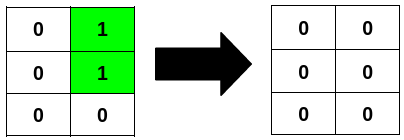

# 分类讨论（Python/Java/C++/C/Go/JS/Rust）

> **[3240. 最少翻转次数使二进制矩阵回文 II](https://leetcode.cn/problems/minimum-number-of-flips-to-make-binary-grid-palindromic-ii/solutions/2868238/fen-lei-tao-lun-pythonjavacgo-by-endless-jl6a/) · Medium · 难度分 2080**

> **所属题单**
> - [贪心算法 · 五、思维题](../../../刷题路径/灵神原版题单/贪心算法/五、思维题.md) · §5.8 分类讨论

> **题目描述**
> 给你一个 `m x n` 的二进制矩阵 `grid` 。
>
> 如果矩阵中一行或者一列从前往后与从后往前读是一样的，那么我们称这一行或者这一列是 **回文** 的。
>
> 你可以将 `grid` 中任意格子的值 **翻转** ，也就是将格子里的值从 `0` 变成 `1` ，或者从 `1` 变成 `0` 。
>
> 请你返回 **最少** 翻转次数，使得矩阵中 **所有** 行和列都是 **回文的** ，且矩阵中 `1` 的数目可以被 `4` **整除** 。
>
> **示例 1：**
>
> **输入：**`grid = [[1,0,0],[0,1,0],[0,0,1]]`
>
> **输出：**`3`
>
> **解释：**
>
> 
>
> **示例 2：**
>
> **输入：**`grid = [[0,1],[0,1],[0,0]]`
>
> **输出：**`2`
>
> **解释：**
>
> 
>
> **示例 3：**
>
> **输入：**`grid = [[1],[1]]`
>
> **输出：**`2`
>
> **解释：**
>
> 
>
> **提示：**
>
> - `m == grid.length`
>
> - `n == grid[i].length`
>
> - `1 <= m * n <= 2 * 10⁵`
>
> - `0 <= grid[i][j] <= 1`

> **题解**
> ## 分析：行和列都是回文
>
> 为方便描述，把 $\textit{grid}$ 简称为 $a$。
>
> 由于所有行和列都必须是回文的，所以要满足
>
> $$
> a[i][j] = a[i][n-1-j] = a[m-1-i][j] = a[m-1-i][n-1-j]
> $$
>
> 也就是这四个数要么都是 $0$，要么都是 $1$。其中 $0\le i < \lfloor m/2 \rfloor,\ 0\le j < \lfloor n/2 \rfloor$。
>
> 设
>
> $$
> \textit{cnt}_1 = a[i][j] + a[i][n-1-j] + a[m-1-i][j] + a[m-1-i][n-1-j]
> $$
>
> 把这四个数都变成 $0$ 需要翻转 $\textit{cnt}_1$ 次，都变成 $1$ 需要翻转 $4-\textit{cnt}_1$ 次。
>
> 两种情况取最小值，把
>
> $$
> \min(\textit{cnt}_1, 4-\textit{cnt}_1)
> $$
>
> 加入答案。
>
> ## 分析：1 的数目被 4 整除
>
> 分类讨论：
>
> - 如果 $m$ 和 $n$ 都是偶数：由于上面四个数四个数一组，都翻转成了 $0$ 或者 $1$，所以 $1$ 的数目能被 $4$ 整除自动成立。
> - 如果 $m$ 是奇数，$n$ 是偶数：正中间一排需要翻转成回文的，且 $1$ 的数目需要能被 $4$ 整除。
> - 如果 $m$ 是偶数，$n$ 是奇数：正中间一列需要翻转成回文的，且 $1$ 的数目需要能被 $4$ 整除。
> - 如果 $m$ 和 $n$ 都是奇数：正中间一排和正中间一列都需要翻转成回文的，且 $1$ 的数目需要能被 $4$ 整除。除了正中央的格子以外，每个格子都有镜像位置，这些格子两个数两个数一组，都翻转成了 $0$ 或者 $1$。那么翻转之后，不考虑正中央的格子，$1$ 的数目就是偶数。所以正中央的格子必须是 $0$，否则最终 $1$ 的数目是奇数，无法被 $4$ 整除。
>
> 如何处理正中间一排和正中间一列，是本题的重点。
>
> ## 具体计算方法
>
> 首先，如果 $m$ 和 $n$ 都是奇数，那么正中央的格子 $(\lfloor m/2 \rfloor, \lfloor n/2 \rfloor)$ 必须是 $0$，把其元素值加入答案。
>
> 然后统计正中间一排（如果 $m$ 是奇数）和正中间一列（如果 $n$ 是奇数）的格子：
>
> - 设 $\textit{diff}$ 为镜像位置不同的数对个数。注意统计的是数对。
> - 设 $\textit{cnt}_1$ 为镜像位置相同的 $1$ 的个数。注意统计的是个数。
>
> 这 $\textit{diff}$ 对 $0$ 和 $1$ 必须翻转其中一个数，所以答案至少要增加 $\textit{diff}$。什么情况下，可以只增加 $\textit{diff}$？
>
> 分类讨论：
>
> - 如果 $\textit{cnt}_1$ 是 $4$ 的倍数，那么只需把这 $\textit{diff}$ 对 $0$ 和 $1$ 中的 $1$ 全部变成 $0$，这样 $1$ 的个数就是 $4$ 的倍数了。所以把 $\textit{diff}$ 加入答案。
> - 如果 $\textit{cnt}_1$ 不是 $4$ 的倍数，由于 $\textit{cnt}_1$ 是偶数，其除以 $4$ 必定余 $2$（注意这说明 $\textit{cnt}_1 \ge 2$）。继续讨论：
>     - 如果 $\textit{diff} > 0$，把其中一对数都变成 $1$，其余 $\textit{diff}-1$ 对数全部变成 $0$，这样 $1$ 的个数就是 $4$ 的倍数了。所以同样地，把 $\textit{diff}$ 加入答案。
>     - 如果 $\textit{diff} = 0$，我们只能把 $\textit{cnt}_1$ 中的两个 $1$ 变成 $0$，使得 $1$ 的个数是 $4$ 的倍数。所以把答案增加 $2$。
>
> 综上所述：
>
> - 如果 $\textit{diff} > 0$，额外把 $\textit{diff}$ 加入答案。
> - 如果 $\textit{diff} = 0$，额外把 $\textit{cnt}_1\bmod 4$ 加入答案。
>
> 具体请看 [视频讲解](https://www.bilibili.com/video/BV1F4421S7XU/) 第三题，欢迎点赞关注~
>
> ```python
> class Solution:
>     def minFlips(self, a: List[List[int]]) -> int:
>         m, n = len(a), len(a[0])
>         ans = 0
>         for i in range(m // 2):
>             row, row2 = a[i], a[-1 - i]
>             for j in range(n // 2):
>                 cnt1 = row[j] + row[-1 - j] + row2[j] + row2[-1 - j]
>                 ans += min(cnt1, 4 - cnt1)  # 全为 1 或全为 0
>
>         if m % 2 and n % 2:
>             # 正中间的数必须是 0
>             ans += a[m // 2][n // 2]
>
>         diff = cnt1 = 0
>         if m % 2:
>             # 统计正中间这一排
>             row = a[m // 2]
>             for j in range(n // 2):
>                 if row[j] != row[-1 - j]:
>                     diff += 1
>                 else:
>                     cnt1 += row[j] * 2
>         if n % 2:
>             # 统计正中间这一列
>             for i in range(m // 2):
>                 if a[i][n // 2] != a[-1 - i][n // 2]:
>                     diff += 1
>                 else:
>                     cnt1 += a[i][n // 2] * 2
>
>         return ans + (diff if diff else cnt1 % 4)
> ```
>
>
> #### 复杂度分析
>
> - 时间复杂度：$\mathcal{O}(mn)$，其中 $m$ 和 $n$ 分别为 $\textit{grid}$ 的行数和列数。
> - 空间复杂度：$\mathcal{O}(1)$。
>
> ## 分类题单
>
> [如何科学刷题？](https://leetcode.cn/circle/discuss/RvFUtj/)
>
> 1. [滑动窗口与双指针（定长/不定长/单序列/双序列/三指针）](https://leetcode.cn/circle/discuss/0viNMK/)
> 2. [二分算法（二分答案/最小化最大值/最大化最小值/第K小）](https://leetcode.cn/circle/discuss/SqopEo/)
> 3. [单调栈（基础/矩形面积/贡献法/最小字典序）](https://leetcode.cn/circle/discuss/9oZFK9/)
> 4. [网格图（DFS/BFS/综合应用）](https://leetcode.cn/circle/discuss/YiXPXW/)
> 5. [位运算（基础/性质/拆位/试填/恒等式/思维）](https://leetcode.cn/circle/discuss/dHn9Vk/)
> 6. [图论算法（DFS/BFS/拓扑排序/最短路/最小生成树/二分图/基环树/欧拉路径）](https://leetcode.cn/circle/discuss/01LUak/)
> 7. [动态规划（入门/背包/状态机/划分/区间/状压/数位/数据结构优化/树形/博弈/概率期望）](https://leetcode.cn/circle/discuss/tXLS3i/)
> 8. [常用数据结构（前缀和/差分/栈/队列/堆/字典树/并查集/树状数组/线段树）](https://leetcode.cn/circle/discuss/mOr1u6/)
> 9. [数学算法（数论/组合/概率期望/博弈/计算几何/随机算法）](https://leetcode.cn/circle/discuss/IYT3ss/)
> 10. [贪心与思维（基本贪心策略/反悔/区间/字典序/数学/思维/脑筋急转弯/构造）](https://leetcode.cn/circle/discuss/g6KTKL/)
> 11. [链表、二叉树与一般树（前后指针/快慢指针/DFS/BFS/直径/LCA）](https://leetcode.cn/circle/discuss/K0n2gO/)
> 12. [字符串（KMP/Z函数/Manacher/字符串哈希/AC自动机/后缀数组/子序列自动机）](https://leetcode.cn/circle/discuss/SJFwQI/)
>
> [我的题解精选（已分类）](https://github.com/EndlessCheng/codeforces-go/blob/master/leetcode/SOLUTIONS.md)
>
> 欢迎关注 [B站@灵茶山艾府](https://space.bilibili.com/206214)
