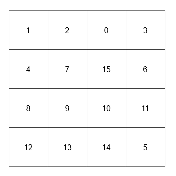

# 预处理（Python/Java/C++/Go）

> **[3242. 设计相邻元素求和服务](https://leetcode.cn/problems/design-neighbor-sum-service/solutions/2868968/jian-ji-xie-fa-pythonjavacgo-by-endlessc-ymcf/) · Easy**

> **题目描述**
> 给你一个 `n x n` 的二维数组 `grid`，它包含范围 `[0, n² - 1]` 内的**不重复**元素。
>
> 实现 `neighborSum` 类：
>
> - `neighborSum(int [][]grid)` 初始化对象。
>
> - `int adjacentSum(int value)` 返回在 `grid` 中与 `value` 相邻的元素之**和**，相邻指的是与 `value` 在上、左、右或下的元素。
>
> - `int diagonalSum(int value)` 返回在 `grid` 中与 `value` 对角线相邻的元素之**和**，对角线相邻指的是与 `value` 在左上、右上、左下或右下的元素。
>
> 
>
> **示例 1：**
>
> **输入：**
>
> ["neighborSum", "adjacentSum", "adjacentSum", "diagonalSum", "diagonalSum"]
>
> \[\[\[\[0, 1, 2], [3, 4, 5], [6, 7, 8]]], [1], [4], [4], [8]]
>
> **输出：** [null, 6, 16, 16, 4]
>
> **解释：**
>
> 
>
> - 1 的相邻元素是 0、2 和 4。
>
> - 4 的相邻元素是 1、3、5 和 7。
>
> - 4 的对角线相邻元素是 0、2、6 和 8。
>
> - 8 的对角线相邻元素是 4。
>
> **示例 2：**
>
> **输入：**
>
> ["neighborSum", "adjacentSum", "diagonalSum"]
>
> \[\[\[\[1, 2, 0, 3], [4, 7, 15, 6], [8, 9, 10, 11], [12, 13, 14, 5]]], [15], [9]]
>
> **输出：** [null, 23, 45]
>
> **解释：**
>
> 
>
> - 15 的相邻元素是 0、10、7 和 6。
>
> - 9 的对角线相邻元素是 4、12、14 和 15。
>
> **提示：**
>
> - `3 <= n == grid.length == grid[0].length <= 10`
>
> - `0 <= grid[i][j] <= n² - 1`
>
> - 所有 `grid[i][j]` 值均不重复。
>
> - `adjacentSum` 和 `diagonalSum` 中的 `value` 均在范围 `[0, n² - 1]` 内。
>
> - 最多会调用 `adjacentSum` 和 `diagonalSum` 总共 `2 * n²` 次。

> **题解**
> 用一个长为 $8$ 的数组存放偏移向量，前 $4$ 个表示上下左右四个方向，后 $4$ 个表示斜向的四个方向。
>
> 用一个大小为 $n^2\times 2$ 的数组 $s$ 预处理元素和，其中 $s[v][0]$ 为 $\texttt{adjacentSum}(v)$ 的结果，$s[v][1]$ 为 $\texttt{diagonalSum}(v)$ 的结果。这可以在初始化时，遍历 $\textit{grid}[i][j]$ 以及偏移向量，累加每个元素的相邻元素之和计算出来。
>
> > 注：也可以在 $\textit{grid}$ 外面加一圈 $0$，这样无需判断下标越界。
>
> ```python
> DIRS = ((-1, 0), (1, 0), (0, -1), (0, 1), (1, 1), (-1, 1), (-1, -1), (1, -1))
>
> class NeighborSum:
>     def __init__(self, grid: List[List[int]]):
>         n = len(grid)
>         s = [[0, 0] for _ in range(n * n)]
>         for i, row in enumerate(grid):
>             for j, v in enumerate(row):
>                 for k, (dx, dy) in enumerate(DIRS):
>                     x, y = i + dx, j + dy
>                     if 0 <= x < n and 0 <= y < n:
>                         s[v][k // 4] += grid[x][y]
>         self.s = s
>
>     def adjacentSum(self, value: int) -> int:
>         return self.s[value][0]
>
>     def diagonalSum(self, value: int) -> int:
>         return self.s[value][1]
> ```
>
>
> #### 复杂度分析
>
> - 时间复杂度：初始化 $\mathcal{O}(n^2)$，其余 $\mathcal{O}(1)$，其中 $n$ 为 $\textit{grid}$ 的行数和列数。
> - 空间复杂度：初始化 $\mathcal{O}(n^2)$，其余 $\mathcal{O}(1)$。
>
> ## 分类题单
>
> [如何科学刷题？](https://leetcode.cn/circle/discuss/RvFUtj/)
>
> 1. [滑动窗口与双指针（定长/不定长/单序列/双序列/三指针）](https://leetcode.cn/circle/discuss/0viNMK/)
> 2. [二分算法（二分答案/最小化最大值/最大化最小值/第K小）](https://leetcode.cn/circle/discuss/SqopEo/)
> 3. [单调栈（基础/矩形面积/贡献法/最小字典序）](https://leetcode.cn/circle/discuss/9oZFK9/)
> 4. [网格图（DFS/BFS/综合应用）](https://leetcode.cn/circle/discuss/YiXPXW/)
> 5. [位运算（基础/性质/拆位/试填/恒等式/思维）](https://leetcode.cn/circle/discuss/dHn9Vk/)
> 6. [图论算法（DFS/BFS/拓扑排序/最短路/最小生成树/二分图/基环树/欧拉路径）](https://leetcode.cn/circle/discuss/01LUak/)
> 7. [动态规划（入门/背包/状态机/划分/区间/状压/数位/数据结构优化/树形/博弈/概率期望）](https://leetcode.cn/circle/discuss/tXLS3i/)
> 8. [常用数据结构（前缀和/差分/栈/队列/堆/字典树/并查集/树状数组/线段树）](https://leetcode.cn/circle/discuss/mOr1u6/)
> 9. [数学算法（数论/组合/概率期望/博弈/计算几何/随机算法）](https://leetcode.cn/circle/discuss/IYT3ss/)
> 10. [贪心与思维（基本贪心策略/反悔/区间/字典序/数学/思维/脑筋急转弯/构造）](https://leetcode.cn/circle/discuss/g6KTKL/)
> 11. [链表、二叉树与一般树（前后指针/快慢指针/DFS/BFS/直径/LCA）](https://leetcode.cn/circle/discuss/K0n2gO/)
> 12. [字符串（KMP/Z函数/Manacher/字符串哈希/AC自动机/后缀数组/子序列自动机）](https://leetcode.cn/circle/discuss/SJFwQI/)
>
> [我的题解精选（已分类）](https://github.com/EndlessCheng/codeforces-go/blob/master/leetcode/SOLUTIONS.md)
>
> 欢迎关注 [B站@灵茶山艾府](https://space.bilibili.com/206214)
