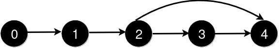

# 两种方法：区间并查集 / 维护跳转位置（Python/Java/C++/Go）

> **[3244. 新增道路查询后的最短距离 II](https://leetcode.cn/problems/shortest-distance-after-road-addition-queries-ii/solutions/2868558/qu-jian-bing-cha-ji-pythonjavacgo-by-end-a9k7/) · Hard · 难度分 2270**

> **所属题单**
> - [常用数据结构 · 七、并查集](../../../刷题路径/灵神原版题单/常用数据结构/七、并查集.md) · §7.5 区间并查集

> **题目描述**
> 给你一个整数 `n` 和一个二维整数数组 `queries`。
>
> 有 `n` 个城市，编号从 `0` 到 `n - 1`。初始时，每个城市 `i` 都有一条**单向**道路通往城市 `i + 1`（ `0 <= i < n - 1`）。
>
> `queries[i] = [u_i, v_i]` 表示新建一条从城市 `u_i` 到城市 `v_i` 的**单向**道路。每次查询后，你需要找到从城市 `0` 到城市 `n - 1` 的**最短路径**的**长度**。
>
> 所有查询中不会存在两个查询都满足 `queries[i][0] < queries[j][0] < queries[i][1] < queries[j][1]`。
>
> 返回一个数组 `answer`，对于范围 `[0, queries.length - 1]` 中的每个 `i`，`answer[i]` 是处理完**前** `i + 1` 个查询后，从城市 `0` 到城市 `n - 1` 的最短路径的<em>长度</em>。
>
> **示例 1：**
>
> **输入：** `n = 5, queries = [[2, 4], [0, 2], [0, 4]]`
>
> **输出：** `[3, 2, 1]`
>
> **解释：**
>
> 
>
> 新增一条从 2 到 4 的道路后，从 0 到 4 的最短路径长度为 3。
>
> 
>
> 新增一条从 0 到 2 的道路后，从 0 到 4 的最短路径长度为 2。
>
> 
>
> 新增一条从 0 到 4 的道路后，从 0 到 4 的最短路径长度为 1。
>
> **示例 2：**
>
> **输入：** `n = 4, queries = [[0, 3], [0, 2]]`
>
> **输出：** `[1, 1]`
>
> **解释：**
>
> 
>
> 新增一条从 0 到 3 的道路后，从 0 到 3 的最短路径长度为 1。
>
> 
>
> 新增一条从 0 到 2 的道路后，从 0 到 3 的最短路径长度仍为 1。
>
> **提示:**
>
> - `3 <= n <= 10⁵`
>
> - `1 <= queries.length <= 10⁵`
>
> - `queries[i].length == 2`
>
> - `0 <= queries[i][0] < queries[i][1] < n`
>
> - `1 < queries[i][1] - queries[i][0]`
>
> - 查询中不存在重复的道路。
>
> - 不存在两个查询都满足 `i != j` 且 `queries[i][0] < queries[j][0] < queries[i][1] < queries[j][1]`。

> **题解**
> ## 方法一：区间并查集
>
> 由于题目保证添加的边（捷径）不会交叉，从贪心的角度看，遇到捷径就走捷径是最优的。
>
> 把目光放在**边**上。
>
> 初始有 $n-1$ 条边，我们在 $0\rightarrow 1$ 这条边上，目标是到达 $(n-2)\rightarrow (n-1)$ 这条边，并把这条边走完。
>
> 处理 $\textit{queries}$ 之前，需要走 $n-1$ 条边。
>
> 
>
> 连一条从 $2$ 到 $4$ 的边，意味着什么？
>
> 相当于把 $2\rightarrow 3$ 这条边和 $3\rightarrow 4$ 这条边合并成一条边。现在从起点到终点需要 $3$ 条边。
>
> 
>
> 连一条从 $0$ 到 $2$ 的边，意味着什么？
>
> 相当于把 $0\rightarrow 1$ 这条边和 $1\rightarrow 2$ 这条边合并成一条边。现在从起点到终点需要 $2$ 条边。
>
> 用**并查集**实现边的合并。初始化一个大小为 $n-1$ 的并查集，并查集中的节点 $i$ 表示题目的边 $i \rightarrow (i+1)$。（相当于给每条边编号 $0,1,2,\ldots,n-2$）
>
> 连一条从 $L$ 到 $R$ 的边，相当于把并查集中的节点 $L,L+1,L+2,\ldots, R-2$ 合并到并查集中的节点 $R-1$ 上。
>
> 合并的同时，维护并查集连通块个数。
>
> 答案就是每次合并后的并查集连通块个数。
>
> 具体请看 [视频讲解](https://www.bilibili.com/video/BV124421Z78J/)，欢迎点赞关注~
>
> ```python
> class Solution:
>     def shortestDistanceAfterQueries(self, n: int, queries: List[List[int]]) -> List[int]:
>         fa = list(range(n - 1))
>
>         # 非递归并查集
>         def find(x: int) -> int:
>             rt = x
>             while fa[rt] != rt:
>                 rt = fa[rt]
>             while fa[x] != rt:
>                 fa[x], x = rt, fa[x]
>             return rt
>
>         ans = []
>         cnt = n - 1  # 并查集连通块个数
>         for l, r in queries:
>             fr = find(r - 1)
>             i = find(l)
>             while i < r - 1:
>                 cnt -= 1
>                 fa[i] = fr
>                 i = find(i + 1)
>             ans.append(cnt)
>         return ans
> ```
>
>
> #### 复杂度分析
>
> - 时间复杂度：$\mathcal{O}(n+q)$，其中 $q$ 是 $\textit{queries}$ 的长度。注意每个点只会被合并一次，在后面的循环中会被 `i = find(l)` 以及 `i = find(i + 1)` 跳过。由于数组的特殊性，每次合并的复杂度为 $\mathcal{O}(1)$。
> - 空间复杂度：$\mathcal{O}(n)$。返回值不计入。
>
> ## 方法二：记录跳转位置
>
> 定义 $\textit{nxt}[i]$ 表示 $i$ 指向的最右节点编号，这里 $0\le i \le n-2$。
>
> 初始值 $\textit{nxt}[i]=i+1$。
>
> 连一条从 $L$ 到 $R$ 的边，分类讨论：
>
> - 如果之前连了一条从 $L'$ 到 $R'$ 的边，且区间 $[L,R]$ 被 $[L',R']$ 包含，则什么也不做。
> - 否则更新 $\textit{nxt}[L] = R$，在更新前，标记 $[\textit{nxt}[L], R-1]$ 中的没有被标记的点，表示这些点被更大的区间包含。怎么标记？把 $\textit{nxt}[i]$ 置为 $0$。
>
> 和方法一一样，维护一个 $\textit{cnt}$ 变量，每把一个 $\textit{nxt}[i]$ 置为 $0$，就把 $\textit{cnt}$ 减一。
>
> ```python
> class Solution:
>     def shortestDistanceAfterQueries(self, n: int, queries: List[List[int]]) -> List[int]:
>         ans = []
>         nxt = list(range(1, n))
>         cnt = n - 1
>         for l, r in queries:
>             if 0 < nxt[l] < r:
>                 i = nxt[l]
>                 while i < r:
>                     cnt -= 1
>                     nxt[i], i = 0, nxt[i]
>                 nxt[l] = r
>             ans.append(cnt)
>         return ans
> ```
>
>
> 也可以把 $\textit{nxt}[i]$ 置为 $r$，这样可以把进入循环和继续循环的逻辑合并成一个：当 $\textit{nxt}[i]<r$ 时进入循环/继续循环。
>
> ```python
> class Solution:
>     def shortestDistanceAfterQueries(self, n: int, queries: List[List[int]]) -> List[int]:
>         ans = []
>         nxt = list(range(1, n))
>         cnt = n - 1
>         for i, r in queries:
>             while nxt[i] < r:
>                 cnt -= 1
>                 nxt[i], i = r, nxt[i]
>             ans.append(cnt)
>         return ans
> ```
>
>
> #### 复杂度分析
>
> - 时间复杂度：$\mathcal{O}(n+q)$，其中 $q$ 是 $\textit{queries}$ 的长度。注意内层循环的 `cnt--` 至多执行 $\mathcal{O}(n)$ 次，所以二重循环是 $\mathcal{O}(n+q)$ 的时间。
> - 空间复杂度：$\mathcal{O}(n)$。返回值不计入。
>
> 更多相似题目，见下面数据结构题单中的「**数组上的并查集**」和「**区间并查集**」。
>
> ## 分类题单
>
> [如何科学刷题？](https://leetcode.cn/circle/discuss/RvFUtj/)
>
> 1. [滑动窗口与双指针（定长/不定长/单序列/双序列/三指针）](https://leetcode.cn/circle/discuss/0viNMK/)
> 2. [二分算法（二分答案/最小化最大值/最大化最小值/第K小）](https://leetcode.cn/circle/discuss/SqopEo/)
> 3. [单调栈（基础/矩形面积/贡献法/最小字典序）](https://leetcode.cn/circle/discuss/9oZFK9/)
> 4. [网格图（DFS/BFS/综合应用）](https://leetcode.cn/circle/discuss/YiXPXW/)
> 5. [位运算（基础/性质/拆位/试填/恒等式/思维）](https://leetcode.cn/circle/discuss/dHn9Vk/)
> 6. [图论算法（DFS/BFS/拓扑排序/最短路/最小生成树/二分图/基环树/欧拉路径）](https://leetcode.cn/circle/discuss/01LUak/)
> 7. [动态规划（入门/背包/状态机/划分/区间/状压/数位/数据结构优化/树形/博弈/概率期望）](https://leetcode.cn/circle/discuss/tXLS3i/)
> 8. [常用数据结构（前缀和/差分/栈/队列/堆/字典树/并查集/树状数组/线段树）](https://leetcode.cn/circle/discuss/mOr1u6/)
> 9. [数学算法（数论/组合/概率期望/博弈/计算几何/随机算法）](https://leetcode.cn/circle/discuss/IYT3ss/)
> 10. [贪心与思维（基本贪心策略/反悔/区间/字典序/数学/思维/脑筋急转弯/构造）](https://leetcode.cn/circle/discuss/g6KTKL/)
> 11. [链表、二叉树与一般树（前后指针/快慢指针/DFS/BFS/直径/LCA）](https://leetcode.cn/circle/discuss/K0n2gO/)
> 12. [字符串（KMP/Z函数/Manacher/字符串哈希/AC自动机/后缀数组/子序列自动机）](https://leetcode.cn/circle/discuss/SJFwQI/)
>
> [我的题解精选（已分类）](https://github.com/EndlessCheng/codeforces-go/blob/master/leetcode/SOLUTIONS.md)
>
> 欢迎关注 [B站@灵茶山艾府](https://space.bilibili.com/206214)
