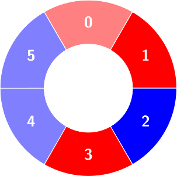

# 从易到难，一步步推导（Python/Java/C++/Go）

> **[3245. 交替组 III](https://leetcode.cn/problems/alternating-groups-iii/solutions/2869147/cong-yi-dao-nan-yi-bu-bu-tui-dao-pythonj-jho9/) · Hard · 难度分 3112**

> **所属题单**
> - [常用数据结构 · 八、树状数组和线段树](../../../刷题路径/灵神原版题单/常用数据结构/八、树状数组和线段树.md) · §8.1 树状数组

> **题目描述**
> 给你一个整数数组 `colors` 和一个二维整数数组 `queries` 。`colors`表示一个由红色和蓝色瓷砖组成的环，第 `i` 块瓷砖的颜色为 `colors[i]` ：
>
> - `colors[i] == 0` 表示第 `i` 块瓷砖的颜色是 **红色** 。
>
> - `colors[i] == 1` 表示第 `i` 块瓷砖的颜色是 **蓝色** 。
>
> 环中连续若干块瓷砖的颜色如果是 **交替** 颜色（也就是说这组瓷砖中除了第一块和最后一块瓷砖以外，中间瓷砖的颜色与它 **左边** 和 **右边** 的颜色都不同），那么它被称为一个 **交替组**。
>
> 你需要处理两种类型的查询：
>
> - `queries[i] = [1, size_i]`，确定大小为`size_i`的 **交替组** 的数量。
>
> - `queries[i] = [2, index_i, color_i]`，将`colors[index_i]`更改为`color_i`。
>
> 返回数组 `answer`，数组中按顺序包含第一种类型查询的结果。
>
> **注意** ，由于 `colors` 表示一个 **环** ，**第一块** 瓷砖和 **最后一块** 瓷砖是相邻的。
>
> **示例 1：**
>
> **输入：**`colors = [0,1,1,0,1], queries = [[2,1,0],[1,4]]`
>
> **输出：**`[2]`
>
> **解释：**
>
> 第一次查询：
>
> 将 `colors[1]` 改为 0。
>
> 
>
> 第二次查询：
>
> 统计大小为 4 的交替组的数量：
>
> 
>
> 
>
> **示例 2：**
>
> **输入：**`colors = [0,0,1,0,1,1], queries = [[1,3],[2,3,0],[1,5]]`
>
> **输出：**`[2,0]`
>
> **解释：**
>
> 
>
> 第一次查询：
>
> 统计大小为 3 的交替组的数量。
>
> 
>
> 
>
> 第二次查询：`colors`不变。
>
> 第三次查询：不存在大小为 5 的交替组。
>
> **提示：**
>
> - `4 <= colors.length <= 5 * 10⁴`
>
> - `0 <= colors[i] <= 1`
>
> - `1 <= queries.length <= 5 * 10⁴`
>
> - `queries[i][0] == 1` 或 `queries[i][0] == 2`
>
> - 对于所有的`i`：
>
>     - `queries[i][0] == 1`： `queries[i].length == 2`, `3 <= queries[i][1] <= colors.length - 1`
>
>     - `queries[i][0] == 2`： `queries[i].length == 3`, `0 <= queries[i][1] <= colors.length - 1`, `0 <= queries[i][2] <= 1`

> **题解**
> 为方便讨论，下文把 $\textit{colors}$ 数组简记为 $a$。
>
> ## 一、非环形数组 + 没有修改操作
>
> 这是最简单的情况。
>
> 以 $a=[0,1,1,0,1,0,0,1,0]$ 为例，它可以分为三个交替段：$[0,1],[1,0,1,0],[0,1,0]$。
>
> 有多少个长度恰好为 $\textit{size}=3$ 的交替子数组？有 $3$ 个：$[1,0,1,0]$ 中有 $2$ 个，$[0,1,0]$ 中有 $1$ 个。
>
> 如果遍历所有交替段，时间复杂度就太高了。
>
> 一般地，对于长为 $k$ 的交替段，其中有
>
> $$
> k - (\textit{size} - 1)
> $$
>
> 个长度恰好为 $\textit{size}$ 的交替子数组。
>
> 假设有 $3$ 个长度均 $\ge \textit{size}$ 的交替段，长度分别为 $k_1,k_2,k_3$，那么其中有
>
> $$
> \begin{aligned}
>     & k_1 - (\textit{size} - 1) + k_2 - (\textit{size} - 1) + k_3 - (\textit{size} - 1)      \\
> ={} & (k_1+k_2+k_3) - 3 \cdot (\textit{size} - 1)        \\
> \end{aligned}
> $$
>
> 个长度恰好为 $\textit{size}$ 的交替子数组。
>
> 这启发我们维护长度 $\ge \textit{size}$ 的交替段的**个数**以及**元素和**。考虑到后续要执行修改操作，用**树状数组**维护。
>
> ## 二、非环形数组 + 有修改操作
>
> 考虑交替段的结束位置，即 $i=n-1$ 或者 $a[i]=a[i+1]$ 的位置。
>
> 如果修改 $a[i]$ 的值，**会影响哪些结束位置**？**会对交替段的长度产生什么影响**？
>
> 结束位置 $i-1$ 和 $i$ 会受到影响。
>
> 为避免复杂的分类讨论，在修改之前，先移除掉结束位置 $i-1$ 和 $i$（如果是结束位置的话），然后再根据 $a[i-1]=a[i]$ 以及 $a[i]=a[i+1]$ 是否成立，添加结束位置 $i-1$ 和 $i$。
>
> - 当我们添加结束位置 $i$ 时，设 $\textit{pre}$ 和 $\textit{nxt}$ 是 $i$ 前后两个相邻的结束位置，那么一个长为 $\textit{nxt} - \textit{pre}$ 的交替段会被拆分为两个长度分别为 $i-\textit{pre}$ 和 $\textit{nxt}-i$ 的交替段。
> - 当我们移除结束位置 $i$ 时，设 $\textit{pre}$ 和 $\textit{nxt}$ 是 $i$ 前后两个相邻的结束位置，那么两个长度分别为 $i-\textit{pre}$ 和 $\textit{nxt}-i$ 的交替段会合并成一个长为 $\textit{nxt} - \textit{pre}$ 的交替段。
>
> 如何快速找到 $i$ 的前后两个相邻的结束位置？
>
> 用有序集合维护所有结束位置。
>
> ## 三、环形数组 + 有修改操作
>
> $a$ 变成环形数组后，哪些计算会发生变化？
>
> 1. $i=n-1$ 不一定是结束位置了，必须判断 $a[n-1]=a[0]$ 是否成立才行。
> 2. 如果小于 $i$ 的最大结束位置不存在，那么取所有结束位置的最大值。
> 3. 如果大于 $i$ 的最小结束位置不存在，那么取所有结束位置的最小值。
> 4. 对于交替段长度，例如 $\textit{nxt} - \textit{pre}$，可能会算出负数或 $0$。可以通过 $(\textit{nxt} - \textit{pre} + n - 1)\bmod n + 1$ 调整成 $[1,n]$ 中的数。
>
> ### 细节
>
> 1. 如果没有结束位置，那么无论询问多长的交替子数组，答案都是 $n$。
> 2. 如果修改操作不改变 $a[i]$ 的值，则直接 `continue`。
>
> 具体请看 [视频讲解](https://www.bilibili.com/video/BV124421Z78J/) 第四题，欢迎点赞关注！
>
> ```python
> from sortedcontainers import SortedList
>
> class FenwickTree:
>     def __init__(self, n: int):
>         self.t = [[0, 0] for _ in range(n + 1)]
>
>     # op=1，添加一个 size
>     # op=-1，移除一个 size
>     def update(self, size: int, op: int) -> None:
>         i = len(self.t) - size
>         while i < len(self.t):
>             self.t[i][0] += op
>             self.t[i][1] += op * size
>             i += i & -i
>
>     # 返回 >= size 的元素个数，元素和
>     def query(self, size: int) -> (int, int):
>         cnt = s = 0
>         i = len(self.t) - size
>         while i > 0:
>             cnt += self.t[i][0]
>             s += self.t[i][1]
>             i &= i - 1
>         return cnt, s
>
> class Solution:
>     def numberOfAlternatingGroups(self, a: List[int], queries: List[List[int]]) -> List[int]:
>         n = len(a)
>         sl = SortedList()
>         t = FenwickTree(n)
>
>         # op=1，添加一个结束位置 i
>         # op=-1，移除一个结束位置 i
>         def update(i: int, op: int) -> None:
>             idx = sl.bisect_left(i)
>             pre = sl[idx - 1]
>             nxt = sl[idx % len(sl)]
>
>             t.update((nxt - pre - 1) % n + 1, -op)  # 移除/添加旧长度
>             t.update((i - pre) % n, op)
>             t.update((nxt - i) % n, op)  # 添加/移除新长度
>
>         # 添加一个结束位置 i
>         def add(i: int) -> None:
>             if not sl:
>                 t.update(n, 1)
>             else:
>                 update(i, 1)
>             sl.add(i)
>
>         # 移除一个结束位置 i
>         def remove(i: int) -> None:
>             sl.remove(i)
>             if not sl:
>                 t.update(n, -1)
>             else:
>                 update(i, -1)
>
>         for i, c in enumerate(a):
>             if c == a[(i + 1) % n]:
>                 add(i)  # i 是一个结束位置
>
>         ans = []
>         for q in queries:
>             if q[0] == 1:
>                 if not sl:
>                     ans.append(n)  # 每个长为 size 的子数组都符合要求
>                 else:
>                     cnt, s = t.query(q[1])
>                     ans.append(s - cnt * (q[1] - 1))
>             else:
>                 i, c = q[1], q[2]
>                 if a[i] == c:  # 无影响
>                     continue
>                 pre, nxt = (i - 1) % n, (i + 1) % n
>                 # 修改前，先去掉结束位置
>                 if a[pre] == a[i]:
>                     remove(pre)
>                 if a[i] == a[nxt]:
>                     remove(i)
>                 a[i] = c
>                 # 修改后，添加新的结束位置
>                 if a[pre] == a[i]:
>                     add(pre)
>                 if a[i] == a[nxt]:
>                     add(i)
>         return ans
> ```
>
> > [!example]- Python3 写法二
> > ```python
> > from sortedcontainers import SortedList
> >
> > class Solution:
> >     def numberOfAlternatingGroups(self, a: List[int], queries: List[List[int]]) -> List[int]:
> >         n = len(a)
> >         sl = SortedList()
> >         t = [[0, 0] for _ in range(n + 1)]
> >
> >         # op=1，添加一个 size
> >         # op=-1，移除一个 size
> >         def fenwick_update(size: int, op: int) -> None:
> >             i = len(t) - size
> >             while i < len(t):
> >                 t[i][0] += op
> >                 t[i][1] += op * size
> >                 i += i & -i
> >
> >         # 返回 >= size 的元素个数，元素和
> >         def fenwick_query(size: int) -> (int, int):
> >             cnt = s = 0
> >             i = len(t) - size
> >             while i > 0:
> >                 cnt += t[i][0]
> >                 s += t[i][1]
> >                 i &= i - 1
> >             return cnt, s
> >
> >         # op=1，添加一个结束位置 i
> >         # op=-1，移除一个结束位置 i
> >         def update(i: int, op: int) -> None:
> >             idx = sl.bisect_left(i)
> >             pre = sl[idx - 1]
> >             nxt = sl[idx % len(sl)]
> >
> >             fenwick_update((nxt - pre - 1) % n + 1, -op)  # 移除/添加旧长度
> >             fenwick_update((i - pre) % n, op)
> >             fenwick_update((nxt - i) % n, op)  # 添加/移除新长度
> >
> >         # 添加一个结束位置 i
> >         def add(i: int) -> None:
> >             if not sl:
> >                 fenwick_update(n, 1)
> >             else:
> >                 update(i, 1)
> >             sl.add(i)
> >
> >         # 移除一个结束位置 i
> >         def remove(i: int) -> None:
> >             sl.remove(i)
> >             if not sl:
> >                 fenwick_update(n, -1)
> >             else:
> >                 update(i, -1)
> >
> >         for i, c in enumerate(a):
> >             if c == a[(i + 1) % n]:
> >                 add(i)  # i 是一个结束位置
> >
> >         ans = []
> >         for q in queries:
> >             if q[0] == 1:
> >                 if not sl:
> >                     ans.append(n)  # 每个长为 size 的子数组都符合要求
> >                 else:
> >                     cnt, s = fenwick_query(q[1])
> >                     ans.append(s - cnt * (q[1] - 1))
> >             else:
> >                 i, c = q[1], q[2]
> >                 if a[i] == c:  # 无影响
> >                     continue
> >                 pre, nxt = (i - 1) % n, (i + 1) % n
> >                 # 修改前，先去掉结束位置
> >                 if a[pre] == a[i]:
> >                     remove(pre)
> >                 if a[i] == a[nxt]:
> >                     remove(i)
> >                 a[i] = c
> >                 # 修改后，添加新的结束位置
> >                 if a[pre] == a[i]:
> >                     add(pre)
> >                 if a[i] == a[nxt]:
> >                     add(i)
> >         return ans
> > ```
>
>
> #### 复杂度分析
>
> - 时间复杂度：$\mathcal{O}((n+q)\log n)$，其中 $n$ 是 $\textit{colors}$ 的长度，$q$ 是 $\textit{queries}$ 的长度。
> - 空间复杂度：$\mathcal{O}(n)$。返回值不计入。
>
> ## 分类题单
>
> [如何科学刷题？](https://leetcode.cn/circle/discuss/RvFUtj/)
>
> 1. [滑动窗口（定长/不定长/多指针）](https://leetcode.cn/circle/discuss/0viNMK/)
> 2. [二分算法（二分答案/最小化最大值/最大化最小值/第K小）](https://leetcode.cn/circle/discuss/SqopEo/)
> 3. [单调栈（基础/矩形面积/贡献法/最小字典序）](https://leetcode.cn/circle/discuss/9oZFK9/)
> 4. [网格图（DFS/BFS/综合应用）](https://leetcode.cn/circle/discuss/YiXPXW/)
> 5. [位运算（基础/性质/拆位/试填/恒等式/思维）](https://leetcode.cn/circle/discuss/dHn9Vk/)
> 6. [图论算法（DFS/BFS/拓扑排序/最短路/最小生成树/二分图/基环树/欧拉路径）](https://leetcode.cn/circle/discuss/01LUak/)
> 7. [动态规划（入门/背包/状态机/划分/区间/状压/数位/数据结构优化/树形/博弈/概率期望）](https://leetcode.cn/circle/discuss/tXLS3i/)
> 8. [常用数据结构（前缀和/差分/栈/队列/堆/字典树/并查集/树状数组/线段树）](https://leetcode.cn/circle/discuss/mOr1u6/)
> 9. [数学算法（数论/组合/概率期望/博弈/计算几何/随机算法）](https://leetcode.cn/circle/discuss/IYT3ss/)
> 10. [贪心算法（基本贪心策略/反悔/区间/字典序/数学/思维/脑筋急转弯/构造）](https://leetcode.cn/circle/discuss/g6KTKL/)
>
> [我的题解精选（已分类）](https://github.com/EndlessCheng/codeforces-go/blob/master/leetcode/SOLUTIONS.md)
