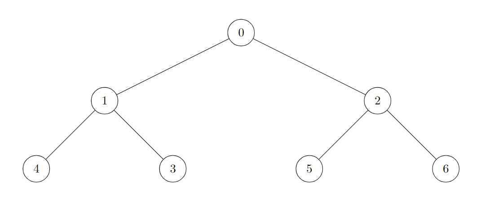
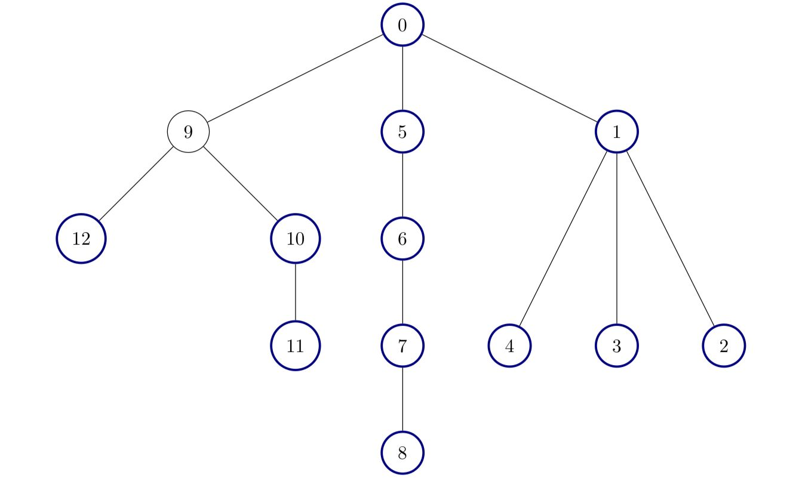

# 3249. 统计好节点的数目

Medium · 难度分 1566 · [力扣原题](https://leetcode.cn/problems/count-the-number-of-good-nodes/)

所在刷题路径：灵神题单·链表树与回溯

| 作者 | 题解 | 动画讲解 |
|---|---|---|
| 灵茶山艾府 | [📄 题解](灵茶山艾府.md) | [▶︎ 动画（GIF）](3249%20统计好节点的数目%20·%20灵茶山艾府.gif) · [mp4 文件](3249%20统计好节点的数目%20·%20灵茶山艾府.mp4) |
| yiduobo | [📄 题解](yiduobo.md) | [▶︎ 动画（GIF）](3249%20统计好节点的数目%20·%20yiduobo.gif) · [mp4 文件](3249%20统计好节点的数目%20·%20yiduobo.mp4) |

## 动画讲解

> 动图会循环播放；想暂停、拖进度条请下载上面表格里的 mp4 文件。

### 灵茶山艾府

### yiduobo

## 题目描述

现有一棵 **无向** 树，树中包含 `n` 个节点，按从 `0` 到 `n - 1` 标记。树的根节点是节点 `0` 。给你一个长度为 `n - 1` 的二维整数数组 `edges`，其中 `edges[i] = [a_i, b_i]` 表示树中节点 `a_i` 与节点 `b_i` 之间存在一条边。

如果一个节点的所有子节点为根的 子树 包含的节点数相同，则认为该节点是一个 **好节点**。

返回给定树中 **好节点** 的数量。

**子树** 指的是一个节点以及它所有后代节点构成的一棵树。

**示例 1：**

**输入：**`edges = [[0,1],[0,2],[1,3],[1,4],[2,5],[2,6]]`

**输出：**`7`

**说明：**

树的所有节点都是好节点。

**示例 2：**

**输入：**`edges = [[0,1],[1,2],[2,3],[3,4],[0,5],[1,6],[2,7],[3,8]]`

**输出：**`6`

**说明：**

树中有 6 个好节点。上图中已将这些节点着色。

**示例 3：**

**输入：**`edges = [[0,1],[1,2],[1,3],[1,4],[0,5],[5,6],[6,7],[7,8],[0,9],[9,10],[9,12],[10,11]]`

**输出：**`12`

**解释：**

除了节点 9 以外其他所有节点都是好节点。

**提示：**

- `2 <= n <= 10⁵`

- `edges.length == n - 1`

- `edges[i].length == 2`

- `0 <= a_i, b_i < n`

- 输入确保 `edges` 总表示一棵有效的树。

---
[↑ 返回 3200-3299](../README.md) · [总索引](../../../索引.md) · [仓库首页](../../../README.md)
