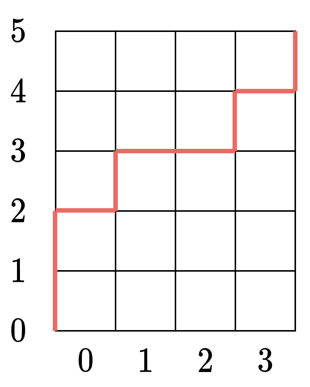

# 两种方法：前缀和优化 DP / 组合数学（Python/Java/C++/Go）

> **[3251. 单调数组对的数目 II](https://leetcode.cn/problems/find-the-count-of-monotonic-pairs-ii/solutions/2876190/qian-zhui-he-you-hua-dppythonjavacgo-by-3biek/) · Hard · 难度分 2323**

> **所属题单**
> - [动态规划 · 十一、优化 DP](../../../刷题路径/灵神原版题单/动态规划/十一、优化%20DP.md) · §11.1 前缀和优化 DP
> - [数学算法 · 二、组合数学](../../../刷题路径/灵神原版题单/数学算法/二、组合数学.md) · §2.2 组合计数

> **题目描述**
> 给你一个长度为 `n` 的 **正** 整数数组 `nums` 。
>
> 如果两个 **非负** 整数数组 `(arr1, arr2)` 满足以下条件，我们称它们是 **单调** 数组对：
>
> - 两个数组的长度都是 `n` 。
>
> - `arr1` 是单调 **非递减** 的，换句话说 `arr1[0] <= arr1[1] <= ... <= arr1[n - 1]` 。
>
> - `arr2` 是单调 **非递增** 的，换句话说 `arr2[0] >= arr2[1] >= ... >= arr2[n - 1]` 。
>
> - 对于所有的 `0 <= i <= n - 1` 都有 `arr1[i] + arr2[i] == nums[i]` 。
>
> 请你返回所有 **单调** 数组对的数目。
>
> 由于答案可能很大，请你将它对 `10⁹ + 7` **取余** 后返回。
>
> **示例 1：**
>
> **输入：**`nums = [2,3,2]`
>
> **输出：**`4`
>
> **解释：**
>
> 单调数组对包括：
>
> 1. `([0, 1, 1], [2, 2, 1])`
>
> 2. `([0, 1, 2], [2, 2, 0])`
>
> 3. `([0, 2, 2], [2, 1, 0])`
>
> 4. `([1, 2, 2], [1, 1, 0])`
>
> **示例 2：**
>
> **输入：**`nums = [5,5,5,5]`
>
> **输出：**`126`
>
> **提示：**
>
> - `1 <= n == nums.length <= 2000`
>
> - `1 <= nums[i] <= 1000`

> **题解**
> ## 方法一：前缀和优化 DP
>
> 看示例 1，$\textit{nums}=[2,3,2]$。
>
> 单调数组对有 $4$ 个：
>
> - $\textit{arr}_1 = [0, 1, 1],\ \textit{arr}_2 = [2, 2, 1]$
> - $\textit{arr}_1 = [0, 1, 2],\ \textit{arr}_2 = [2, 2, 0]$
> - $\textit{arr}_1 = [0, 2, 2],\ \textit{arr}_2 = [2, 1, 0]$
> - $\textit{arr}_1 = [1, 2, 2],\ \textit{arr}_2 = [1, 1, 0]$
>
> 从右往左思考。假设 $\textit{arr}_1[2]=2$，那么 $\textit{arr}_2[2]=\textit{nums}[2] - \textit{arr}_1[2]=2-2= 0$。考虑枚举 $\textit{arr}_1[1]$ 是多少：
>
> - 如果 $\textit{arr}_1[1]=0$，那么问题变成计算下标 $0$ 到 $1$ 中的单调数组对的个数，且 $\textit{arr}_1[1]=0$。（没有这样的单调数组对）
> - 如果 $\textit{arr}_1[1]=1$，那么问题变成计算下标 $0$ 到 $1$ 中的单调数组对的个数，且 $\textit{arr}_1[1]=1$。（有 $1$ 个）
> - 如果 $\textit{arr}_1[1]=2$，那么问题变成计算下标 $0$ 到 $1$ 中的单调数组对的个数，且 $\textit{arr}_1[1]=2$。（有 $2$ 个）
> - 注意 $\textit{arr}_1[1]$ 不能超过 $\textit{arr}_1[2]$，且 $\textit{arr}_2[1] = \textit{nums}[1] - \textit{arr}_1[1]$ 不能低于 $\textit{arr}_2[2]$。否则不满足 $\textit{arr}_1$ 单调非递减和 $\textit{arr}_2$ 单调非递增的要求。
>
> 累加这些个数，我们就得到了在 $\textit{arr}_1[2]=2$ 的情况下，下标 $0$ 到 $2$ 中的单调数组对的个数。（有 $3$ 个）
>
> 此外，在 $\textit{arr}_1[2]=1$ 的情况下，下标 $0$ 到 $2$ 中的单调数组对的个数是 $1$；在 $\textit{arr}_1[2]=0$ 的情况下，下标 $0$ 到 $2$ 中的单调数组对的个数是 $0$。所以 $\textit{nums}=[2,3,2]$ 一共有 $4$ 个单调数组对。
>
> 上面的讨论说明：
>
> - 原问题是「下标 $0$ 到 $n-1$ 中的单调数组对的个数，且 $\textit{arr}_1[n-1]=0,1,2,\ldots,\textit{nums}[n-1]$」。
> - 子问题是「下标 $0$ 到 $i$ 中的单调数组对的个数，且 $\textit{arr}_1[i]=j$」，将其记作 $f[i][j]$。
>
> 考虑枚举 $\textit{arr}_1[i-1] = k$，那么必须满足 $\textit{arr}_1[i-1]\le \textit{arr}_1[i]$ 且 $\textit{arr}_2[i-1]\ge \textit{arr}_2[i]$，即 $k\le j$ 且 $\textit{nums}[i-1]-k\ge \textit{nums}[i] - j$。
>
> 整理得
>
> $$
> k \le \min(j,\textit{nums}[i-1] - \textit{nums}[i] + j) = j + \min(\textit{nums}[i-1] - \textit{nums}[i], 0)
> $$
>
> ⚠**注意**：无需判断 $k\le \textit{nums}[i-1]$，因为 $\textit{nums}[i-1] - \textit{nums}[i] + j = \textit{nums}[i-1] - (\textit{nums}[i] - j)\le \textit{nums}[i-1]$，由数学归纳法可以证明 $k\le \textit{nums}[i-1]$。
>
> 记 $\textit{maxK} = j + \min(\textit{nums}[i-1] - \textit{nums}[i], 0)$，那么有
>
> $$
> f[i][j] = 
> \begin{cases} 
> 0, & \textit{maxK} < 0     \\
> \sum\limits_{k=0}^{\textit{maxK}} f[i-1][k], &  \textit{maxK} \ge 0     \\
> \end{cases}
> $$
>
> 其中和式可以用 [前缀和](../../0300-0399/0303%20区域和检索%20-%20数组不可变/灵茶山艾府.md) 优化。
>
> 设 $f[i-1]$ 的前缀和 $s[j] = \sum\limits_{k=0}^{j} f[i-1][k]$，状态转移方程化简为
>
> $$
> f[i][j] =
> \begin{cases}
> 0, & \textit{maxK} < 0     \\
> s[\textit{maxK}], &  \textit{maxK} \ge 0     \\
> \end{cases}
> $$
>
> 初始值：$f[0][j] = 1$，其中 $j=0,1,2,\ldots,\textit{nums}[0]$。
>
> 答案：枚举 $\textit{arr}_1[n-1] = 0,1,2,\ldots,\textit{nums}[n-1]$，累加得 $\sum\limits_{j=0}^{\textit{nums}[n-1]} f[n-1][j]$。
>
> 具体请看 [视频讲解](https://www.bilibili.com/video/BV1Cf421v7Ky/)，欢迎点赞关注！
>
> ```python
> class Solution:
>     def countOfPairs(self, nums: List[int]) -> int:
>         MOD = 1_000_000_007
>         n = len(nums)
>         m = max(nums)
>         f = [[0] * (m + 1) for _ in range(n)]
>         for j in range(nums[0] + 1):
>             f[0][j] = 1
>         for i in range(1, n):
>             s = list(accumulate(f[i - 1]))  # f[i-1] 的前缀和
>             for j in range(nums[i] + 1):
>                 max_k = j + min(nums[i - 1] - nums[i], 0)
>                 f[i][j] = s[max_k] % MOD if max_k >= 0 else 0
>         return sum(f[-1][:nums[-1] + 1]) % MOD
> ```
>
>
> #### 复杂度分析
>
> - 时间复杂度：$\mathcal{O}(nm)$，其中 $n$ 是 $\textit{nums}$ 的长度，$m=\max(\textit{nums})$。
> - 空间复杂度：$\mathcal{O}(nm)$。
>
> ### 空间优化
>
> 进一步分析，$\textit{maxK} \ge 0$ 即
>
> $$
> j + \min(\textit{nums}[i-1] - \textit{nums}[i], 0) \ge 0
> $$
>
> 变形得
>
> $$
> j\ge \max(\textit{nums}[i] - \textit{nums}[i-1], 0)
> $$
>
> 记 $j_0 = \max(\textit{nums}[i] - \textit{nums}[i-1], 0)$，那么我们只需要计算在 $j$ 区间 $[j_0, \textit{nums}[i]]$ 中的 $f[i][j]$，其余 $f[i][j]$ 均为 $0$。
>
> 设 $s[j] = \sum\limits_{k=0}^{j} f[i-1][k]$，状态转移方程化简为
>
> $$
> f[i][j] =
> \begin{cases}
> 0, & j < j_0     \\
> s[j-j_0], &  j\ge j_0    \\
> \end{cases}
> $$
>
> 代码实现时，$f[i][j]$ 可以用一维数组滚动计算：先把前缀和直接保存在 $f$ 数组中，然后倒序更新 $f[j] = f[j-j_0]$（倒序更新的理由同 0-1 背包）。
>
> 此外，由于在计算答案时只考虑 $j\le \textit{nums}[n-1]$ 的状态，所以 $f$ 数组只需要开 $\textit{nums}[n-1]+1$ 的大小。
>
> ```python
> class Solution:
>     def countOfPairs(self, nums: List[int]) -> int:
>         MOD = 1_000_000_007
>         m = nums[-1]
>         f = [0] * (m + 1)
>         for j in range(min(nums[0], m) + 1):
>             f[j] = 1
>         for pre, cur in pairwise(nums):
>             for j in range(1, m + 1):
>                 f[j] += f[j - 1]  # 计算前缀和
>             j0 = max(cur - pre, 0)
>             for j in range(min(cur, m), j0 - 1, -1):
>                 f[j] = f[j - j0] % MOD
>             for j in range(min(j0, m + 1)):
>                 f[j] = 0
>         return sum(f) % MOD
> ```
>
>
> ### 进一步优化
>
> 如果 $j_0 > \min(\textit{nums}[i],m)$，那么后面计算出的 $f[j]$ 均为 $0$，我们可以直接返回 $0$。
>
> 此外，前缀和只需要计算到 $j=\min(\textit{nums}[i],m) - j_0$ 为止。
>
> ```python
> class Solution:
>     def countOfPairs(self, nums: List[int]) -> int:
>         MOD = 1_000_000_007
>         m = nums[-1]
>         f = [0] * (m + 1)
>         for j in range(min(nums[0], m) + 1):
>             f[j] = 1
>         for pre, cur in pairwise(nums):
>             j0 = max(cur - pre, 0)
>             m2 = min(cur, m)
>             if j0 > m2:
>                 return 0
>             for j in range(1, m2 - j0 + 1):
>                 f[j] = (f[j] + f[j - 1]) % MOD  # 计算前缀和
>             f[j0: m2 + 1] = f[:m2 - j0 + 1]
>             f[:j0] = [0] * j0
>         return sum(f) % MOD
> ```
>
>
> #### 复杂度分析
>
> - 时间复杂度：$\mathcal{O}(nm)$，其中 $n$ 是 $\textit{nums}$ 的长度，$m=\textit{nums}[n-1]$。
> - 空间复杂度：$\mathcal{O}(m)$。
>
> ## 方法二：组合数学
>
> 首先来看一个特殊的情况：所有 $\textit{nums}[i]$ 都相同。
>
> 例如示例 2，$\textit{nums}=[5,5,5,5]$，在所有元素都相同的情况下，只要 $\textit{arr}_1$ 是单调非递减的，那么 $\textit{arr}_2$ 就一定是单调非递增的。
>
> 问题变成：
>
> - 计算长为 $n=4$ 的单调非递减数组个数，数组元素范围是 $[0,5]$。
>
> 
>
> 考虑一条从左下角走到右上角的路径，每次只能向右或向上走。向右走时，把之前向上走的次数（或者说当前高度）作为数组元素值。如上图，对应的数组为 $[2,3,3,4]$。
>
> 由于路径与单调非递减数组是一一对应的，所以问题变成路径个数是多少。
>
> 要向上走 $5$ 步，向右走 $4$ 步，一共走 $5+4=9$ 步。选择其中 $4$ 步向右走，于是问题变成从 $9$ 步中选 $4$ 步的方案数，即
>
> $$
> C(9,4) = 126
> $$
>
> 以 $m=\textit{nums}[n-1]$ 为基准，如果所有元素都等于 $m$，那么问题等价于从 $m+n$ 步中选 $n$ 步的方案数，即
>
> $$
> C(m+n,n)
> $$
>
> 回到原问题，来看看 $\textit{nums}[i]$ 会如何影响路径个数。
>
> 为方便描述，下文把 $\textit{arr}_1$ 记作 $a$。
>
> 如果 $a[i-1] = x,\ a[i] = y$，那么必须满足 $x\le y$ 且 $\textit{nums}[i-1]-x\ge \textit{nums}[i]-y$，即
>
> $$
> y \ge \max(x, x+ \textit{nums}[i]-\textit{nums}[i-1])
> $$
>
> 分类讨论：
>
> - 如果 $\textit{nums}[i]-\textit{nums}[i-1]\le 0$，那么上式相当于 $y\ge x$。由于我们要计算的就是单调非递减的数组个数，所以这不会影响上面得出的 $C(m+n,m)$ 的结论。
> - 如果 $\textit{nums}[i]-\textit{nums}[i-1]> 0$，那么上式相当于 $y\ge x + \textit{nums}[i]-\textit{nums}[i-1]$。这意味着 $a[i]$ 填的数字必须比 $a[i-1]$ 填的数字多至少 $d=\textit{nums}[i]-\textit{nums}[i-1]$。用路径来理解，就是在 $i$ 这个位置向右走之前，要「**强制性**」地向上走 $d$ 步。
>
> 剩下的 $m+n-d$ 步可以随意安排向右走还是向上走。于是问题变成从 $m+n-d$ 步中选 $n$ 步向右走的方案数，即
>
> $$
> C(m+n-d,n)
> $$
>
> 一般地，设 $d_i=\max(\textit{nums}[i]-\textit{nums}[i-1],0)$，计算
>
> $$
> m = \textit{nums}[n-1] - d_1 - d_2 - \cdots - d_{n-1}
> $$
>
> 那么答案为
>
> $$
> \begin{cases} 
> 0, & m < 0     \\
> C(m+n,n), & m \ge 0     \\
> \end{cases}
> $$
>
> 由于 $C(m+n,n) = C(m+n,m)$，答案也可以是 $C(m+n,m)$。
>
> ### 答疑
>
> **问**：为什么要以 $\textit{nums}[n-1]$ 为基准？
>
> **答**：从路径的角度上看，$\textit{nums}[n-1]$ 与 $n$ 一起，决定了我们总共要走多少步。至于 $\textit{nums}$ 中的其他元素，影响的是 $a[i]$ 与 $a[i-1]$ 的差值，相当于在某些位置强行向上走若干步，这不会改变「总共要走 $\textit{nums}[n-1]+n$ 步」的事实。此外，如果以 $\textit{arr}_2$，也就是「单调非递增的数组个数」计算答案，也可以以 $\textit{nums}[0]$ 为基准，计算方法是类似的，感兴趣的读者可以自行推导，从而加深对方法二的理解。
>
> ```python
> class Solution:
>     def countOfPairs(self, nums: List[int]) -> int:
>         MOD = 1_000_000_007
>         m = nums[-1]
>         for x, y in pairwise(nums):
>             m -= max(y - x, 0)
>         return comb(m + len(nums), m) % MOD if m >= 0 else 0
> ```
>
> > [!example]- Python3 预处理
> > ```python
> > MOD = 1_000_000_007
> > MX = 3001  # MAX_N + MAX_M = 2000 + 1000 = 3000
> >
> > fac = [0] * MX  # f[i] = i!
> > fac[0] = 1
> > for i in range(1, MX):
> >     fac[i] = fac[i - 1] * i % MOD
> >
> > inv_f = [0] * MX  # inv_f[i] = i!^-1
> > inv_f[-1] = pow(fac[-1], -1, MOD)
> > for i in range(MX - 1, 0, -1):
> >     inv_f[i - 1] = inv_f[i] * i % MOD
> >
> > def comb(n: int, m: int) -> int:
> >     return fac[n] * inv_f[m] * inv_f[n - m] % MOD
> >
> > class Solution:
> >     def countOfPairs(self, nums: List[int]) -> int:
> >         m = nums[-1]
> >         for x, y in pairwise(nums):
> >             if y > x:  # 更快的写法：手写 max
> >                 m -= y - x
> >                 if m < 0:  # 更快的写法：提前返回 0
> >                     return 0
> >         return comb(m + len(nums), m) if m >= 0 else 0
> > ```
>
>
> #### 复杂度分析
>
> - 时间复杂度：$\mathcal{O}(n)$，其中 $n$ 是 $\textit{nums}$ 的长度。忽略预处理的时间和空间。
> - 空间复杂度：$\mathcal{O}(1)$。
>
> 更多相似题目，见下面动态规划题单中的「**§11.1 前缀和优化 DP**」。
>
> ## 分类题单
>
> [如何科学刷题？](https://leetcode.cn/circle/discuss/RvFUtj/)
>
> 1. [滑动窗口与双指针（定长/不定长/单序列/双序列/三指针）](https://leetcode.cn/circle/discuss/0viNMK/)
> 2. [二分算法（二分答案/最小化最大值/最大化最小值/第K小）](https://leetcode.cn/circle/discuss/SqopEo/)
> 3. [单调栈（基础/矩形面积/贡献法/最小字典序）](https://leetcode.cn/circle/discuss/9oZFK9/)
> 4. [网格图（DFS/BFS/综合应用）](https://leetcode.cn/circle/discuss/YiXPXW/)
> 5. [位运算（基础/性质/拆位/试填/恒等式/思维）](https://leetcode.cn/circle/discuss/dHn9Vk/)
> 6. [图论算法（DFS/BFS/拓扑排序/最短路/最小生成树/二分图/基环树/欧拉路径）](https://leetcode.cn/circle/discuss/01LUak/)
> 7. 【本题相关】[动态规划（入门/背包/状态机/划分/区间/状压/数位/数据结构优化/树形/博弈/概率期望）](https://leetcode.cn/circle/discuss/tXLS3i/)
> 8. [常用数据结构（前缀和/差分/栈/队列/堆/字典树/并查集/树状数组/线段树）](https://leetcode.cn/circle/discuss/mOr1u6/)
> 9. 【本题相关】[数学算法（数论/组合/概率期望/博弈/计算几何/随机算法）](https://leetcode.cn/circle/discuss/IYT3ss/)
> 10. [贪心与思维（基本贪心策略/反悔/区间/字典序/数学/思维/脑筋急转弯/构造）](https://leetcode.cn/circle/discuss/g6KTKL/)
> 11. [链表、二叉树与回溯（前后指针/快慢指针/DFS/BFS/直径/LCA/一般树）](https://leetcode.cn/circle/discuss/K0n2gO/)
> 12. [字符串（KMP/Z函数/Manacher/字符串哈希/AC自动机/后缀数组/子序列自动机）](https://leetcode.cn/circle/discuss/SJFwQI/)
>
> [我的题解精选（已分类）](https://github.com/EndlessCheng/codeforces-go/blob/master/leetcode/SOLUTIONS.md)
>
> 欢迎关注 [B站@灵茶山艾府](https://space.bilibili.com/206214)
