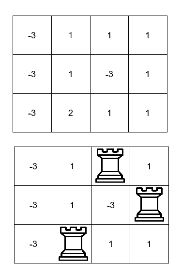

# 3256. 放三个车的价值之和最大 I

Hard · [力扣原题](https://leetcode.cn/problems/maximum-value-sum-by-placing-three-rooks-i/)

| 作者 | 题解 | 动画讲解 |
|---|---|---|
| 灵茶山艾府 | [📄 题解](灵茶山艾府.md) | 灵神这篇题解指向 3257 题的题解，请看那道题的视频：[▶︎ 3257 放三个车的价值之和最大 II · 灵茶山艾府.mp4](../3257%20放三个车的价值之和最大%20II/3257%20放三个车的价值之和最大%20II%20·%20灵茶山艾府.mp4) |
| yiduobo | [📄 题解](yiduobo.md) | [▶︎ 3256 放三个车的价值之和最大 I · yiduobo.mp4](3256%20放三个车的价值之和最大%20I%20·%20yiduobo.mp4) |

## 题目描述

给你一个 `m x n` 的二维整数数组 `board` ，它表示一个国际象棋棋盘，其中 `board[i][j]` 表示格子 `(i, j)` 的 **价值** 。

处于 **同一行** 或者 **同一列** 车会互相 **攻击** 。你需要在棋盘上放三个车，确保它们两两之间都 **无法互相攻击** 。

请你返回满足上述条件下，三个车所在格子 **值** 之和 **最大** 为多少。

**示例 1：**

**输入：**board = \[\[-3,1,1,1],[-3,1,-3,1],[-3,2,1,1]]

**输出：**4

**解释：**

我们可以将车分别放在格子 `(0, 2)` ，`(1, 3)` 和 `(2, 1)` 处，价值之和为 `1 + 1 + 2 = 4` 。

**示例 2：**

**输入：**`board = [[1,2,3],[4,5,6],[7,8,9]]`

**输出：**`15`

**解释：**

我们可以将车分别放在格子 `(0, 0)` ，`(1, 1)` 和 `(2, 2)` 处，价值之和为 `1 + 5 + 9 = 15` 。

**示例 3：**

**输入：**`board = [[1,1,1],[1,1,1],[1,1,1]]`

**输出：**`3`

**解释：**

我们可以将车分别放在格子 `(0, 2)` ，`(1, 1)` 和 `(2, 0)` 处，价值之和为 `1 + 1 + 1 = 3` 。

**提示：**

- `3 <= m == board.length <= 100`

- `3 <= n == board[i].length <= 100`

- `-10⁹ <= board[i][j] <= 10⁹`

---
[↑ 返回 3200-3299](../README.md) · [总索引](../../../索引.md) · [仓库首页](../../../README.md)
