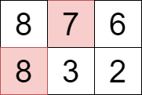

# 3276. 选择矩阵中单元格的最大得分

Hard · 难度分 2403 · [力扣原题](https://leetcode.cn/problems/select-cells-in-grid-with-maximum-score/)

所在刷题路径：灵神题单·图论算法、灵神题单·动态规划

| 作者 | 题解 | 动画讲解 |
|---|---|---|
| 灵茶山艾府 | [📄 题解](灵茶山艾府.md) | [▶︎ 3276 选择矩阵中单元格的最大得分 · 灵茶山艾府.mp4](3276%20选择矩阵中单元格的最大得分%20·%20灵茶山艾府.mp4) |
| yiduobo | [📄 题解](yiduobo.md) | [▶︎ 3276 选择矩阵中单元格的最大得分 · yiduobo.mp4](3276%20选择矩阵中单元格的最大得分%20·%20yiduobo.mp4) |

## 题目描述

给你一个由正整数构成的二维矩阵 `grid`。

你需要从矩阵中选择 **一个或多个** 单元格，选中的单元格应满足以下条件：

- 所选单元格中的任意两个单元格都不会处于矩阵的 **同一行**。

- 所选单元格的值 **互不相同**。

你的得分为所选单元格值的**总和**。

返回你能获得的 **最大** 得分。

**示例 1：**

**输入：** `grid = [[1,2,3],[4,3,2],[1,1,1]]`

**输出：** `8`

**解释：**

选择上图中用彩色标记的单元格，对应的值分别为 1、3 和 4 。

**示例 2：**

**输入：** `grid = [[8,7,6],[8,3,2]]`

**输出：** `15`

**解释：**

选择上图中用彩色标记的单元格，对应的值分别为 7 和 8 。

**提示：**

- `1 <= grid.length, grid[i].length <= 10`

- `1 <= grid[i][j] <= 100`

---
[↑ 返回 3200-3299](../README.md) · [总索引](../../../索引.md) · [仓库首页](../../../README.md)
