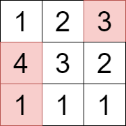

# 枚举值域，状压行号，附费用流做法（Python/Java/C++/Go）

> **[3276. 选择矩阵中单元格的最大得分](https://leetcode.cn/problems/select-cells-in-grid-with-maximum-score/solutions/2899994/zhi-yu-zhuang-ya-dppythonjavacgo-by-endl-x27y/) · Hard · 难度分 2403**

> **所属题单**
> - [动态规划 · 九、状态压缩 DP（状压 DP）](../../../刷题路径/灵神原版题单/动态规划/九、状态压缩%20DP（状压%20DP）.md) · §9.7 其他状压 DP
> - [图论算法 · 八、网络流](../../../刷题路径/灵神原版题单/图论算法/八、网络流.md)

> **题目描述**
> 给你一个由正整数构成的二维矩阵 `grid`。
>
> 你需要从矩阵中选择 **一个或多个** 单元格，选中的单元格应满足以下条件：
>
> - 所选单元格中的任意两个单元格都不会处于矩阵的 **同一行**。
>
> - 所选单元格的值 **互不相同**。
>
> 你的得分为所选单元格值的**总和**。
>
> 返回你能获得的 **最大** 得分。
>
> **示例 1：**
>
> **输入：** `grid = [[1,2,3],[4,3,2],[1,1,1]]`
>
> **输出：** `8`
>
> **解释：**
>
> 
>
> 选择上图中用彩色标记的单元格，对应的值分别为 1、3 和 4 。
>
> **示例 2：**
>
> **输入：** `grid = [[8,7,6],[8,3,2]]`
>
> **输出：** `15`
>
> **解释：**
>
> 
>
> 选择上图中用彩色标记的单元格，对应的值分别为 7 和 8 。
>
> **提示：**
>
> - `1 <= grid.length, grid[i].length <= 10`
>
> - `1 <= grid[i][j] <= 100`

> **题解**
> 
>
> 看示例 1，$\textit{grid}$ 的最大值 $\textit{mx}=4$。
>
> 讨论 $4$ **选或不选**：
>
> - 不选 $4$，问题变成在 $[1,3]$ 中选数字，每行至多一个数且没有相同元素时，所选元素之和的最大值。注意题目要求不能选相同的数，选了 $4$ 之后，就不能再选 $4$ 了。
> - 选 $4$，**枚举**选哪一行的 $4$（本例中只能选第二行），问题变成在 $[1,3]$ 中选数字，第二行不能选数字，每行至多一个数且没有相同元素时，所选元素之和的最大值。
>
> 于是，我们需要在递归的过程中，跟踪两个信息：
>
> - $i$：当前要在 $[1,i]$ 中选数字。
> - $j$：已选的行号集合为 $j$。后续所选数字所在的行号不能在 $j$ 中。
>
> 因此，定义状态为 $\textit{dfs}(i,j)$，表示在 $[1,i]$ 中选数字，所选数字所处的行号不能在集合 $j$ 中，每行至多一个数且没有相同元素时，所选元素之和的最大值。
>
> 讨论元素 $i$ **选或不选**：
>
> - 不选 $i$，问题变成在 $[1,i-1]$ 中选数字，所选数字所处的行号不能在集合 $j$ 中，每行至多一个数且没有相同元素时，所选元素之和的最大值，即 $\textit{dfs}(i-1,j)$。
> - 选 $i$，**枚举**选第 $k$ 行的 $i$（提前预处理 $i$ 所处的行号），问题变成在 $[1,i-1]$ 中选数字（注意 $i$ 只能选一次），所选数字所处的行号不能在集合 $j\cup \{k\}$ 中，每行至多一个数且没有相同元素时，所选元素之和的最大值，即 $\textit{dfs}(i-1,j\cup \{k\})$。
>
> 两种情况取最大值，即为 $\textit{dfs}(i,j)$。
>
> 递归边界：$\textit{dfs}(0,j) = 0$。
>
> 递归入口：$\textit{dfs}(\textit{mx},\varnothing)$。一开始没有选行号。
>
> 代码实现时，可以只考虑在 $\textit{grid}$ 中的元素。
>
> 代码用到了一些位运算技巧，原理请看 [从集合论到位运算，常见位运算技巧分类总结！](https://leetcode.cn/circle/discuss/CaOJ45/)
>
> [本题视频讲解](https://www.bilibili.com/video/BV142Hae7E5y/)（第三题），欢迎点赞关注~
>
> ## 一、记忆化搜索（优化前）
>
> ```python
> class Solution:
>     def maxScore(self, grid: List[List[int]]) -> int:
>         pos = defaultdict(list)
>         for i, row in enumerate(grid):
>             for x in set(row):  # 去重
>                 pos[x].append(i)
>         all_nums = list(pos)  # 只考虑在 grid 中的元素
>
>         @cache  # 缓存装饰器，避免重复计算 dfs 的结果（记忆化）
>         def dfs(i: int, j: int) -> int:
>             if i < 0:
>                 return 0
>             # 不选 x
>             res = dfs(i - 1, j)
>             # 枚举选第 k 行的 x
>             for k in pos[all_nums[i]]:
>                 if (j >> k & 1) == 0:
>                     res = max(res, dfs(i - 1, j | 1 << k) + all_nums[i])
>             return res
>         return dfs(len(all_nums) - 1, 0)
> ```
>
>
> ## 二、记忆化搜索（优化）
>
> $\textit{grid}$ 的最大值是肯定要选的，不会出现不选的情况。
>
> 进一步地，我们从大到小递归所有元素，如果当前元素可以选（有之前没选过的行），那么就**不用考虑不选的情况**了。
>
> ```python
> class Solution:
>     def maxScore(self, grid: List[List[int]]) -> int:
>         pos = defaultdict(list)
>         for i, row in enumerate(grid):
>             for x in set(row):  # 去重
>                 pos[x].append(i)
>         all_nums = sorted(pos)  # 下面从大到小递归
>
>         @cache  # 缓存装饰器，避免重复计算 dfs 的结果（记忆化）
>         def dfs(i: int, j: int) -> int:
>             if i < 0:
>                 return 0
>             res = 0  # 如果循环结束后 res > 0，就不再递归不选的情况
>             for k in pos[all_nums[i]]:
>                 if (j >> k & 1) == 0:
>                     res = max(res, dfs(i - 1, j | 1 << k) + all_nums[i])
>             return res if res else dfs(i - 1, j)
>         return dfs(len(all_nums) - 1, 0)
> ```
>
>
> ## 三、递推
>
> ```python
> class Solution:
>     def maxScore(self, grid: List[List[int]]) -> int:
>         pos = defaultdict(list)
>         for i, row in enumerate(grid):
>             for x in set(row):  # 去重
>                 pos[x].append(i)
>         all_nums = list(pos)
>
>         u = 1 << len(grid)
>         f = [[0] * u for _ in range(len(all_nums) + 1)]
>         for i, x in enumerate(all_nums):
>             for j in range(u):
>                 f[i + 1][j] = f[i][j]  # 不选 x
>                 for k in pos[x]:
>                     if (j >> k & 1) == 0:  # 没选过第 k 行的数
>                         f[i + 1][j] = max(f[i + 1][j], f[i][j | 1 << k] + x)  # 选第 k 行的 x
>         return f[-1][0]
> ```
>
>
> ## 四、空间压缩
>
> 去掉 $f$ 的第一个维度。
>
> ```python
> class Solution:
>     def maxScore(self, grid: List[List[int]]) -> int:
>         pos = defaultdict(list)
>         for i, row in enumerate(grid):
>             for x in set(row):  # 去重
>                 pos[x].append(i)
>
>         u = 1 << len(grid)
>         f = [0] * u
>         for x, ps in pos.items():
>             for j in range(u):
>                 for k in ps:
>                     if (j >> k & 1) == 0:
>                         f[j] = max(f[j], f[j | 1 << k] + x)
>         return f[0]
> ```
>
>
> #### 复杂度分析
>
> - 时间复杂度：$\mathcal{O}(mn2^m)$，其中 $m$ 和 $n$ 分别为 $\textit{grid}$ 的行数和列数。
> - 空间复杂度：$\mathcal{O}(mn + 2^m)$ 或 $\mathcal{O}(k + 2^m)$，其中 $k$ 是 $\textit{grid}$ 中的不同元素的个数。
>
> ## 五、费用流（选读）
>
> 和 [3257. 放三个车的价值之和最大 II](https://leetcode.cn/problems/maximum-value-sum-by-placing-three-rooks-ii/) 一样，本题也可以抽象成图论模型，用**费用流**解决。
>
> - 创建一个**二分图**，左部为元素值，右部为行号。
> - 把第 $i$ 个元素看作节点 $i$，第 $j$ 行看作节点 $k+j$。其中 $k$ 是 $\textit{grid}$ 中的不同元素个数。
> - 在第 $i$ 个元素到其所在的第 $j$ 行之间连边，容量为 $1$，费用为 $0$。
> - 从超级源点 $S=k+m$ 向所有元素节点 $0,1,2,\cdots,k-1$ 连边，容量为 $1$，费用为节点值取反。取反是为了方便套最小费用流模板。
> - 从所有行节点 $k,k+1,k+2,\cdots,k+m-1$ 向超级汇点 $T=k+m+1$ 连边，容量为 $1$，费用为 $0$。
>
> 这样建图可以保证同样的元素至多选一个，且每一行至多选一个元素。
>
> 计算从 $S$ 到 $T$ 的最小费用流，取相反数，即为答案。
>
>
> #### 复杂度分析
>
> - 时间复杂度：$\mathcal{O}(m^2n)$，其中 $m$ 和 $n$ 分别为 $\textit{grid}$ 的行数和列数。由于二分图的特殊性，算法跑至多 $m$ 次 $\mathcal{O}(mn)$ 的 SPFA 就结束了。
> - 空间复杂度：$\mathcal{O}(mn)$。
>
> ## 相似题目
>
> - [1434. 每个人戴不同帽子的方案数](https://leetcode.cn/problems/number-of-ways-to-wear-different-hats-to-each-other/)
>
> 更多相似题目，见下面动态规划题单中的「**状压 DP**」和图论题单中的「**二分图**」和「**网络流**」。
>
> ## 分类题单
>
> [如何科学刷题？](https://leetcode.cn/circle/discuss/RvFUtj/)
>
> 1. [滑动窗口与双指针（定长/不定长/单序列/双序列/三指针）](https://leetcode.cn/circle/discuss/0viNMK/)
> 2. [二分算法（二分答案/最小化最大值/最大化最小值/第K小）](https://leetcode.cn/circle/discuss/SqopEo/)
> 3. [单调栈（基础/矩形面积/贡献法/最小字典序）](https://leetcode.cn/circle/discuss/9oZFK9/)
> 4. [网格图（DFS/BFS/综合应用）](https://leetcode.cn/circle/discuss/YiXPXW/)
> 5. [位运算（基础/性质/拆位/试填/恒等式/思维）](https://leetcode.cn/circle/discuss/dHn9Vk/)
> 6. [图论算法（DFS/BFS/拓扑排序/最短路/最小生成树/二分图/基环树/欧拉路径）](https://leetcode.cn/circle/discuss/01LUak/)
> 7. [动态规划（入门/背包/状态机/划分/区间/状压/数位/数据结构优化/树形/博弈/概率期望）](https://leetcode.cn/circle/discuss/tXLS3i/)
> 8. [常用数据结构（前缀和/差分/栈/队列/堆/字典树/并查集/树状数组/线段树）](https://leetcode.cn/circle/discuss/mOr1u6/)
> 9. [数学算法（数论/组合/概率期望/博弈/计算几何/随机算法）](https://leetcode.cn/circle/discuss/IYT3ss/)
> 10. [贪心与思维（基本贪心策略/反悔/区间/字典序/数学/思维/脑筋急转弯/构造）](https://leetcode.cn/circle/discuss/g6KTKL/)
> 11. [链表、二叉树与一般树（前后指针/快慢指针/DFS/BFS/直径/LCA）](https://leetcode.cn/circle/discuss/K0n2gO/)
>
> [我的题解精选（已分类）](https://github.com/EndlessCheng/codeforces-go/blob/master/leetcode/SOLUTIONS.md)
