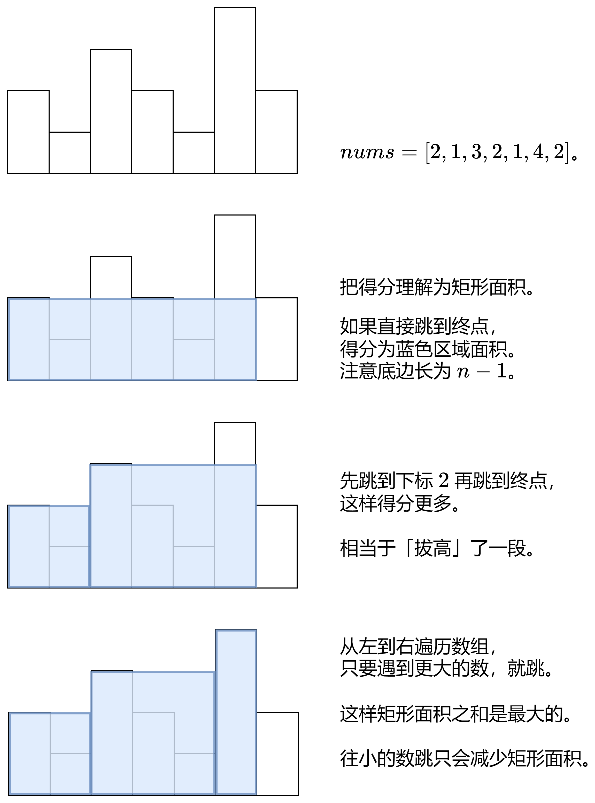

# 【一图秒懂】贪心（Python/Java/C++/Go）

> **[3282. 到达数组末尾的最大得分](https://leetcode.cn/problems/reach-end-of-array-with-max-score/solutions/2908950/yi-tu-miao-dong-tan-xin-pythonjavacgo-by-tfua/) · Medium · 难度分 1772**

> **所属题单**
> - [贪心算法 · 五、思维题](../../../刷题路径/灵神原版题单/贪心算法/五、思维题.md) · §5.2 脑筋急转弯

> **题目描述**
> 给你一个长度为 `n` 的整数数组 `nums` 。
>
> 你的目标是从下标 `0` 出发，到达下标 `n - 1` 处。每次你只能移动到 **更大** 的下标处。
>
> 从下标 `i` 跳到下标 `j` 的得分为 `(j - i) * nums[i]` 。
>
> 请你返回你到达最后一个下标处能得到的 **最大总得分** 。
>
> **示例 1：**
>
> **输入：**`nums = [1,3,1,5]`
>
> **输出：**7
>
> **解释：**
>
> 一开始跳到下标 1 处，然后跳到最后一个下标处。总得分为 `1 * 1 + 2 * 3 = 7` 。
>
> **示例 2：**
>
> **输入：**`nums = [4,3,1,3,2]`
>
> **输出：**16
>
> **解释：**
>
> 直接跳到最后一个下标处。总得分为 `4 * 4 = 16` 。
>
> **提示：**
>
> - `1 <= nums.length <= 10⁵`
>
> - `1 <= nums[i] <= 10⁵`

> **题解**
> 
>
> 代码实现时，可以视作有 $n-1$ 个底边长为 $1$ 的矩形。
>
> 最大化每个矩形的高，即可最大化所有矩形的面积之和。
>
> 从左到右遍历，维护遍历到的数的最大值，作为矩形的高。
>
> 具体请看 [视频讲解](https://www.bilibili.com/video/BV1z5pieUEkQ/) 第三题，欢迎点赞关注~
>
> ```python
> class Solution:
>     def findMaximumScore(self, nums: List[int]) -> int:
>         ans = mx = 0
>         for x in nums[:-1]:  # 也可以先 pop 掉最后一个数
>             mx = max(mx, x)
>             ans += mx
>         return ans
> ```
>
> > [!example]- Python3 一行
> > ```python
> > class Solution:
> >     def findMaximumScore(self, nums: List[int]) -> int:
> >         return sum(accumulate(nums[:-1], max))
> > ```
>
>
> #### 复杂度分析
>
> - 时间复杂度：$\mathcal{O}(n)$，其中 $n$ 是 $\textit{nums}$ 的长度。
> - 空间复杂度：$\mathcal{O}(1)$。Python 忽略切片的空间。
>
> ## 思考题
>
> 改成求**最小**得分，要怎么做？
>
> ## 分类题单
>
> [如何科学刷题？](https://leetcode.cn/circle/discuss/RvFUtj/)
>
> 1. [滑动窗口与双指针（定长/不定长/单序列/双序列/三指针）](https://leetcode.cn/circle/discuss/0viNMK/)
> 2. [二分算法（二分答案/最小化最大值/最大化最小值/第K小）](https://leetcode.cn/circle/discuss/SqopEo/)
> 3. [单调栈（基础/矩形面积/贡献法/最小字典序）](https://leetcode.cn/circle/discuss/9oZFK9/)
> 4. [网格图（DFS/BFS/综合应用）](https://leetcode.cn/circle/discuss/YiXPXW/)
> 5. [位运算（基础/性质/拆位/试填/恒等式/思维）](https://leetcode.cn/circle/discuss/dHn9Vk/)
> 6. [图论算法（DFS/BFS/拓扑排序/最短路/最小生成树/二分图/基环树/欧拉路径）](https://leetcode.cn/circle/discuss/01LUak/)
> 7. [动态规划（入门/背包/状态机/划分/区间/状压/数位/数据结构优化/树形/博弈/概率期望）](https://leetcode.cn/circle/discuss/tXLS3i/)
> 8. [常用数据结构（前缀和/差分/栈/队列/堆/字典树/并查集/树状数组/线段树）](https://leetcode.cn/circle/discuss/mOr1u6/)
> 9. [数学算法（数论/组合/概率期望/博弈/计算几何/随机算法）](https://leetcode.cn/circle/discuss/IYT3ss/)
> 10. [贪心与思维（基本贪心策略/反悔/区间/字典序/数学/思维/脑筋急转弯/构造）](https://leetcode.cn/circle/discuss/g6KTKL/)
> 11. [链表、二叉树与一般树（前后指针/快慢指针/DFS/BFS/直径/LCA）](https://leetcode.cn/circle/discuss/K0n2gO/)
> 12. [字符串（KMP/Z函数/Manacher/字符串哈希/AC自动机/后缀数组/子序列自动机）](https://leetcode.cn/circle/discuss/SJFwQI/)
>
> [我的题解精选（已分类）](https://github.com/EndlessCheng/codeforces-go/blob/master/leetcode/SOLUTIONS.md)
