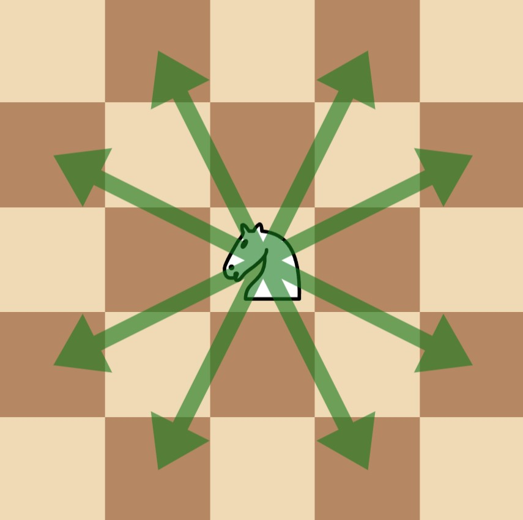
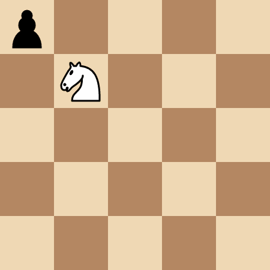

# 相邻相关排列型状压 DP（Python/Java/C++/Go）

> **[3283. 吃掉所有兵需要的最多移动次数](https://leetcode.cn/problems/maximum-number-of-moves-to-kill-all-pawns/solutions/2909069/pai-lie-xing-zhuang-ya-dpxiang-lin-xiang-q49q/) · Hard · 难度分 2473**

> **所属题单**
> - [动态规划 · 九、状态压缩 DP（状压 DP）](../../../刷题路径/灵神原版题单/动态规划/九、状态压缩%20DP（状压%20DP）.md) · §9.2 排列型状压 DP ② 相邻相关

> **题目描述**
> 给你一个 `50 x 50` 的国际象棋棋盘，棋盘上有 **一个** 马和一些兵。给你两个整数 `kx` 和 `ky` ，其中 `(kx, ky)` 表示马所在的位置，同时还有一个二维数组 `positions` ，其中 `positions[i] = [x_i, y_i]` 表示第 `i` 个兵在棋盘上的位置。
>
> Alice 和 Bob 玩一个回合制游戏，Alice 先手。玩家的一次操作中，可以执行以下操作：
>
> - 玩家选择一个仍然在棋盘上的兵，然后移动马，通过 **最少** 的 **步数** 吃掉这个兵。**注意** ，玩家可以选择 **任意** 一个兵，**不一定** 要选择从马的位置出发 **最少** 移动步数的兵。
>
> - 在马吃兵的过程中，马 **可能** 会经过一些其他兵的位置，但这些兵 **不会** 被吃掉。**只有** 选中的兵在这个回合中被吃掉。
>
> Alice 的目标是 **最大化** 两名玩家的 **总** 移动次数，直到棋盘上不再存在兵，而 Bob 的目标是 **最小化** 总移动次数。
>
> 假设两名玩家都采用 **最优** 策略，请你返回可以达到的 **最大** 总移动次数。
>
> 在一次 **移动** 中，如下图所示，马有 8 个可以移动到的位置，每个移动位置都是沿着坐标轴的一个方向前进 2 格，然后沿着垂直的方向前进 1 格。
>
> 
>
> **示例 1：**
>
> **输入：**`kx = 1, ky = 1, positions = [[0,0]]`
>
> **输出：**`4`
>
> **解释：**
>
> 
>
> 马需要移动 4 步吃掉 `(0, 0)` 处的兵。
>
> **示例 2：**
>
> **输入：**`kx = 0, ky = 2, positions = [[1,1],[2,2],[3,3]]`
>
> **输出：**`8`
>
> **解释：**
>
> 
>
> - Alice 选择 `(2, 2)` 处的兵，移动马吃掉它需要 2 步：`(0, 2) -> (1, 4) -> (2, 2)` 。
>
> - Bob 选择 `(3, 3)` 处的兵，移动马吃掉它需要 2 步：`(2, 2) -> (4, 1) -> (3, 3)` 。
>
> - Alice 选择 `(1, 1)` 处的兵，移动马吃掉它需要 4 步：`(3, 3) -> (4, 1) -> (2, 2) -> (0, 3) -> (1, 1)` 。
>
> **示例 3：**
>
> **输入：**`kx = 0, ky = 0, positions = [[1,2],[2,4]]`
>
> **输出：**`3`
>
> **解释：**
>
> - Alice 选择 `(2, 4)` 处的兵，移动马吃掉它需要 2 步：`(0, 0) -> (1, 2) -> (2, 4)` 。注意，`(1, 2)` 处的兵不会被吃掉。
>
> - Bob 选择 `(1, 2)` 处的兵，移动马吃掉它需要 1 步：`(2, 4) -> (1, 2)` 。
>
> **提示：**
>
> - `0 <= kx, ky <= 49`
>
> - `1 <= positions.length <= 15`
>
> - `positions[i].length == 2`
>
> - `0 <= positions[i][0], positions[i][1] <= 49`
>
> - `positions[i]` 两两互不相同。
>
> - 输入保证对于所有 `0 <= i < positions.length` ，都有 `positions[i] != [kx, ky]` 。

> **题解**
> ## 引入
>
> 考虑以下两种情况：
>
> - Alice 吃掉第一个兵，Bob 吃掉第二个兵，Alice 吃掉第三个兵，现在轮到 Bob 操作。
> - Alice 吃掉第二个兵，Bob 吃掉第一个兵，Alice 吃掉第三个兵，现在轮到 Bob 操作。
>
> 这两种情况，Bob 面临的局面是完全一样的：前三个兵都被吃掉，马现在在第三个兵的位置。
>
> 有重复的子问题，就可以用记忆化搜索/递推解决。
>
> ## 状态和状态转移方程
>
> 根据上面的讨论，我们需要在递归过程中跟踪以下信息：
>
> - $i$：当前马在第 $i$ 个兵的位置。特别地，把 $(\textit{kx}, \textit{ky})$ 当作第 $n+1$ 个兵的位置。
> - $\textit{mask}$：剩余没有被吃掉的兵的集合。
>
> 因此，定义状态为 $\textit{dfs}(i,\textit{mask})$，表示当前马在第 $i$ 个兵的位置，且剩余没有被吃掉的兵的集合为 $\textit{mask}$ 的情况下，继续游戏，两名玩家的总移动次数的最大值。
>
> > 注意题目要计算的是两名玩家的总移动次数，不是 Alice 一个人的总移动次数。
>
> 接下来，思考如何从一个状态转移到另一个状态。
>
> 设从 $(x,y)$ 移动到第 $i$ 个兵的最小步数为 $\textit{dis}[i][x][y]$，这可以用网格图 BFS 算出来：反向思考，计算从第 $i$ 个兵的位置出发，通过「马走日」移动到 $(x,y)$ 的最小步数。
>
> 设当前位置为 $(x,y) = \textit{positions}[i]$，考虑枚举吃掉第 $j$ 个兵：
>
> - 如果第 $j$ 个兵在集合 $\textit{mask}$ 中，把马移动 $\textit{dis}[j][x][y]$ 步，吃掉第 $j$ 个兵。现在问题变成当前马在第 $j$ 个兵的位置，且剩余没有被吃掉的兵的集合为 $\textit{mask}\setminus \{j\}$ 的情况下，继续游戏，两名玩家的总移动次数的最大值，即 $\textit{dfs}(j,\textit{mask}\setminus \{j\})$。
>
> 如果当前是 Alice 操作，则有
>
> $$
> \textit{dfs}(i,\textit{mask}) = \max_{j\in \textit{mask}}  \textit{dfs}(j,\textit{mask}\setminus \{j\}) + \textit{dis}[j][x][y]
> $$
>
> 如果当前是 Bob 操作，则有
>
> $$
> \textit{dfs}(i,\textit{mask}) = \min_{j\in \textit{mask}}  \textit{dfs}(j,\textit{mask}\setminus \{j\}) + \textit{dis}[j][x][y]
> $$
>
> 如何判断当前是谁在操作？
>
> 可以添加一个状态 $\textit{curPlayer}$，也可以用已被吃掉的兵的集合 $\complement_U \textit{mask}$ 的大小的奇偶性来判断，其中全集 $\textit{U}={0,1,2,\cdots,n-1}$。
>
> - 如果吃掉了 $0,2,4,\cdots$ 个兵，那么当前轮到 Alice 操作。
> - 如果吃掉了 $1,3,5,\cdots$ 个兵，那么当前轮到 Bob 操作。
>
> > 注：也可以写两个递归函数，直接从代码层面区分开谁在操作。
>
> 递归边界：$\textit{dfs}(i,\varnothing) = 0$。所有兵都被吃掉，游戏结束。
>
> 递归入口：$\textit{dfs}(n,U)$。即答案。
>
> 代码中用到了一些位运算技巧，原理见 [从集合论到位运算，常见位运算技巧分类总结！](https://leetcode.cn/circle/discuss/CaOJ45/)
>
> 具体请看 [视频讲解](https://www.bilibili.com/video/BV1z5pieUEkQ/) 第四题，欢迎点赞关注~
>
> ## 记忆化搜索
>
> ```python
> DIRS = ((2, 1), (1, 2), (-1, 2), (-2, 1), (-2, -1), (-1, -2), (1, -2), (2, -1))
>
> class Solution:
>     def maxMoves(self, kx: int, ky: int, positions: List[List[int]]) -> int:
>         n = len(positions)
>         # 计算马到兵的步数，等价于计算兵到其余格子的步数
>         dis = [[[-1] * 50 for _ in range(50)] for _ in range(n)]
>         for d, (px, py) in zip(dis, positions):
>             d[px][py] = 0
>             q = [(px, py)]
>             step = 1
>             while q:
>                 tmp = q
>                 q = []
>                 for p in tmp:
>                     for dx, dy in DIRS:
>                         x, y = p[0] + dx, p[1] + dy
>                         if 0 <= x < 50 and 0 <= y < 50 and d[x][y] < 0:
>                             d[x][y] = step
>                             q.append((x, y))
>                 step += 1
>
>         positions.append((kx, ky))
>         u = (1 << n) - 1
>         @cache
>         def dfs(i: int, mask: int) -> int:
>             if mask == 0:
>                 return 0
>             odd = (u ^ mask).bit_count() % 2
>             res = inf if odd else 0
>             op = min if odd else max
>             x, y = positions[i]
>             for j, d in enumerate(dis):
>                 if mask >> j & 1:
>                     res = op(res, dfs(j, mask ^ (1 << j)) + d[x][y])
>             return res
>         return dfs(n, u)
> ```
>
> > [!example]- Python3 写法二
> > ```python
> > DIRS = ((2, 1), (1, 2), (-1, 2), (-2, 1), (-2, -1), (-1, -2), (1, -2), (2, -1))
> >
> > class Solution:
> >     def maxMoves(self, kx: int, ky: int, positions: List[List[int]]) -> int:
> >         n = len(positions)
> >         # 计算马到兵的步数，等价于计算兵到其余格子的步数
> >         dis = [[[-1] * 50 for _ in range(50)] for _ in range(n)]
> >         for d, (px, py) in zip(dis, positions):
> >             d[px][py] = 0
> >             q = [(px, py)]
> >             step = 1
> >             while q:
> >                 tmp = q
> >                 q = []
> >                 for p in tmp:
> >                     for dx, dy in DIRS:
> >                         x, y = p[0] + dx, p[1] + dy
> >                         if 0 <= x < 50 and 0 <= y < 50 and d[x][y] < 0:
> >                             d[x][y] = step
> >                             q.append((x, y))
> >                 step += 1
> >
> >         positions.append((kx, ky))
> >
> >         @cache
> >         def alice(i: int, mask: int) -> int:
> >             if mask == 0:
> >                 return 0
> >             res = 0
> >             x, y = positions[i]
> >             for j, d in enumerate(dis):
> >                 if mask >> j & 1:
> >                     res = max(res, bob(j, mask ^ (1 << j)) + d[x][y])
> >             return res
> >
> >         @cache
> >         def bob(i: int, mask: int) -> int:
> >             if mask == 0:
> >                 return 0
> >             res = inf
> >             x, y = positions[i]
> >             for j, d in enumerate(dis):
> >                 if mask >> j & 1:
> >                     res = min(res, alice(j, mask ^ (1 << j)) + d[x][y])
> >             return res
> >
> >         return alice(n, (1 << n) - 1)
> > ```
>
>
> ## 递推
>
> 注意要先把 $\textit{mask}$ 小的状态算出来，再算 $\textit{mask}$ 大的。所以外层循环 $\textit{mask}$，内层循环 $i$。
>
> ```python
> DIRS = ((2, 1), (1, 2), (-1, 2), (-2, 1), (-2, -1), (-1, -2), (1, -2), (2, -1))
>
> class Solution:
>     def maxMoves(self, kx: int, ky: int, positions: List[List[int]]) -> int:
>         n = len(positions)
>         # 计算马到兵的步数，等价于计算兵到其余格子的步数
>         dis = [[[-1] * 50 for _ in range(50)] for _ in range(n)]
>         for d, (px, py) in zip(dis, positions):
>             d[px][py] = 0
>             q = [(px, py)]
>             step = 1
>             while q:
>                 tmp = q
>                 q = []
>                 for p in tmp:
>                     for dx, dy in DIRS:
>                         x, y = p[0] + dx, p[1] + dy
>                         if 0 <= x < 50 and 0 <= y < 50 and d[x][y] < 0:
>                             d[x][y] = step
>                             q.append((x, y))
>                 step += 1
>
>         positions.append((kx, ky))
>         u = (1 << n) - 1
>         f = [[0] * (n + 1) for _ in range(1 << n)]
>         for mask in range(1, 1 << n):
>             for i, (x, y) in enumerate(positions):
>                 odd = (u ^ mask).bit_count() % 2
>                 res = inf if odd else 0
>                 op = min if odd else max
>                 for j, d in enumerate(dis):
>                     if mask >> j & 1:
>                         res = op(res, f[mask ^ (1 << j)][j] + d[x][y])
>                 f[mask][i] = res
>         return f[-1][n]
> ```
>
>
> #### 复杂度分析
>
> - 时间复杂度：$\mathcal{O}(nL^2 + n^2 2^n)$，其中 $n$ 是 $\textit{positions}$ 的长度，$L=50$。
> - 空间复杂度：$\mathcal{O}(nL^2 + n2^n)$。
>
> ## 思考题
>
> 1. 如果要计算的是 Alice 一个人的移动次数之和呢？
> 2. 如果棋盘无限大呢？能否用数学公式 $\mathcal{O}(1)$ 算出马的最小移动步数？见 [1197. 进击的骑士](https://leetcode.cn/problems/minimum-knight-moves/)（会员题）
>
> 更多相似题目，见下面动态规划题单中的「**状压 DP**」。
>
> ## 分类题单
>
> [如何科学刷题？](https://leetcode.cn/circle/discuss/RvFUtj/)
>
> 1. [滑动窗口与双指针（定长/不定长/单序列/双序列/三指针）](https://leetcode.cn/circle/discuss/0viNMK/)
> 2. [二分算法（二分答案/最小化最大值/最大化最小值/第K小）](https://leetcode.cn/circle/discuss/SqopEo/)
> 3. [单调栈（基础/矩形面积/贡献法/最小字典序）](https://leetcode.cn/circle/discuss/9oZFK9/)
> 4. [网格图（DFS/BFS/综合应用）](https://leetcode.cn/circle/discuss/YiXPXW/)
> 5. [位运算（基础/性质/拆位/试填/恒等式/思维）](https://leetcode.cn/circle/discuss/dHn9Vk/)
> 6. [图论算法（DFS/BFS/拓扑排序/最短路/最小生成树/二分图/基环树/欧拉路径）](https://leetcode.cn/circle/discuss/01LUak/)
> 7. [动态规划（入门/背包/状态机/划分/区间/状压/数位/数据结构优化/树形/博弈/概率期望）](https://leetcode.cn/circle/discuss/tXLS3i/)
> 8. [常用数据结构（前缀和/差分/栈/队列/堆/字典树/并查集/树状数组/线段树）](https://leetcode.cn/circle/discuss/mOr1u6/)
> 9. [数学算法（数论/组合/概率期望/博弈/计算几何/随机算法）](https://leetcode.cn/circle/discuss/IYT3ss/)
> 10. [贪心与思维（基本贪心策略/反悔/区间/字典序/数学/思维/脑筋急转弯/构造）](https://leetcode.cn/circle/discuss/g6KTKL/)
> 11. [链表、二叉树与一般树（前后指针/快慢指针/DFS/BFS/直径/LCA）](https://leetcode.cn/circle/discuss/K0n2gO/)
>
> [我的题解精选（已分类）](https://github.com/EndlessCheng/codeforces-go/blob/master/leetcode/SOLUTIONS.md)
