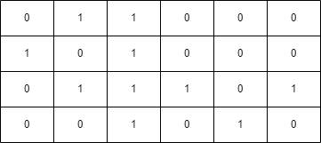
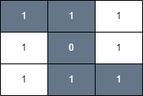

# 3286. 穿越网格图的安全路径

Medium · [力扣原题](https://leetcode.cn/problems/find-a-safe-walk-through-a-grid/)

所在刷题路径：灵神题单·网格图

| 作者 | 题解 | 动画讲解 |
|---|---|---|
| 灵茶山艾府 | [📄 题解](灵茶山艾府.md) | [▶︎ 3286 穿越网格图的安全路径 · 灵茶山艾府.mp4](3286%20穿越网格图的安全路径%20·%20灵茶山艾府.mp4) |
| yiduobo | [📄 题解](yiduobo.md) | [▶︎ 3286 穿越网格图的安全路径 · yiduobo.mp4](3286%20穿越网格图的安全路径%20·%20yiduobo.mp4) |

## 题目描述

给你一个 `m x n` 的二进制矩形 `grid` 和一个整数 `health` 表示你的健康值。

你开始于矩形的左上角 `(0, 0)` ，你的目标是矩形的右下角 `(m - 1, n - 1)` 。

你可以在矩形中往上下左右相邻格子移动，但前提是你的健康值始终是 **正数** 。

对于格子 `(i, j)` ，如果 `grid[i][j] = 1` ，那么这个格子视为 **不安全** 的，会使你的健康值减少 1 。

如果你可以到达最终的格子，请你返回 `true` ，否则返回 `false` 。

**注意** ，当你在最终格子的时候，你的健康值也必须为 **正数** 。

**示例 1：**

**输入：**`grid = [[0,1,0,0,0],[0,1,0,1,0],[0,0,0,1,0]], health = 1`

**输出：**`true`

**解释：**

沿着下图中灰色格子走，可以安全到达最终的格子。

**示例 2：**

**输入：**`grid = [[0,1,1,0,0,0],[1,0,1,0,0,0],[0,1,1,1,0,1],[0,0,1,0,1,0]], health = 3`

**输出：**`false`

**解释：**

健康值最少为 4 才能安全到达最后的格子。

**示例 3：**

**输入：**`grid = [[1,1,1],[1,0,1],[1,1,1]], health = 5`

**输出：**`true`

**解释：**

沿着下图中灰色格子走，可以安全到达最终的格子。

任何不经过格子 `(1, 1)` 的路径都是不安全的，因为你的健康值到达最终格子时，都会小于等于 0 。

**提示：**

- `m == grid.length`

- `n == grid[i].length`

- `1 <= m, n <= 50`

- `2 <= m * n`

- `1 <= health <= m + n`

- `grid[i][j]` 要么是 0 ，要么是 1 。

---
[↑ 返回 3200-3299](../README.md) · [总索引](../../../索引.md) · [仓库首页](../../../README.md)
