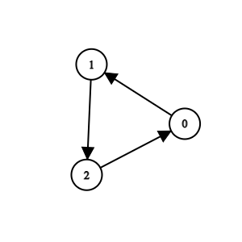

# 3310. 移除可疑的方法

Medium · 难度分 1711 · [力扣原题](https://leetcode.cn/problems/remove-methods-from-project/)

所在刷题路径：灵神题单·图论算法

| 作者 | 题解 | 动画讲解 |
|---|---|---|
| 灵茶山艾府 | [📄 题解](灵茶山艾府.md) | [▶︎ 3310 移除可疑的方法 · 灵茶山艾府.mp4](3310%20移除可疑的方法%20·%20灵茶山艾府.mp4) |
| yiduobo | [📄 题解](yiduobo.md) | [▶︎ 3310 移除可疑的方法 · yiduobo.mp4](3310%20移除可疑的方法%20·%20yiduobo.mp4) |

## 题目描述

你正在维护一个项目，该项目有 `n` 个方法，编号从 `0` 到 `n - 1`。

给你两个整数 `n` 和 `k`，以及一个二维整数数组 `invocations`，其中 `invocations[i] = [a_i, b_i]` 表示方法 `a_i` 调用了方法 `b_i`。

已知如果方法 `k` 存在一个已知的 bug。那么方法 `k` 以及它直接或间接调用的任何方法都被视为 **可疑方法** ，我们需要从项目中移除这些方法。

只有当一组方法没有被这组之外的任何方法调用时，这组方法才能被移除。

返回一个数组，包含移除所有 **可疑方法** 后剩下的所有方法。你可以以任意顺序返回答案。如果无法移除 **所有** 可疑方法，则 **不** 移除任何方法。

**示例 1:**

**输入:** `n = 4, k = 1, invocations = [[1,2],[0,1],[3,2]]`

**输出:** `[0,1,2,3]`

**解释:**

方法 2 和方法 1 是可疑方法，但它们分别直接被方法 3 和方法 0 调用。由于方法 3 和方法 0 不是可疑方法，我们无法移除任何方法，故返回所有方法。

**示例 2:**

**输入:** `n = 5, k = 0, invocations = [[1,2],[0,2],[0,1],[3,4]]`

**输出:** `[3,4]`

**解释:**

方法 0、方法 1 和方法 2 是可疑方法，且没有被任何其他方法直接调用。我们可以移除它们。

**示例 3:**

**输入:** `n = 3, k = 2, invocations = [[1,2],[0,1],[2,0]]`

**输出:** `[]`

**解释:**

所有方法都是可疑方法。我们可以移除它们。

**提示:**

- `1 <= n <= 10⁵`

- `0 <= k <= n - 1`

- `0 <= invocations.length <= 2 * 10⁵`

- `invocations[i] == [a_i, b_i]`

- `0 <= a_i, b_i <= n - 1`

- `a_i != b_i`

- `invocations[i] != invocations[j]`

---
[↑ 返回 3300-3399](../README.md) · [总索引](../../../索引.md) · [仓库首页](../../../README.md)
